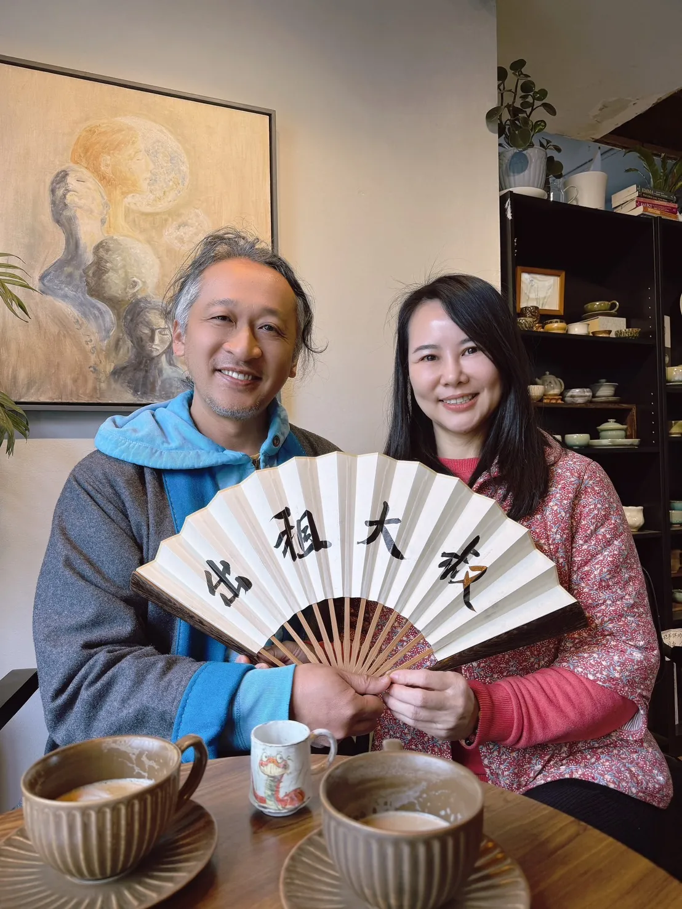
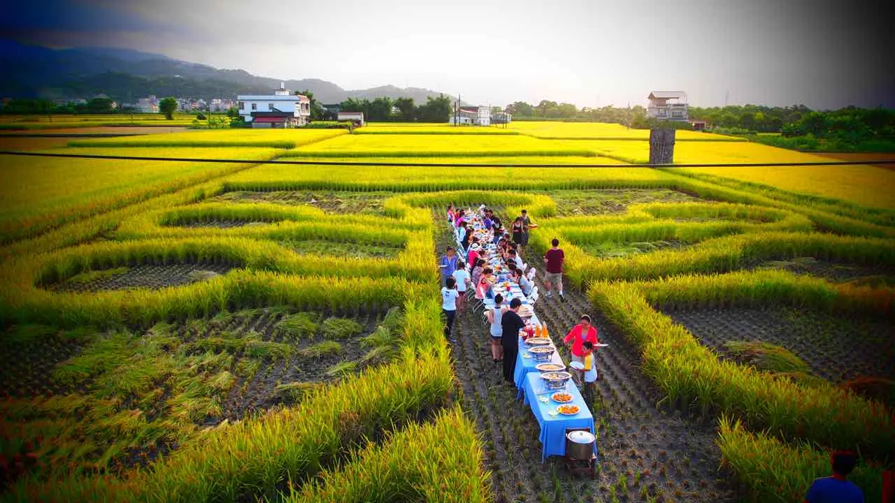

關於我 — 大道至簡・簡家旗

 簡家旗・水里・2024

關於我

# 我用二十年的時間，\
把「幸福」\
從一個概念，\
活成一份工作。

簡家旗。1976年生。\
曾任股票基金經理人，現為幸福行為藝術家。\
定居南投，工作橫跨台灣・香港・大陸。

[往下讀我的故事 ↓](#story)

如果你問我做什麼工作，最簡單的答案是：\
我把「活得幸福」這件事，當成一輩子的研究。

我用銀行家的時間做過一次實驗，\
用稻田裡的一張餐桌做過十四年實驗，\
現在我想用 AI 再做一次。

這頁是我的三個轉彎，\
也是我寫給你的一封邀請函。

2008 第一個轉彎

## 一個銀行家的離開

那一年，我在做股票基金經理人。

雷曼倒下的那個秋天，我盯著螢幕上一條一條紅色的數字往下掉，突然覺得很安靜。不是害怕，是一種更冷的清醒——我用人生大半時間在追的東西，可以在一個下午全部消失。

那天下班，沒走習慣的路線。不知不覺繞進一家書店，隨手翻開《道德經》，看見「*為學日益，為道日損*」八個字。那是我第一次認真停下來想：這些年「益」進來的，到底是什麼？而「損」掉的，又是什麼？

沒有戲劇性地辭職。但從那天起，心裡有種清楚明白，人生方向換了——開始把重心從「擁有更多」，一點一點挪移到「擁有更少」。

四年之後，離開台北，回到土地。

2012 第二個轉彎

## 一張擺在稻田裡的餐桌

 稻田裡的餐桌・宜蘭・2012

2012年的秋天，我做了一件當時沒人理解的事：在一片剛割完稻的稻田中間，擺了一張長桌。

餐桌上沒有米其林的菜，只有當地有機農民種的米、隔壁村婆婆做的新鮮蔬菜、還有那一季田邊正開的花。我從線上募集了三十幾個朋友坐下來吃飯。風從田埂上吹過來，沒有人滑手機。

那一頓飯吃了四個小時。這不是一張餐桌，沒有人想離開。

> 那天我才明白：\
> 「幸福」不是一個概念，\
> 是一種*可以被設計、被傳遞、被複製的場景*。

從那張桌子開始，我把它擺進了香港的薄扶林、河北的秦皇島、四川的成都、雲南的昆明。十四年裡，這張桌子變成了一個社會企業、一個文化IP、一個我用來研究「人怎麼會幸福」的田野現場。

如果說有什麼決定了我後來所有的選擇，\
就是那一張田裡的桌子。

2026 第三個轉彎・現在

## 把幸福做成一個系統

到了2026年，我站在一個新的問題面前：

過去十四年，我用一張一張的餐桌、一場一場的課，把「幸福」傳遞給遇見的人。但我一個人，一輩子能擺多少桌？能上多少課？

於是我開始做一件之前的我從沒想過會做的事——用 AI，把這些年累積的幸福哲學、對話、方法，建成一個任何人在任何時刻都可以打開的系統。

我給自己一個新的身份：*幸福行為藝術家*。

一個人公司、一本回憶錄、六個 AI 智能體、一個流動在上海咖啡館之間的幸福解憂雜貨鋪、一個橫跨台灣・香港・大陸的社群——它們看起來是五件事，其實是同一件事：

把我這一生在不同領域裡學到的「怎麼活得幸福」，\
翻譯成可以被傳遞的東西。

這就是「大道至簡」對我的意思——

不是把事情做少，

是把複雜的東西，活成簡單。

完整生命線 點開閱讀 1976—2026 完整年表

- 1976生於十分，台灣最大瀑布所在地，亦為天燈發源地

- 1983遷居南投水里，日月潭下、濁水溪畔的小山城

- 1991至宜蘭，遇見太平洋與中央山脈交錯的平原

- 1999北上台北，城市生活的開始

- 2003畢業於國立臺灣大學

- 2008金融海嘯：物質生活的轉折點

- 2010心靈啟蒙，精神生活實踐的開始

- 2011四川安曲查理寺：遇見佛性的自己

- 2012創辦「稻田裡的餐桌」

- 2015首次離台，至香港薄扶林村策展

- 2017通過英國 SVI 協會 SROI 認證・成都鄉村振興顧問項目啟動

- 2018加入友成基金會獵鷹加速器・第一期

- 2019參與湖南衛視「鄉村合夥人」節目，規劃幸福餐桌主題

- 2020布袋戲餐會：文化 × 創意 × 幸福餐桌

- 2022葡萄園裡的幸福課（自然・生命・餐桌教育融合）

- 2023生命裡的幸福課・雲南大理「去有風的地方」

- 2024幸福行為藝術家・出租大叔

- 2025佛系幸福之家

- 2026幸福 AI 智能體公司啟動

邀請

## 想跟我聊聊嗎？

如果你也在某個轉彎上，\
或者，正在尋找屬於你的那一張桌子。

[預約一次幸福對話](/聯絡我/) [先讀讀我的文字](/blog/)

——簡家旗\
幸福行為藝術家・大道至簡踐行者
