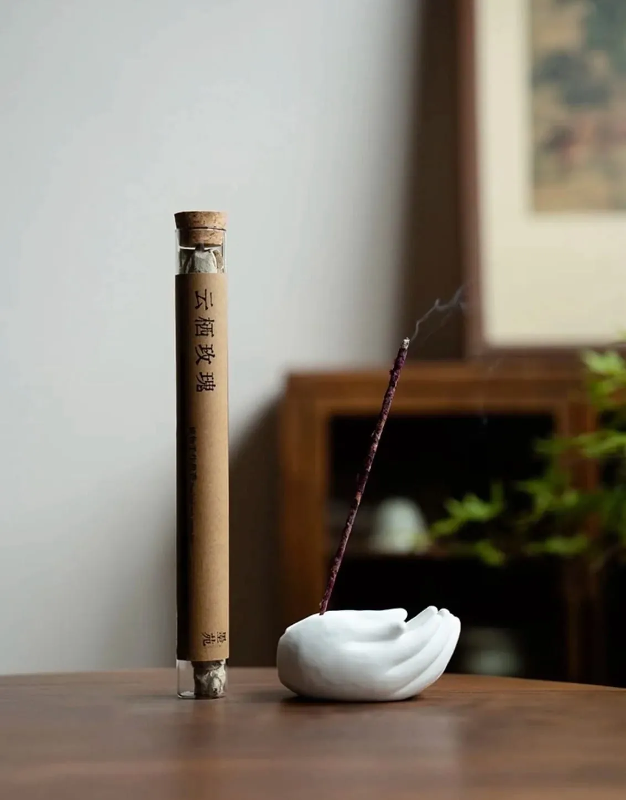

DaoIsSimple ・ 大道至簡

# 雲南線香・香格里拉藏香

兩個簡 ・ 兩個家

家旗與吟嘉，是夫妻。

一人在台灣 南投中興，

一人在雲南 香格里拉，

兩地，都是家。

我們都姓簡，也都信「大道至簡」。

因為愛這兩塊土地——稻田的水氣、雪山的松柏——

我們把雲南的線香、香格里拉的藏香，

一路帶回台灣，也帶來給你。

四 支 香 ・ 四 種 時 間

壹 

## 雲南線香 ・ 降真香

Yunnan Jiangzhen Incense

「降真」之名，因古人說此香能使「群仙降臨」。降真香生於雲南山中，是難得的木本香材——氣味甘甜悠長，帶松、樟與淡淡花蜜的層次。

一支點起，是半個下午的時間。靜坐、品茶、或寫一封信。

規 格20 支 / 管 ・ 長 10 cm 燃 燒每 支 約 30 分 鐘

NT$ 880 / 管

貳 

## 雲南線香 ・ 玫瑰

Yunnan Rose Incense

以雲南玫瑰花瓣為主香材。氣味甜潤、明亮——像把一個花季收進房間。

適合冬天的午後，或想被柔軟的東西包覆的那一刻。也適合送給一個你想讓他開心一下的人。

規 格10 支 / 管 ・ 長 21 cm 燃 燒每 支 約 40 分 鐘

NT$ 400 / 管

參 

## 香格里拉 ・ 長藏香

Shangri-La Tibetan Incense ・ Long

香格里拉海拔三千公尺。當地以柏木、紅景天等高原植物，依寺院千年古方手工搓條、陰乾。氣味厚實、沉靜。

長支設計，適合一段不被打擾的時光——靜坐、書寫、或一個午後的閱讀。

規 格10 支 / 管 ・ 長 21 cm 燃 燒每 支 約 60 分 鐘

NT$ 350 / 管

肆 

## 香格里拉 ・ 短藏香

Shangri-La Tibetan Incense ・ Short

與長藏香同方，縮短為日常版。沿用相同的高原柏木與寺院古方，氣味一致，只是時間更短。

適合茶席、瑜伽前後，或進門那一刻——想把外面的世界放下時，點一支。

規 格10 支 / 管 ・ 長 11 cm 燃 燒每 支 約 30 分 鐘

NT$ 200 / 管

—

香，不是奢侈品。\
是把一段安靜的時間，送給自己。

## 訂 購

Place Your Order

兩 個 簡 ・ 也 在 臉 書

想聊聊嗎？我們也常在那裡分享生活——\
關於香、關於兩個家、關於每一個小小的幸福。

[簡 家 旗

facebook ・ dream2walker](https://www.facebook.com/dream2walker) [簡 吟 嘉

facebook ・ 嘉禮慕華](https://www.facebook.com/profile.php?id=100075746177370)

DaoIsSimple ・ daoissimple.com
