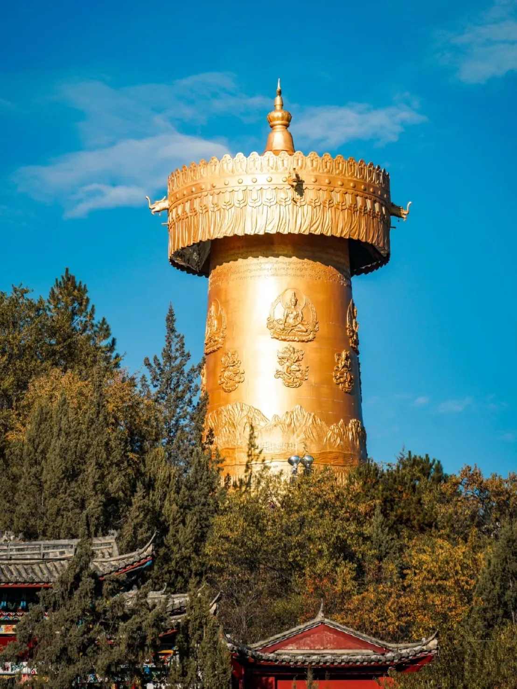

大道至簡 · Dao is simple｜做幸福的事，讓幸福變成有價值的事

[大道至簡Dao is simple](#home)

- [首頁](#home)

- [雲南](#yunnan)

- [台灣](#taiwan)

- [幸福誌](#journal)

- [服務體驗](#services)

- [關於](#about)

- [連繫](#connect)

Dao is simple · 簡家旗

# 大道至簡

做幸福的事，讓幸福變成有價值的事。

雲南台灣幸福

scroll ↓

真正重要的事，總是簡單的。一杯雲南的茶，一碗台灣的米。

— 大道至簡

Three doors · 三扇門

## 從這裡進來

[— 01 —

### 雲南

From the high mountains

高山茶、菌菇、香料、織染、銀器。彩雲之南的厚度，被一件一件帶回來。

入山選物 →](#yunnan) [— 02 —

### 台灣

From the island fields

稻米、海鹽、職人器物、農家蔬果。從稻田裡的餐桌走出來的選物。

島上選物 →](#taiwan) [— 03 —

### 幸福誌

Journal of well-being

產地的故事、節氣的提案、做事的人、選物背後的心法。慢慢讀，不急。

慢讀文章 →](#journal)

### 道

方向。使命。不做的事。

### 情

人與土地的情感。溫度。

### 物

被挑選的物件。好物。

A dialogue · 對話

## 兩地的呼吸

雲南與台灣不是兩個分區，而是一場對話。山與島，茶與米，霧與光。

雲南

Yunnan

高山的耐心，茶馬的緩慢。

×

台灣

Taiwan

海島的清亮，土地的誠實。

Services · 服務體驗

## 把幸福做成一件事

[01

### 稻田裡的餐桌

Table in the rice field

2012 年發起的台灣產地到餐桌引領計畫。在田間、海邊、茶園擺起餐桌，把職人主廚帶到土地上。](#services) [02

### 創業者幸福共創沙龍

Founders' salon

給仍相信慢、相信善、相信本來的創業者。我們不教 KPI，我們聊使命。](#services) [03

### 去有風的地方

Go where the wind blows

雲南旅居體驗。在大理、麗江、有風的小院裡，住下來，慢下來，看見自己。](#services)

大道至簡

Dao is simple · 簡家旗

Yunnan · 彩雲之南

# 雲南

山有多高，茶就有多高。霧有多厚，故事就有多厚。

普洱菌菇織染

Five themes · 五個主題

## 從山到杯，從手到家

[茶

Tea](#tea) [菌

Mushroom](#mushroom) [香

Spice](#spice) [染

Textile](#textile) [器

Silver](#silver)

雲南是中國西南最厚的一塊地。海拔從 76 公尺爬到 6740 公尺，氣候從熱帶到寒帶，民族二十六個。茶馬古道從這裡出發，普洱茶在這裡被發酵。

## 當季選物

[查看全部 →](#)

[YUNNAN

茶 · TEA

#### 易武正山 古樹春茶餅

雲南西雙版納 · 2024 春

NT$ 2,800 / 357g](#) [YUNNAN

茶 · TEA

#### 下關 老段家 30 年陳普洱

雲南大理 · 1994 年發酵

NT$ 8,400 / 250g](#) [YUNNAN

菌 · MUSHROOM

#### 雞樅菌油

楚雄 · 雨季鮮採

NT$ 680 / 200ml](#) [YUNNAN

香 · SPICE

#### 德宏曼掌村咖啡豆

德宏傣族景頗族自治州

NT$ 980 / 250g](#) [YUNNAN

染 · TEXTILE

#### 大理周城 板藍根扎染方巾

大理白族自治州 · 手工

NT$ 1,580](#) [YUNNAN

器 · SILVER

#### 鶴慶 純手打銀茶杯

大理鶴慶縣 · 寸氏家族

NT$ 4,200](#)

The maker · 做事的人

## 物的背後是人

MAKER

Yunnan · 大理

### 段普明 先生

下關老段家 第三代茶人

> 爺爺從十六歲開始做茶，父親接手了三十年，到我這代已經七十三年。茶倉裡那股氣息，是時間的味道。

下關老段家茶倉位於蒼山西麓，海拔 2200 公尺，常年濕度恆定。三十年來只做兩件事：選料、等待。

雲南選物

From the high mountains

Taiwan · 福爾摩沙

# 台灣

海島的清亮，土地的誠實。

稻米海鹽職人

Five themes · 五個主題

## 從田到桌，從手到家

[米

Rice](#) [鹽

Salt](#) [茶

Tea](#) [器

Craft](#) [農

Farm](#)

台灣是一座島，但島上有山、有海、有田。從花蓮的稻、台南的鹽、坪林的茶，到南投的木工、苗栗的窯。

## 當季選物

[查看全部 →](#)

[TAIWAN

米 · RICE

#### 花蓮玉里 有機越光米

花蓮玉里鎮 · 江漢錡先生

NT$ 380 / 1.5kg](#) [TAIWAN

鹽 · SALT

#### 台南七股 手工日曬海鹽

台南七股鹽場 · 老師傅日曬

NT$ 280 / 200g](#) [TAIWAN

茶 · TEA

#### 坪林文山包種茶

新北坪林 · 自然農法

NT$ 1,200 / 150g](#) [TAIWAN

器 · CRAFT

#### 苗栗 柴燒陶杯（一對）

苗栗公館 · 林師傅柴窯

NT$ 2,800](#) [TAIWAN

器 · CRAFT

#### 南投 老梅木砧板

南投埔里 · 三十年老梅

NT$ 1,680](#) [TAIWAN

農 · FARM

#### 宜蘭三星青蔥（季節限定）

宜蘭三星鄉 · 友善耕作

NT$ 320 / 600g](#)

土地不會騙人，做事的人不會騙人。

— 簡家旗

Farm to table · 稻田裡的餐桌

## 從一張餐桌開始的選物

FIELD

Yilan · 宜蘭三星

### 江漢錡 先生

三星有機米農 · 稻田裡的餐桌十四年合作夥伴

> 一開始把餐桌擺進田裡，我覺得這些城裡人來鬧的。後來年復一年地來，我才明白他們是真的想看一下這碗米從哪裡來。

2012 年「稻田裡的餐桌計畫」第一場就在江先生的有機田中舉辦。

台灣選物

From the island fields

Journal · 幸福誌

# 慢慢讀

Stories of land, hands, and stillness.

[全部](#)[生活提案](#)[產地故事](#)[選物筆記](#)[二地對話](#)

FEATURE

產地故事 · 2026.04

## 大理蒼山下，一座 30 年的老茶倉

從昆明驅車三百公里，到了下關。沿著洱海西岸再走半個多小時，才到老段家的茶倉。

[繼續閱讀 →](#)

茶不能急，人也不能急。

— 大理 段先生

## 最近的文章

TAIWAN

產地故事 · 2026.04

### 宜蘭三星，一片不忍離開的稻田

江漢錡先生的有機田，是稻田裡的餐桌最早的場景之一。

JOURNAL

生活提案 · 2026.04

### 節氣穀雨：適合泡一壺新茶

春茶到了。這個節氣最適合什麼茶？

YUNNAN

選物筆記 · 2026.03

### 易武正山的春料是什麼意思

普洱茶的世界裡有許多名詞讓人卻步。

TAIWAN

產地故事 · 2026.03

### 台南鹽田的最後幾位老師傅

七股鹽山旁，還有幾位堅持手工日曬的老師傅。

DIALOGUE

二地對話 · 2026.03

### 雲南的茶馬古道與台灣的茶葉之路

兩條路，兩段歷史。

JOURNAL

生活提案 · 2026.02

### 下午三點的安靜：一個人喝茶的儀式

不需要繁複的茶具。

YUNNAN

選物筆記 · 2026.02

### 麗江納西族的扎染：為什麼藍會這樣藍

板藍根、靛泥、木桶、時間。

TAIWAN

產地故事 · 2026.01

### 花蓮玉里的稻米：水、土、人

玉里的米為什麼好？

[看更多文章 →](#)

Services · 服務體驗

# 把幸福做成一件事

Four ways to live the philosophy.

CHAPTER 01

— 01 —

## 稻田裡的餐桌

Table in the rice field

2012 年發起，是台灣從產地到餐桌的引領性項目。在田間、海邊、茶園、果園擺起餐桌。

| 類型 | 限定場次・產地餐會 |
| --- | --- |
| 地點 | 台灣 / 雲南各地產地 |
| 場次 | 每年春秋兩季 · 8–10 場 |

[我想報名 →](#connect)

CHAPTER 02

— 02 —

## 創業者幸福共創沙龍

Founders' salon

給仍相信慢、相信善、相信本來的創業者。我們不教 KPI，我們聊使命。

| 類型 | 閉門沙龍 · 月度活動 |
| --- | --- |
| 地點 | 台北 / 雲南大理（雙城輪流） |
| 名額 | 每場限額 8 位 |

[我想加入 →](#connect)

CHAPTER 03

— 03 —

## 去有風的地方

Go where the wind blows

雲南旅居體驗。在大理、麗江、有風的小院裡，住下來，慢下來，看見自己。

| 類型 | 深度旅居 · 7 日體驗 |
| --- | --- |
| 地點 | 大理周城 / 麗江束河 |
| 名額 | 每梯次限額 6 位 |

[我想去 →](#connect)

CHAPTER 04

— 04 —

## 選物顧問・私人定制

Curation · One on one

給企業、品牌、與個人的禮品定制服務。不只是送禮，是送一份心意。

| 類型 | 客製禮盒・選物顧問 |
| --- | --- |
| 起訂量 | 10 份 / 案 |

[索取提案 →](#connect)

服務不是被購買的，是被經歷的。

— 大道至簡

體驗幸福

Experience · Service

About · 關於

# 大道至簡

The greatest truths are simple.

宣言

我們相信，真正重要的事，總是簡單的。

一杯雲南的茶，一碗台灣的米。一座山的耐心，一片海的寬容。

這些尋常的事物之所以動人，不是因為它們稀有，而是因為它們誠實。

「大道至簡」不是一句口號，是一個取捨。我們選擇相信慢、相信少、相信本來。

如果這些字讓你心裡安靜了一下，那麼，歡迎你進來坐坐。

The triad · 三層心法

## 道 · 情 · 物

道

Tao · The Way

真正重要的事，總是簡單的。我們相信慢、相信少、相信本來的好。

情

Qing · Feeling

幸福是橋。道與物之間若沒有情，前者空，後者冷。

物

Wu · The Object

物不只是販售的標的，是被介紹的對象。介紹它如何承載大道，介紹它如何傳遞幸福。

一個品牌的清晰度，不是由它包含什麼決定，而是由它捨棄什麼決定。

— 簡家旗

### 我們不做的事

- 不催促。沒有倒數計時、限時搶購。

- 不誇大。物的好就是物的好。

- 不混搭。雲南是雲南，台灣是台灣。

- 不貼標籤。職人不被當網紅。

- 不過度設計。一頁一念，留白勝於裝飾。

- 不快速擴張。慢慢做、做久一點。

FOUNDER

Founder · 主理人

### 簡家旗

大道至簡 · 幸福果食 共同創辦人

> 從金融業轉身回到土地，是我做過最簡單也最難的決定。土地不會騙人，茶不會騙人，做事的人不會騙人。

2012 年共同發起「稻田裡的餐桌計畫」，五年內於兩岸三地舉辦超過五百場農村創意餐會。

Connect · 連繫

# 寫一封信來

不急，慢慢寫。我們會慢慢看，慢慢回。

信

### 電子郵件

hello@daoissimple.com

話

### 電話

+886 02-2345-6789

A letter · 一封信

## 想跟我們說什麼都可以

Frequently asked · 常見問題

## 先回答幾個問題

目前沒有實體店面。雲南選物與台灣選物都是線上銷售加產地直送的方式。如果您想親自接觸到這些物與人，最好的方式是參加我們的「稻田裡的餐桌」或「去有風的地方」服務體驗。

香港、澳門、馬來西亞、新加坡可以下單，運費依商品重量與目的地計算，下單後我們會以信件確認。其他地區請來信告訴我們需求，我們會評估配送可行性。

可以。每件商品結帳時都可選擇禮物包裝（簡單質樸的款式），並可附上手寫卡片。如果是企業或大量送禮，建議直接看「服務體驗」中的「選物顧問・私人定制」項目。

「創業者幸福共創沙龍」每月限額 8 位，採邀請制。您可以透過上面的表單寄信給我們，簡單介紹您正在做的事，我們會在收到後一週內回覆。

媒體、品牌合作、邀請演講或稿件邀約，請來信至 hello@daoissimple.com，主旨註明「合作邀請」，我們會在三個工作日內回覆。

大道至簡

寫信給簡家旗 · Dao is simple

大道至簡

Dao is simple

做幸福的事，讓幸福變成有價值的事。雲南與台灣的好物與生活提案，由簡家旗主理。

#### 選物

- [雲南選物](#yunnan)

- [台灣選物](#taiwan)

#### 內容

- [幸福誌](#journal)

- [關於](#about)

#### 連繫

- [服務體驗](#services)

- [寫信給我們](#connect)

© 2026 大道至簡 · Dao is simple

Designed in stillness · 設計於靜處
