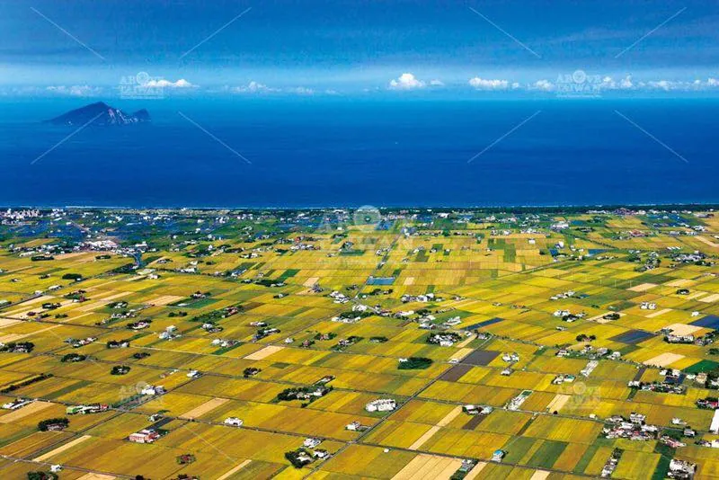
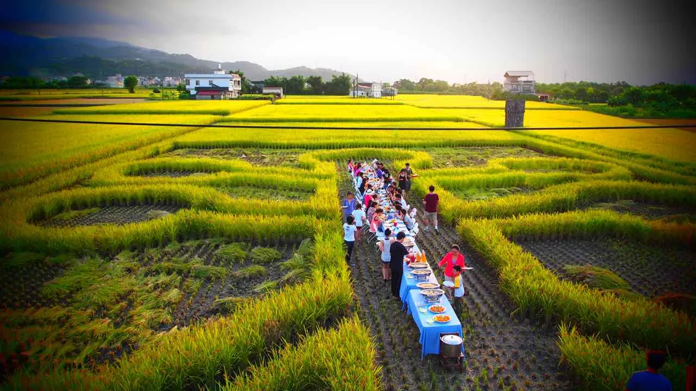
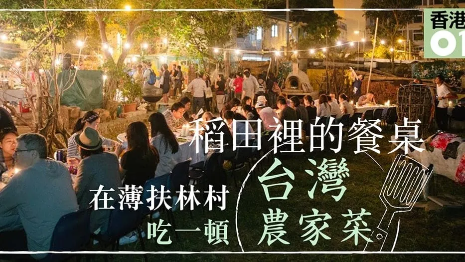
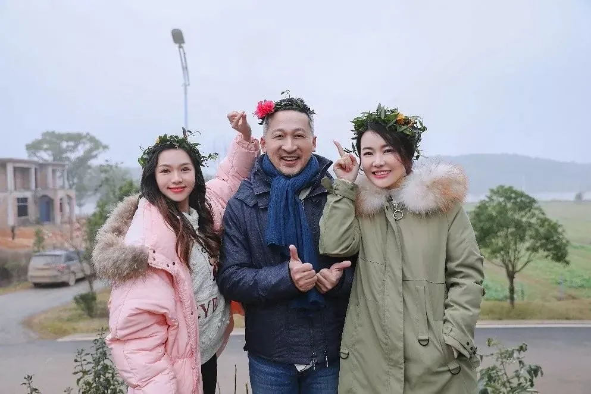
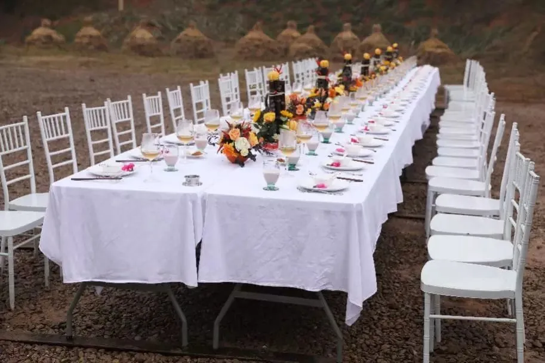
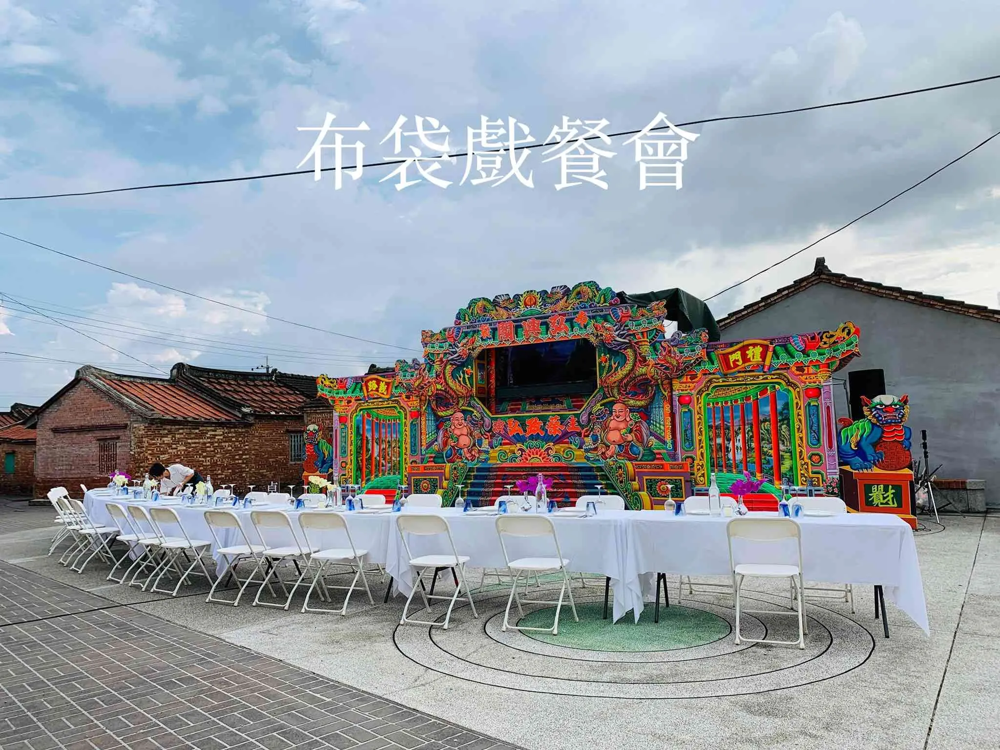
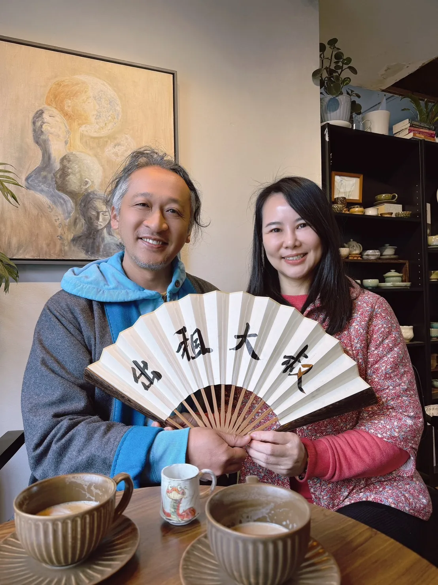

## 做幸福的事，將幸福做成有價值的事(歷年生命作品)

- 1976 年出生於 台灣 十分，台灣最大瀑布 十分瀑布的所在地，也是台灣天燈的發源地。

- 1983年來到台灣南投縣水里鄉，一個在日月潭下、濁水溪旁、遠眺玉山的小山城。

- 1991年來到宜蘭，太平洋、中央山脈交錯平原之地

- 1999年到城市台北生活

- 2003年 畢業於台灣大學

- 2008年金融海嘯-物質生活的轉折點

- 2010年心靈啟蒙-精神生活實踐的開始

- 2011年遇見佛性的自己-四川安曲查理寺

- 2012年創辦 稻田裡的餐桌-從城市回到鄉村。

稻田裡的餐桌

- 2015年社會企業、行為藝術之稻田裡的餐桌，第一次離開台灣到香港最早開發的農村薄扶林村策展。

- 2017年成為亞洲第一家通過英國SVI協會SROI認證之企業

  - 

- 2017年大陸成都鄉村振興顧問項目啟動

- 2017年大陸河北省 秦皇島市 幸福餐桌-餐桌是傳遞幸福的載體。

[video](https://hii.hdv.mybluehost.me/wp-content/uploads/2024/06/2017-年幸福餐桌在秦皇島市-昌黎縣.mp4)

- 2018年加入友成企業家鄉村發展基金會-獵鷹加速器-第一期

- 2019年實地參與湖南衛視 鄉村合夥人節目，並規劃幸福餐桌成為該集鄉村振興主題。

- 2020年文化、創意 結合 幸福餐桌-布袋戲餐會

- 2021年台味開箱

[video](https://hii.hdv.mybluehost.me/wp-content/uploads/2024/03/台味開箱網頁用檔案.mov)

- 2022年 葡萄園裡的幸福課 (融合自然教育、生命教育、幸福餐桌)

[video](https://hii.hdv.mybluehost.me/wp-content/uploads/2024/06/生命裡的幸福課-葡萄園裡的幸福課.mp4)

- 2023年生命裡的幸福課-去有風的地方

## 2024-幸褔行為藝術家-出租大叔

2025-佛系幸福之家

## 大道至簡 簡家旗 幸福生活的踐行者

大道至簡 —— 生活中的幸福實踐。

為學日益 為道日損 損之又損 以致無為 無為而無不為。 出自於 道德經

地球生命進入21世紀，在複雜快速變化的世界中。

「大道至簡」提醒我們回歸生活的本質。

將這一理念實踐於日常，就是在尋找與創造幸福的過程中，重視簡單、純粹的價值與快樂。

專業與熱愛跨領域整合 文化、創意、農業、旅遊、餐飲、設計、藝術、身心靈、社會創新、商業模式成為一個幸福可持續系統模式。

做過的事情很多 參考如下：

- 銀行、保險、產業研究、股票分析、股票基金經理人。

- [稻田裡的餐桌](https://www.facebook.com/love2fruit?locale=zh_TW) 創辦人

- 幸福果食股份有限公司、北京幸福果食文化傳播有限公司 負責人

- [長江商學院](https://www.ckgsb.edu.cn/) 台灣文創之旅講師

- 台味開箱開發設計師

- 幸福創業顧問

- [堉璘臺大人才培育計畫](https://yllproject.ntu.edu.tw/)-2020-2023 連續三年合作夥伴。

- 2012年至今台灣、大陸 線下、線上演講分享超過200場。

- 生命裡的幸福課 創辦人

- 幸福行為藝術家

- 佛系幸福之家
