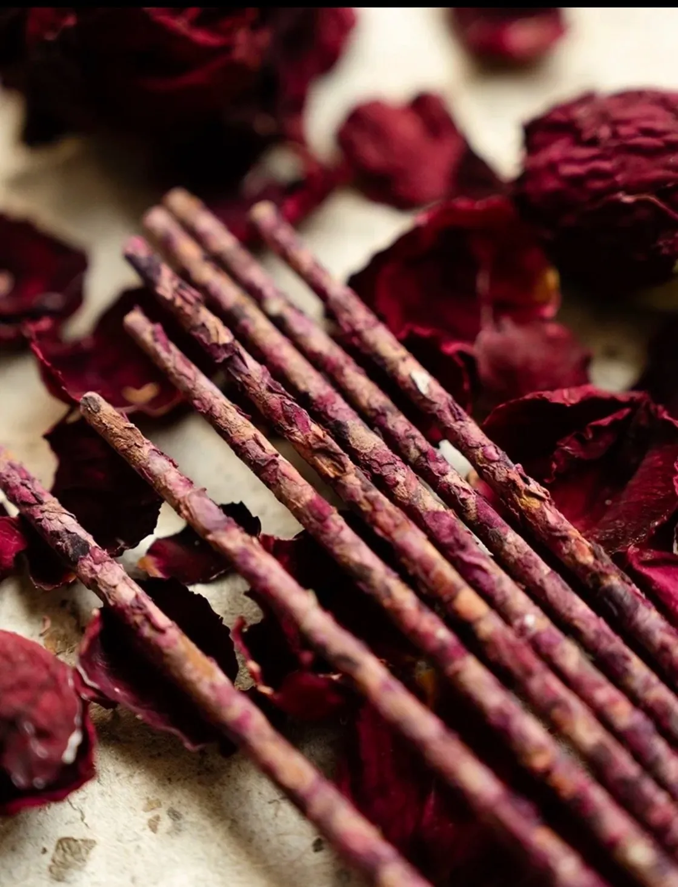
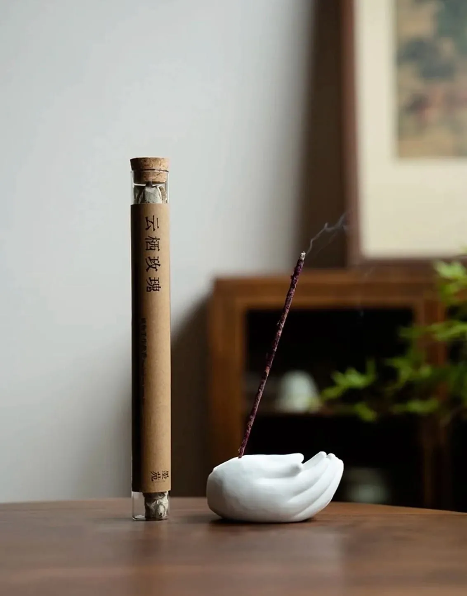

DaoIsSimple ・ 大道至簡

# 雲南線香・香格里拉藏香

兩個簡 ・ 兩個家

家旗與吟嘉，是夫妻。

一人在台灣南投水里，

一人在雲南香格里拉，

兩地，都是家。

我們都姓簡，也都信「大道至簡」。

因為愛這兩塊土地——稻田的水氣、雪山的松柏——

我們把雲南的線香、香格里拉的藏香，

一路帶回台灣，也帶來給你。

三 支 香 ・ 三 種 時 間

壹 

## 雲南線香 ・ 降真香

Yunnan Jiangzhen Incense

「降真」之名，因古人說此香能使 *群仙降臨*。降真香生於雲南山中，是難得的木本香材——氣味甘甜悠長，帶松、樟與淡淡花蜜的層次。

一支點起，是一個下午的時間。靜坐、品茶、或寫一封信。

NT$ 880 / 盒

貳 

## 香格里拉 ・ 長藏香

Shangri-La Tibetan Incense ・ Long

香格里拉海拔三千公尺。當地以柏木、紅景天等高原植物，依寺院千年古方手工搓條、陰乾。氣味厚實、沉靜。

長支設計，適合一段不被打擾的時光——靜坐、書寫、或一個午後的閱讀。

NT$ 400 / 盒

參 

## 香格里拉 ・ 短藏香

Shangri-La Tibetan Incense ・ Short

與長藏香同方，縮短為日常版。沿用相同的高原柏木與寺院古方，氣味一致，只是時間更短。

適合茶席、瑜伽前後，或進門那一刻——想把外面的世界放下時，點一支。

NT$ 200 / 盒

—

香，不是奢侈品。\
是把一段安靜的時間，送給自己。

## 訂 購

Place Your Order

DaoIsSimple ・ daoissimple.com

香格里拉藏香

