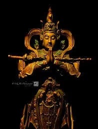
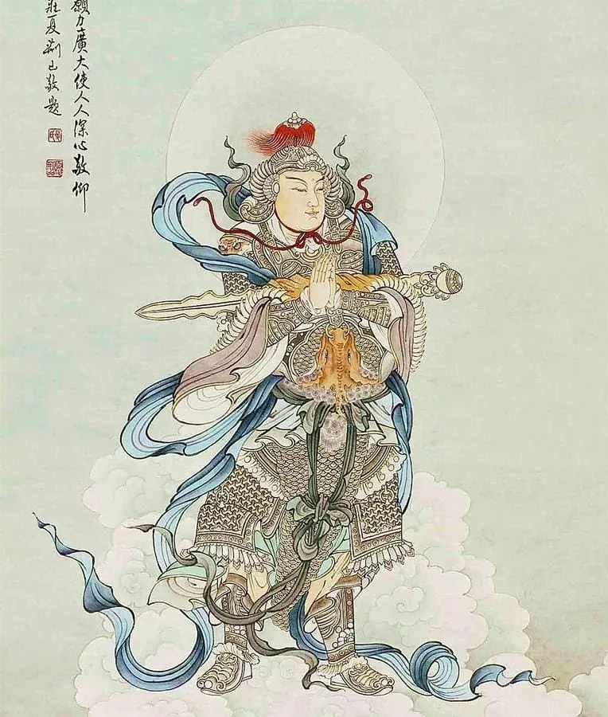
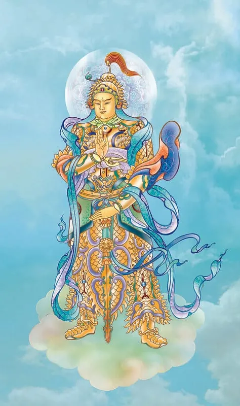

今天是韋馱菩薩誕辰，所有的佛教徒在今天都應該來恭敬供養韋馱菩薩，尤其出家人更應該重視這一天。「護法韋馱菩薩，他發願生生世世願作童子身，永不結婚，來護持佛法。他是賢劫千佛之中最後一位佛。釋迦牟尼佛是賢劫第四位佛，彌勒菩薩是未來第五位佛。」

這位菩薩曾發過願，說你若有三分的修行，就有七分的感應！

韋馱菩薩又稱韋馱天（梵文Skanda）

據《悲華經》記載，韋馱菩薩曾向佛陀立下十大願：

第一願是修菩薩道。菩薩發願修菩薩道，修持布施、精進、忍辱和愛語等。

第二願是護持正法，在佛陀涅槃後收取舍利和建造佛塔供養，並為有意修學佛法的人開示佛法。遇有犯戒者，或有散亂心的人，便以佛法勸化他。

第三願是末法燃燈，在佛陀涅槃後、正法垂滅之時燃起正法之燈，護持佛法，使佛法的傳承永不斷絕。

第四願是在劫難之際教化眾生。在刀兵劫（戰爭）時教導眾生持不殺戒，在飢饉劫（飢荒）、疾病流行之時，勸化眾生安止於六度波羅蜜。

第五願是成就佛道，成阿耨多羅三藐三菩提。

第六願是在半賢劫之中調伏眾生。

第七願是在成阿耨多羅三藐三菩提時，協助毀戒丶毀壞正法丶生嗔恚、惱害心的眾生回歸正道。

第八願是自己涅槃後化為佛像，繼續教化無量眾生，使其不退轉。

第九願是，若有眾生沒有珍寶，菩薩願作其如意摩尼寶珠。

第十願是當大醫王，使眾生免於煩惱病和邪見病等，並勤心修行。

諸世界所有眾生。離諸善根諸苦纏身。我當於中雨憂陀娑香栴檀沈水種種諸香。令諸眾生斷煩惱病諸邪見病身四大病。於三福處勤心修行。令命終時生天人中。

來源：《悲華經》

今天2024/7/8 農曆 六月初三

伽藍菩薩聖誕

明淨月等持如來殊勝功德日；善行與惡行乘一千萬倍。

邁向覺醒之路

迴向眾生覺。

祈願法教遍滿世間！

頂禮、供養、應供無上正等正覺 遍滿虛空法身佛
