> 舉辦雲南親子夏令營的理由：
>
> By 大道至簡 簡家旗\
> 因為我們熱愛這個地方的\
> 多元文化、\
> 高山大湖、\
> 繽紛美麗花卉、\
> 豐富多樣的食物、\
> 舒適涼快的氣候...等。
>
> 這樣多元融合的生活，也是我們認識的幸福生活。
>
> 想透過親子家庭同遊雲南的過程，體會彼此生命裡的幸福。

[video](https://hii.hdv.mybluehost.me/wp-content/uploads/2024/04/224.mp4)

## 雲南Summer Trip & Camp

## 合作單位：雲南廣播電視台

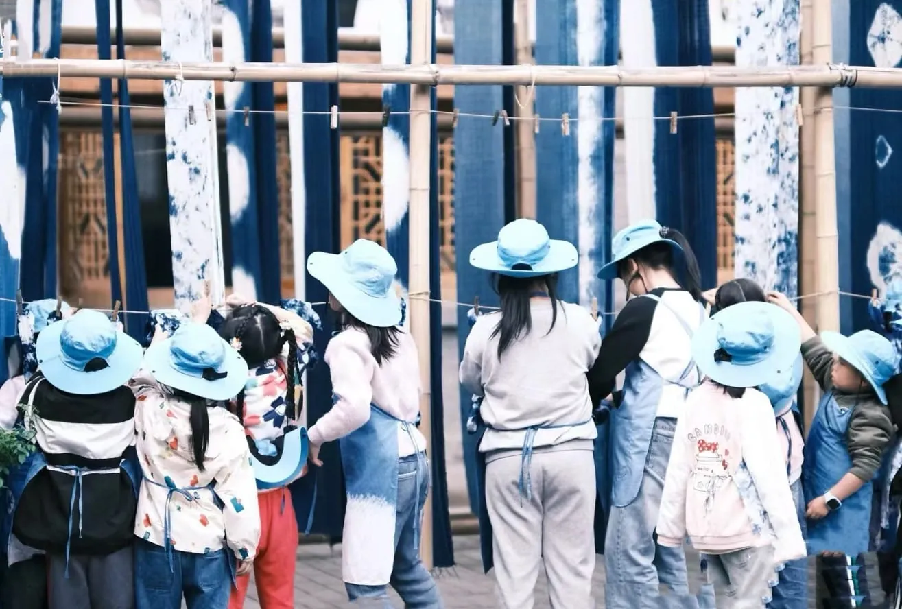

l雲南夏令營l

課程特色

▶️民族非遺體驗

通過參與糍粑、米花糖、織布、扎染等，深刻體驗雲南的傳統與文化。

▶️民族傳統活動

民族傳統活動，如傳統民居中的土坏制作、稻田摸魚等，培養團隊合作精神。

▶️民族村參觀游覽

雲南民族村參觀游覽，了解雲南多樣的民族文化和傳統。

▶️世界恐龍谷考古

恐龍谷考古活動增進恐龍知識，探秘侏羅紀時期恐龍的生活。_

▶️密探喀斯特地貌—石林

結合課本知識，深入了解石林的成因，地質特點以及生態價值，感受大自然的鬼斧神工。

## 幸福雲南夏令營 你們可以學習到什麼？

## 雲南多元民族文化

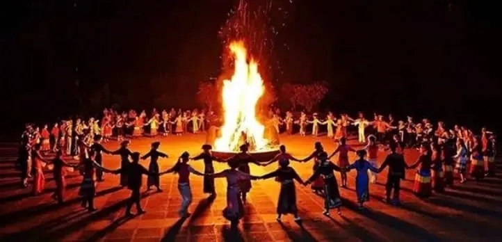

## 石林-世界級特殊地形

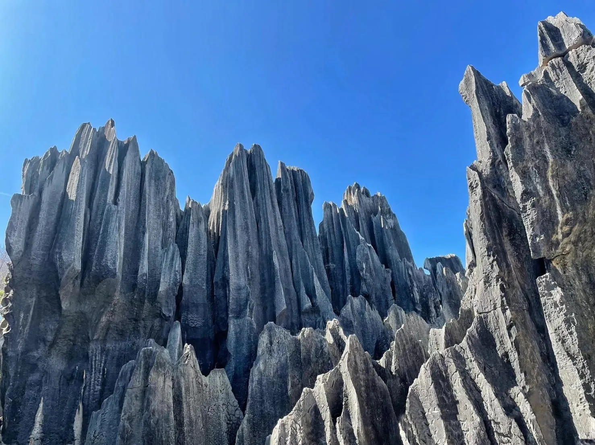

## 恐龍化石

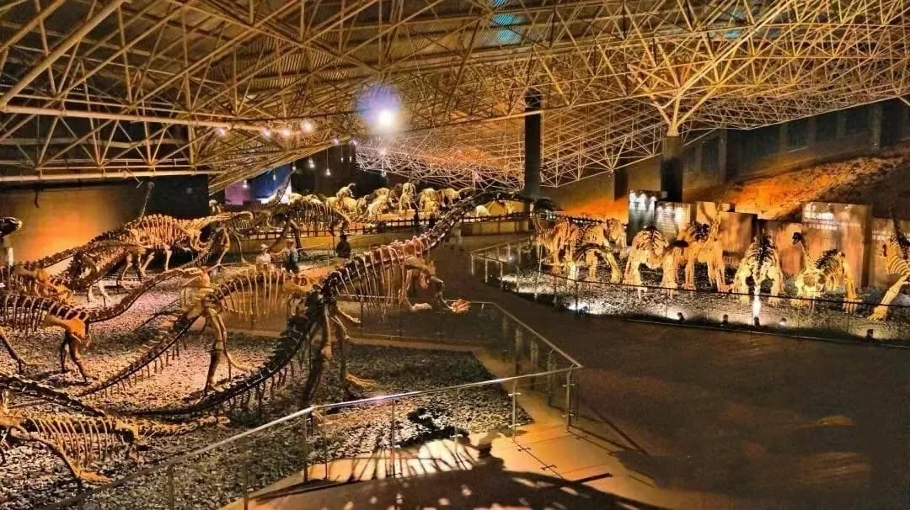

## 滇池日落

## 親子雲南地方文化課程體驗

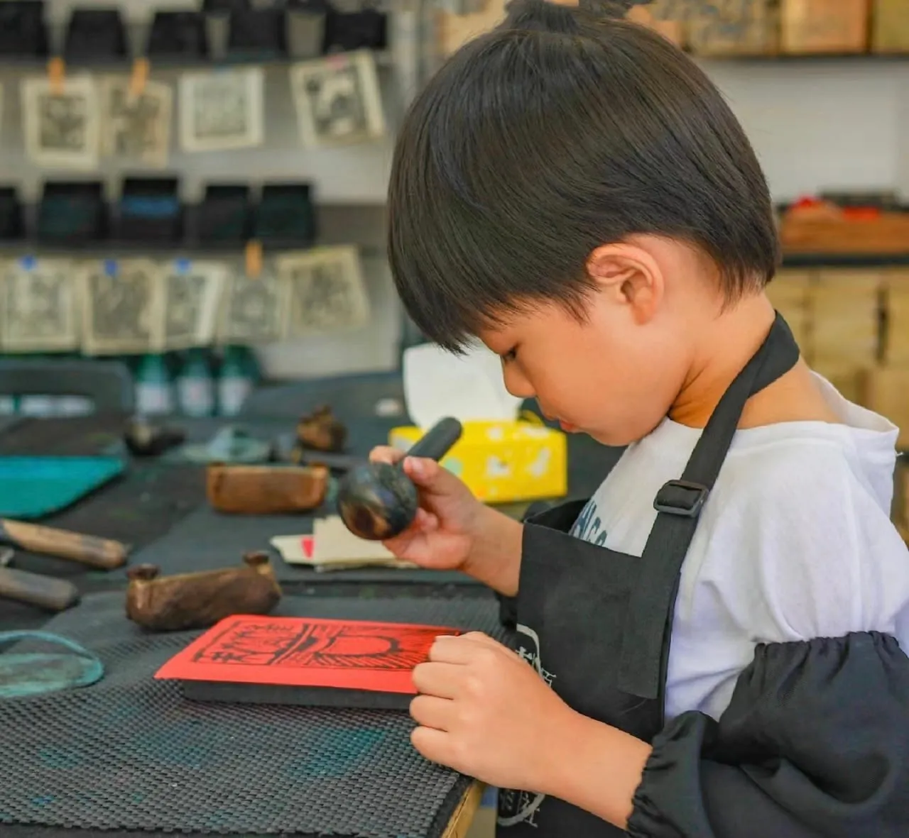

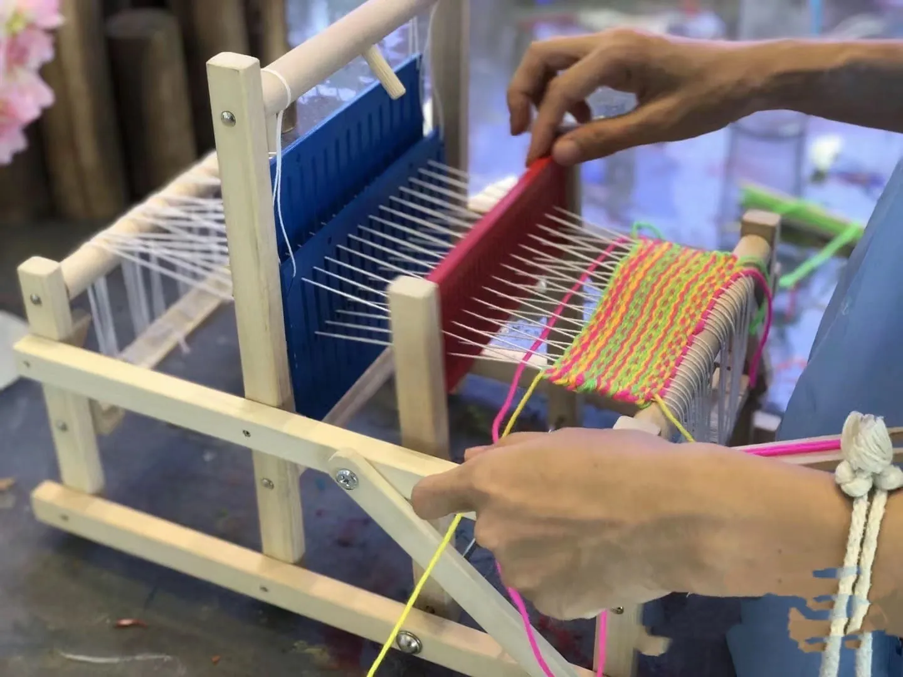

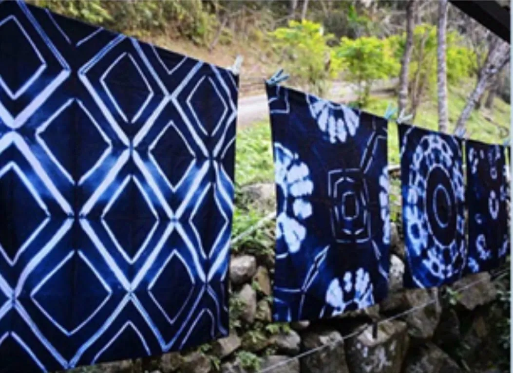

## 雲南特色美食 過橋米線

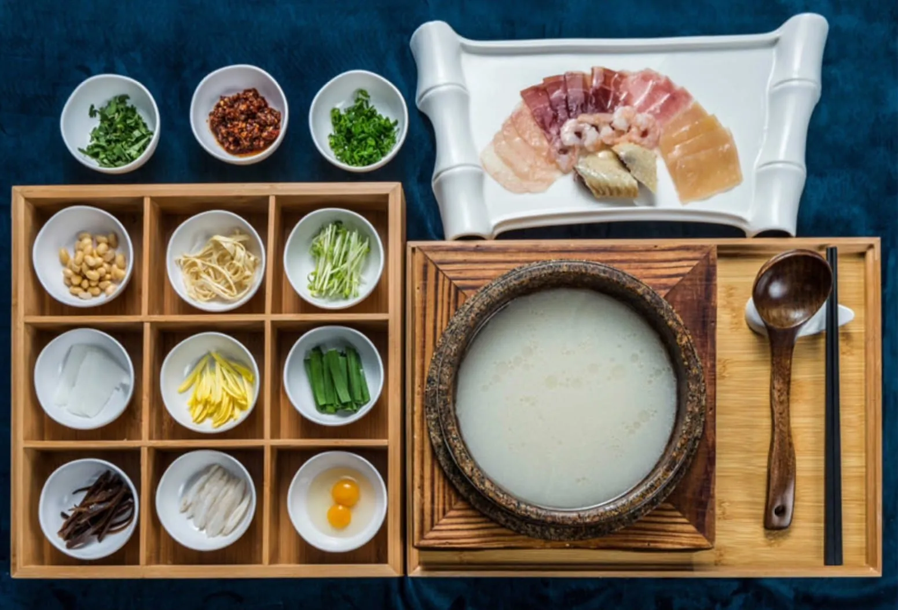

## 雲南各地特色美食

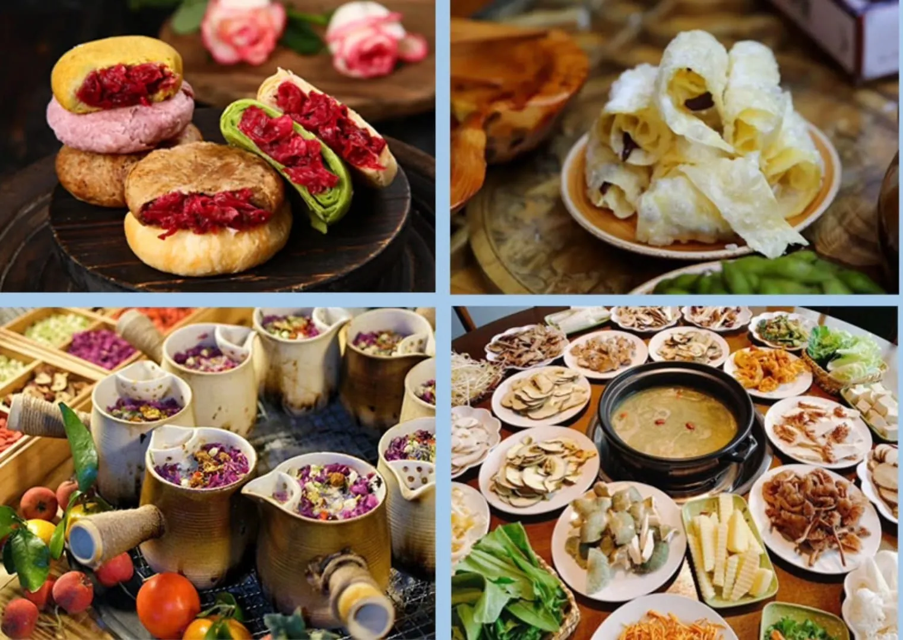

雲南特色美食

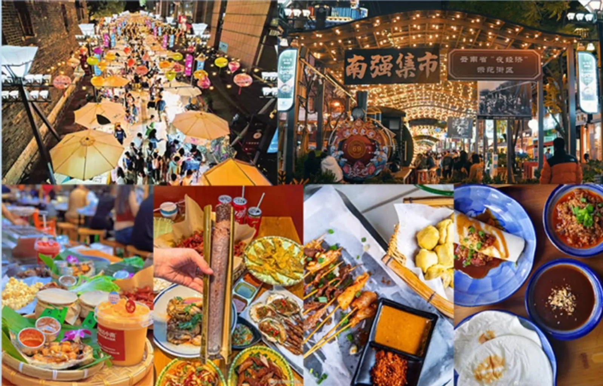

雲南特色美食

## 住宿標準四星級以上

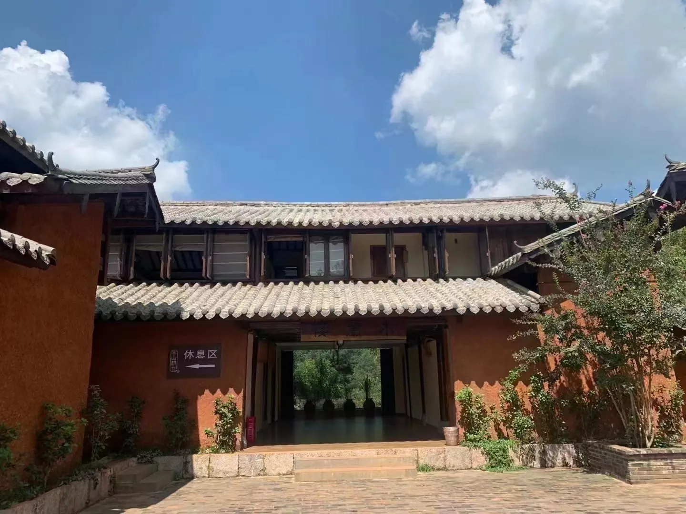

住宿環境參考

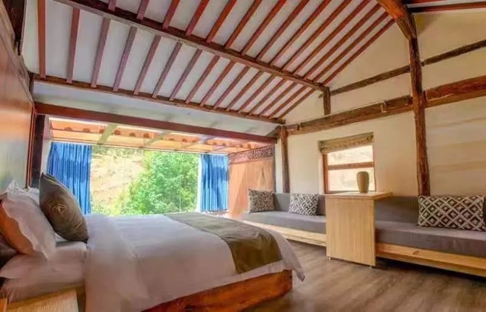

## 交通出行標準

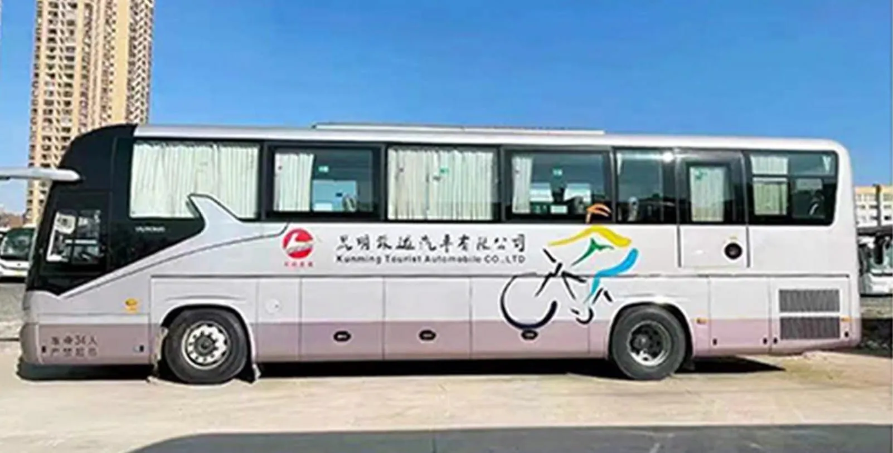

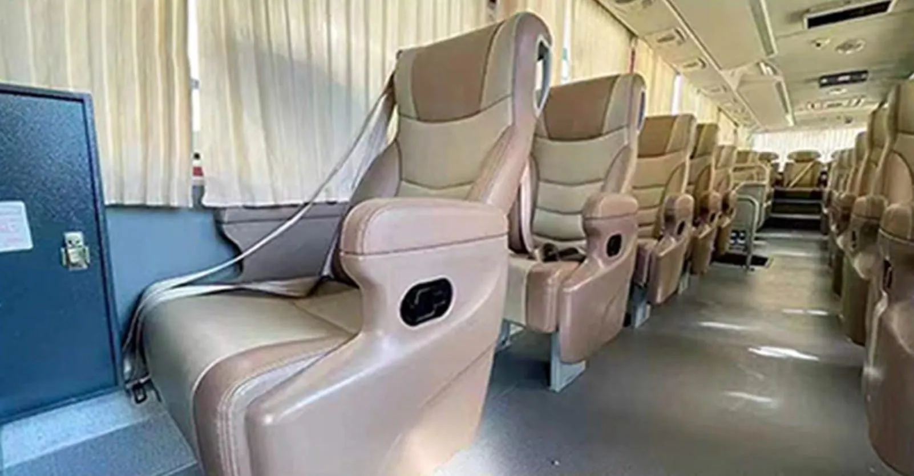

日程安排

第一天：昆明長水機場接機 ，營火晚會。

第二天：破冰儀式 ，自然小課堂，民族非遺體驗（織布、扎染）。

第三天：民族非遺體驗（制作糍粑、米花糖），民族傳統活動（土坏制作、捕捉稻花魚）。

第四天：乘車前往祿丰恐龍谷，恐龍谷考古與時空樂園遊戲時間，主題酒店溫泉時光。

第五天：雲南民族村，南強街夜市，昆明老街。

第六天：幸福廚房，海宴村日落。

第七天：阿盧古洞，品嚐宜良烤鴨

第八天：昆明自由行 。（翠湖， 陸軍講武堂等景點，彈性安排）

第九天：返程 送機

2024雲南夏令營 9天8夜

第一梯次：6/29（六）-7/7（日）

第二梯次：7/8（ㄧ）-7/16（二）

$75,000/成人

$60,000/兒童7-12歲

以上費用不含台灣-雲南來回機票

10人成團

📍報名前請先確認台胞證的有效期喔！

歡迎洽詢 line:@473nnjul 大道至簡

line:@617aipgs 嘉禮慕華🪴孩子園藝

放心選擇

▶️專業的安全團隊-選擇經驗豐富的領隊和工作人員，他們具備專業的安全知識和技能，能迅速應對緊急狀況。

▶️創造輕鬆愉快氛圍-不僅注重學生的安全與健康，還創造一個讓學生感到愉快和放鬆的活動環境。

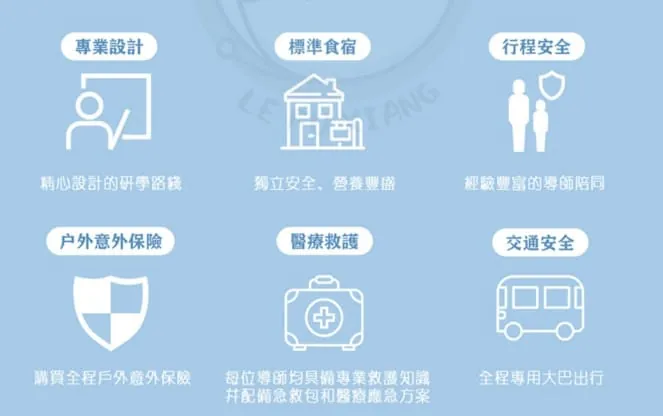
