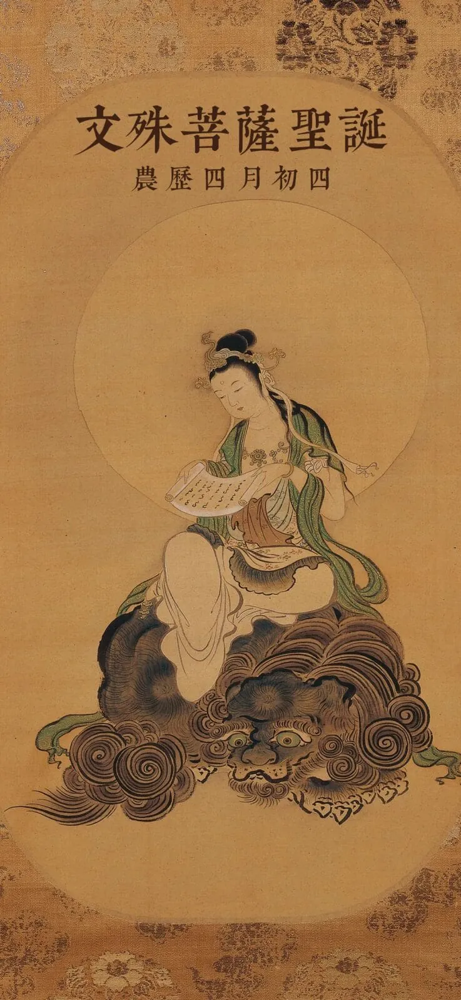
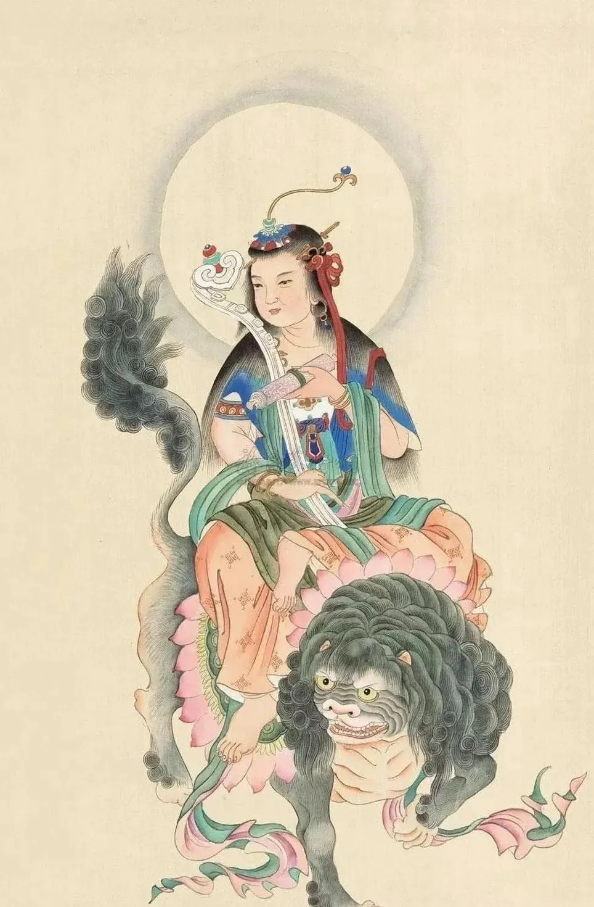

文殊大士妙應無方座前獅子獸中王妙意降吉祥花雨天香寶智透心光

2025年5月1日（農歷四月初四），恭逢文殊菩薩聖誕。文殊菩薩為眾菩薩之首，象徵佛陀智慧，稱“大智”。

適逢農歷四月初四文殊菩薩聖誕，祈求文殊菩薩加持攝受，祈願加持所有護法檀越、善男信女得大吉祥，開大智慧。於人生旅途，學佛道路一切吉祥圓滿！

## 文殊菩薩

文殊菩薩是智慧的象徵，亦是無數佛菩薩的老師，被尊稱為“三世佛母”，據經文記載，文殊菩薩曾發下諸多大願，其中便有：願讓十方無量無邊諸佛剎土的眾生都能看到他，聽聞他，從而勸發、教化一切眾生發菩提心、開智增慧、成菩提道。

《佛說放鉢經》中佛對諸菩薩阿羅漢言：“今我得佛，有三十二相、八十種好，威神尊貴，度脫十方一切眾生者，皆文殊師利之恩，本是我師。前過去無央數諸佛，皆是文殊師利弟子，當來者亦是其威神恩力所致。譬如世間小兒有父母，文殊者佛道中父母也。”文殊菩薩為十方諸佛之母，一切菩薩之師。菩薩手持智慧劍，騎乘獅子，象徵以智慧之劍斬斷無明煩惱，以無畏之力啓迪眾生本具的般若光明。

《佛說佛印三昧經》中載：“文殊師利菩薩最高才第一，光明智慧與諸菩薩絕異，無能及者。”可見文殊菩薩之智慧廣大無邊，照徹法界。

文殊菩薩以大智慧為本願，以智慧光破除無明。智慧從何而來？《楞嚴經》云：“攝心為戒，由戒生定，由定生慧。”想要得大智慧，必先攝心。佛菩薩安住在清淨的境界，而我們的心卻常起貪瞋痴。如果我們的心能轉變過來，像菩薩一樣常存清淨，也就能夠生發智慧。

《華嚴經》云：“若諸菩薩善用其心，則獲一切勝妙功德。”所謂“善用其心”，就是時刻保持內心的清淨與覺察，不被外物所擾，不被貪嗔痴等煩惱所困，在一切行動中利益眾生、增長功德。

## 文殊菩薩 偈語

覺海性澄圓，圓澄覺元妙；\
元明照生所，所立照性亡。

迷妄有虛空，依空立世界；\
想澄成國土，知覺乃眾生。

歸元性無二，方便有多門；\
聖性無不通，順逆皆方便。

旋汝倒聞機，反聞聞自性；\
性成無上道，圓通實如是。

[資料來源如連結](https://mp.weixin.qq.com/s/h1D6ji4FMyqVoIN6ixrsuw)
