去有風的地方 · Meet Yourself ｜雲南幸福深度旅遊

YUNNAN · 2026 SLOW JOURNEY

# 去有風的地方

— Meet Yourself —

九天，把自己交給雲南的風。\
昆明、大理、沙溪古鎮，\
慢慢地走，認真地看，\
在不被打擾的時光裡，重新遇見自己。

Days

九 日

Region

雲 南

Group

4 — 12 人

Pace

慢 旅

Prologue · 開 篇

## 為什麼要走這一趟

風，是空氣的流動。冷的向暖的去，萬物因此有了生機。

人也是。在累了、冷了、走不動的時候，我們也需要一陣風，把自己吹向溫暖的地方。

雲南，就是那個地方。*不是觀光景點的雲南*，是日子被慢慢過、生活被認真愛的雲南。

這趟旅程，沒有打卡，沒有趕場，沒有催促。\
我們只做一件事 —— 把九天的時間，留給自己。

> 僅僅活著是不夠的，\
> 還需要有陽光、自由，\
> 和一點花的芬芳。
>
> — a saying remembered in Yunnan
>
## 這趟旅程，\
是為這樣的你準備的 If you recognise yourself here, come.

1. 在某個位置上累了，但還沒到放下的時候 —— 你需要的不是逃，是換一口氣。

2. 想為自己留一段沒有 KPI、沒有交辦事項、沒有人等你回訊息的時間。

3. 對「慢」這件事好奇，但不知道從哪裡開始。

4. 喜歡在地的、手作的、有溫度的事物，勝過五星級的標準化體驗。

5. 想結識一群同頻的人，但不想被推銷任何東西，只想好好說話、好好吃飯。

6. 願意把九天交給一個陌生的地方，看會發生什麼。

Chapter One I.

## 昆明 · 花的城市

a city that wakes up smelling of flowers

旅程從一座被花包圍的城市開始。\
在這裡，全國七成的鮮切花從一個市場流出。\
我們不急著去看任何景點，先讓自己被花的氣味馴服一晚。

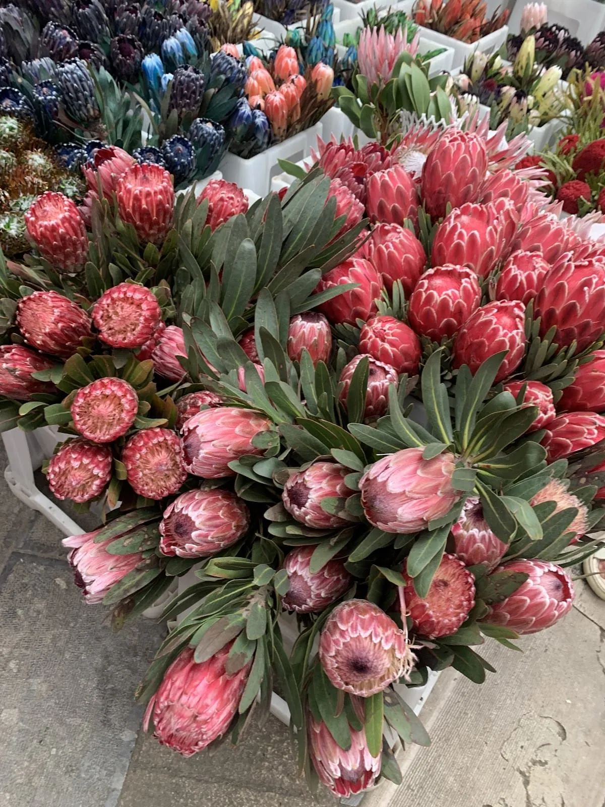

STOP 01 · 斗 南 花 市

### 亞洲最大的鮮花批發市場

每日上市的鮮花品種超過 1,600 種，凌晨開市，黎明散市。

走進這裡，沒有人會跟你介紹什麼，你只能被顏色和氣味淹沒。\
這就是我們要的開場 —— 把腦袋暫時關掉，讓感官先醒來。

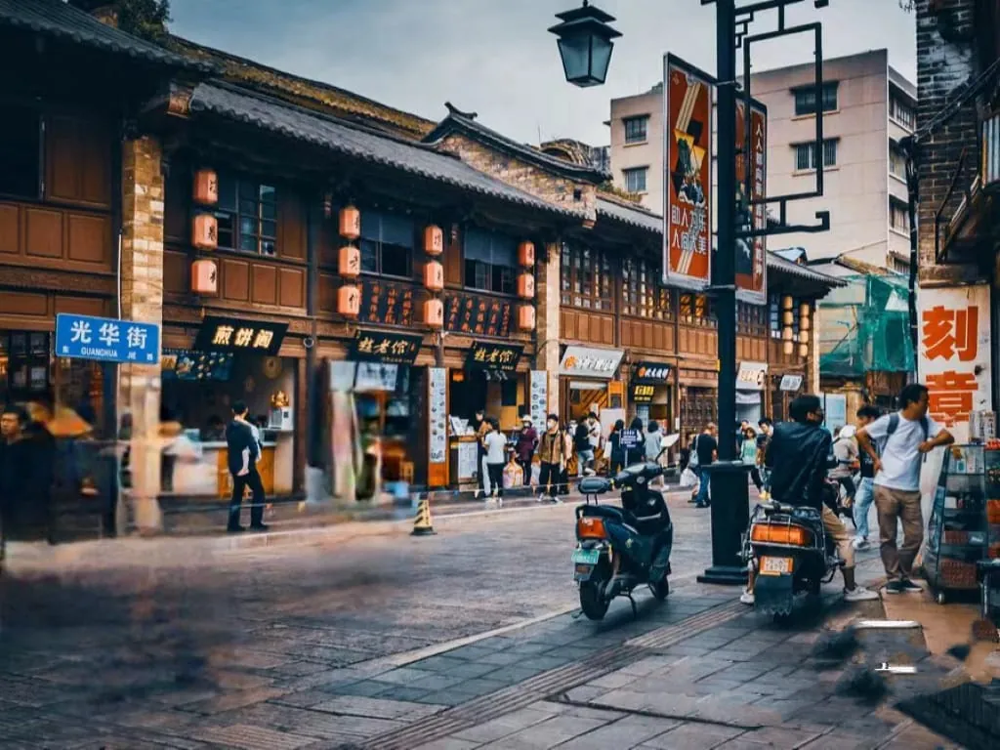

STOP 02 · 昆 明 老 街

### 青磚灰瓦下的煙火日常

老街裡有近九百年歷史的建築群，也有藏在老宅裡的咖啡館、英式酒吧、百年藥舖。

一條街，幾個世紀的日子並排而坐。我們在這裡吃一碗正宗的小鍋米線，再慢慢散步回酒店。

Chapter Two II.

## 大理 · 蒼山為盟，洱海為誓

where mountains pledge, where the lake remembers

蒼山十九峰、洱海四十二公里，這是雲南最知名的浪漫，也是最容易被走馬看花的地方。\
我們選擇放慢三天，住進雨林裡，騎進生態廊道，走進白族人家的院子，\
把「網紅景點」還原成「真實地方」。

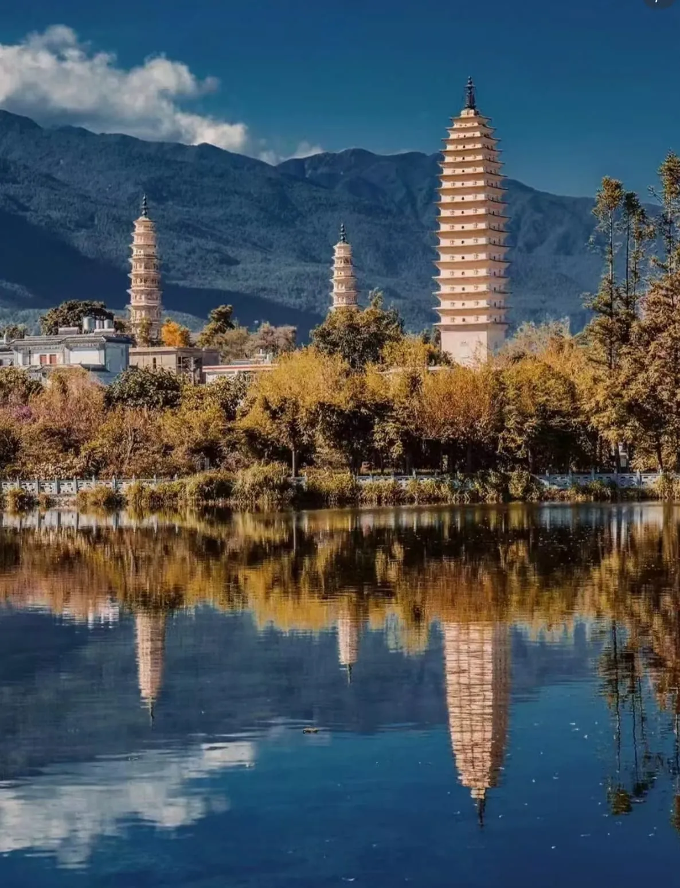

STOP 03 · 崇 聖 寺 三 塔

### 蒼山下，九位皇帝出家的地方

三塔建於南詔，西靠蒼山，東臨洱海。\
千尋塔的紡錘輪廓，是大理最古老的呼吸節奏之一。

在這裡走一段，不為拍照，只為與一千多年前那個放下的決心，安靜地點頭。

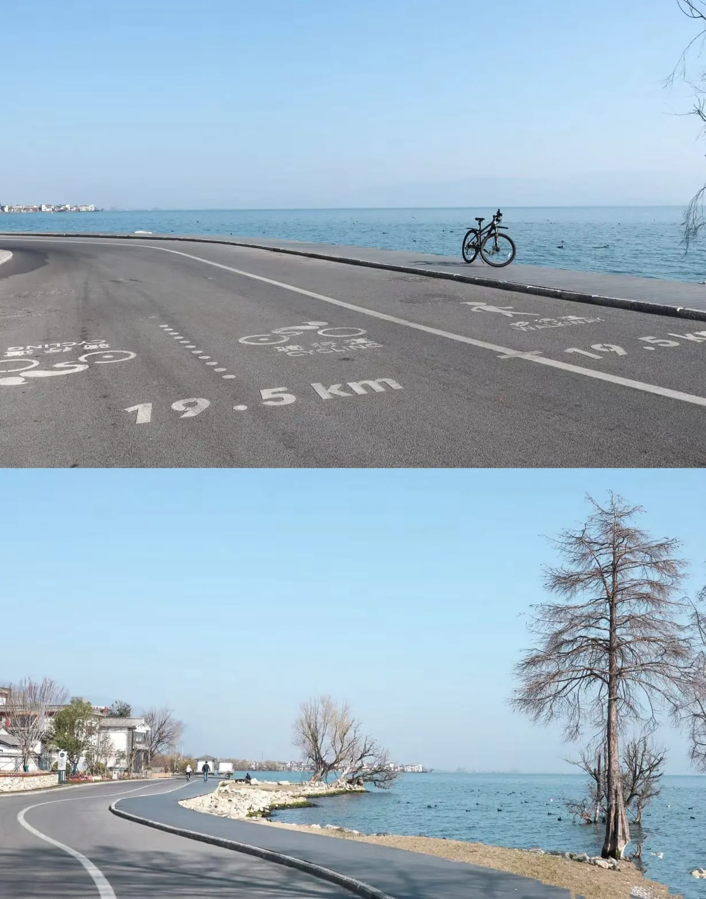

STOP 04 · 洱 海 生 態 廊 道

### 四十三公里，腳踏車或步行

外部車輛不能進入。只能走，或騎。

從陽南溪到桃源碼頭，秋天有水杉，春天有海菜花。\
湖面、山影、風、自己的呼吸 —— 這裡不需要再多任何東西。

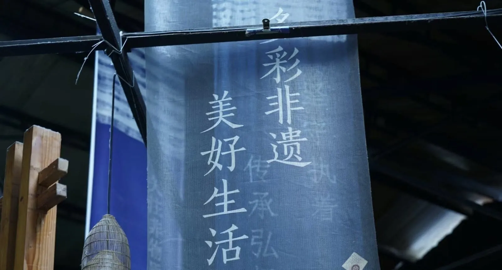 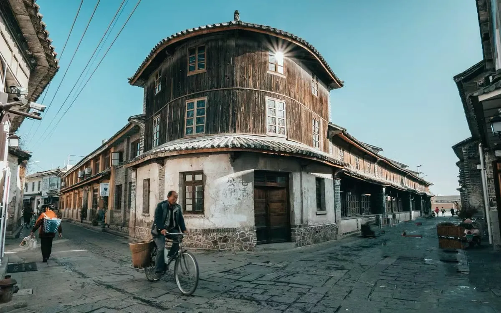 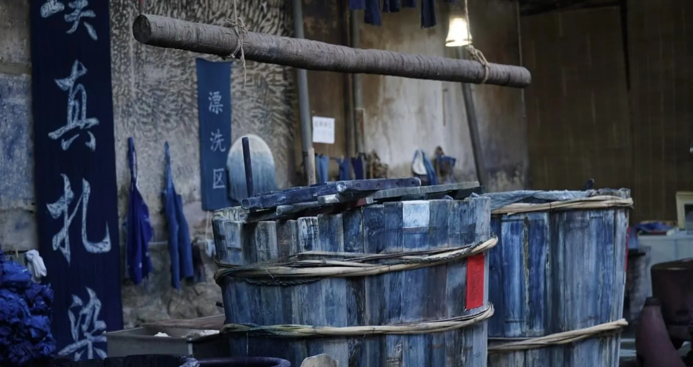

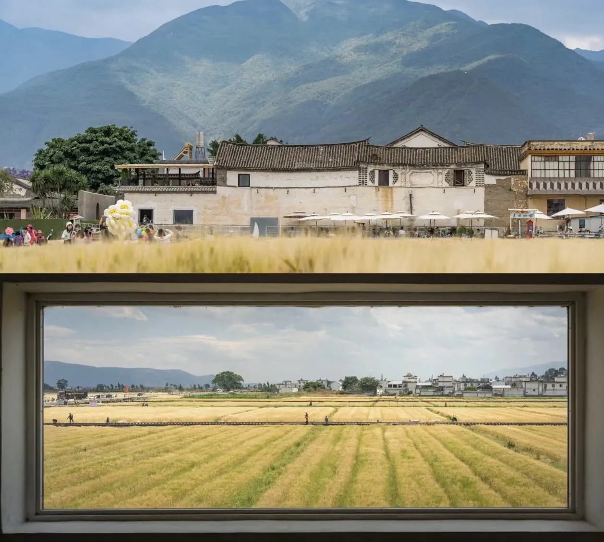

STOP 05 · 喜 洲 · 周 城

### 非遺的手，與一種叫「大理藍」的顏色

喜洲是白族保存最完整的聚居地，「三坊一照壁」「四合五天井」的院落格局還活著。

周城是國家級非遺扎染之鄉。\
我們會走進璞真扎染博物館，*親手把一塊白布，染成只屬於自己的那一片大理藍*。

THE HEART OF THIS JOURNEY

## 關於那個叫「有風小院」的地方

「之所以叫有風小院，是因為希望每一個來這裡住的人，\
都能夠找回人生幸福的力量。

風的本質，就是空氣的流動。\
冷空氣向熱空氣流動，就形成了風，\
萬物因此有了生機。

沒有風，就是一潭死水。\
鳥都要去南方過冬。\
人在感覺疲憊寒冷的時候，\
也需要向溫暖的地方流動。

尋找幸福的力量、快樂的力量、美好的力量；\
或者說 —— 重新出發的力量。」

— 謝之遙 ·《去有風的地方》

Chapter Three III.

## 沙溪 · 日子被過成了詩

a town where time agreed to slow down

茶馬古道上唯一倖存的集市古鎮，藏在劍川的山裡。\
三天，我們不安排太多事。讓你有時間在書店裡發呆，在玉津橋上發呆，\
在石龙村的夯土院落裡，跟一條狗對望一個下午。

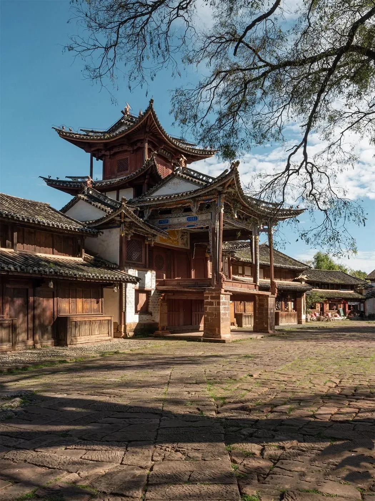

STOP 06 · 寺 登 街 · 古 戲 台

### 魁星閣下，一群人把日子過成了詩

重建於清光緒六年的三層魁星閣，前戲台、後高閣，飛簷疊角。

白天有人擺攤，傍晚有人彈琴，深夜古戲台只剩月光。\
這裡是世界紀念性建築基金會（WMF）認定的世界瀕危遺產 —— 但對居住在這裡的人來說，它只是廣場而已。

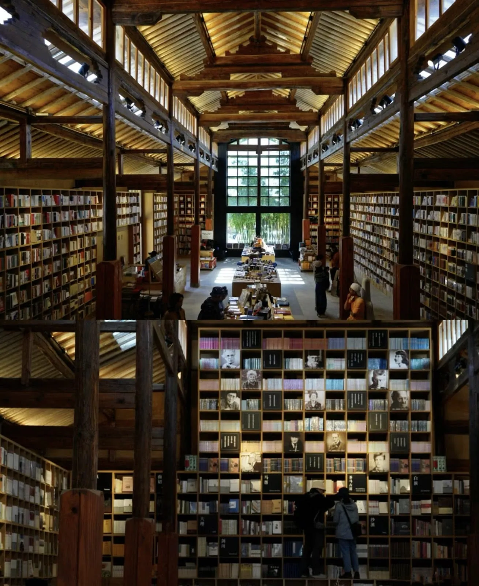

STOP 07 · 先 鋒 沙 溪 白 族 書 局

### 由糧倉改建的，最美鄉村書店

木頭、玻璃、天窗、斑駁光影；書店旁有咖啡館，後院有詩歌塔。

『如果有天堂，應該是圖書館的樣子。』\
—— 詩人博爾赫斯

我們在這裡留半天。你想看書、寫字、發呆，都好。

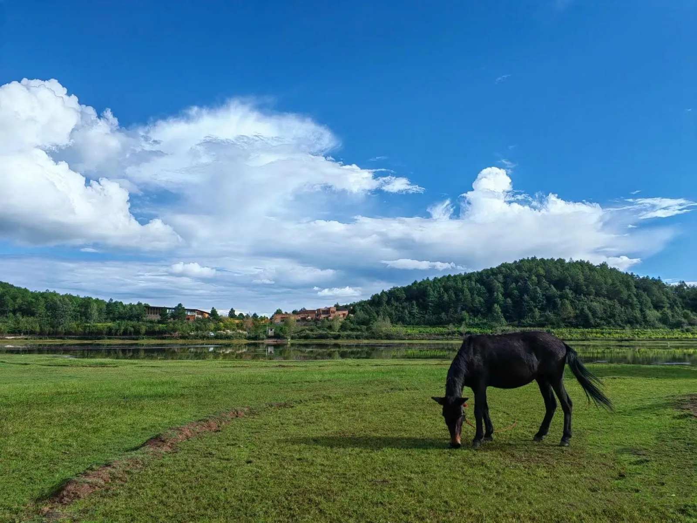

STOP 08 · 石 龙 村 · 幸 福 餐 桌

### 一張在田裡擺起的桌子

石龙村不到三百戶人家，白族、彝族、傈僳族世居於此。\
這裡的詩意，是這裡的人的日常。

我們會在這裡，為你擺出一張*『幸福餐桌』*—— \
食材來自旁邊的田、旁邊的人，由家旗親自下廚。\
這是這趟旅程的句點，也是這 14 年的延伸。

— Tastes & Shelters —

## 食 之 一 隅 · 宿 之 一 角

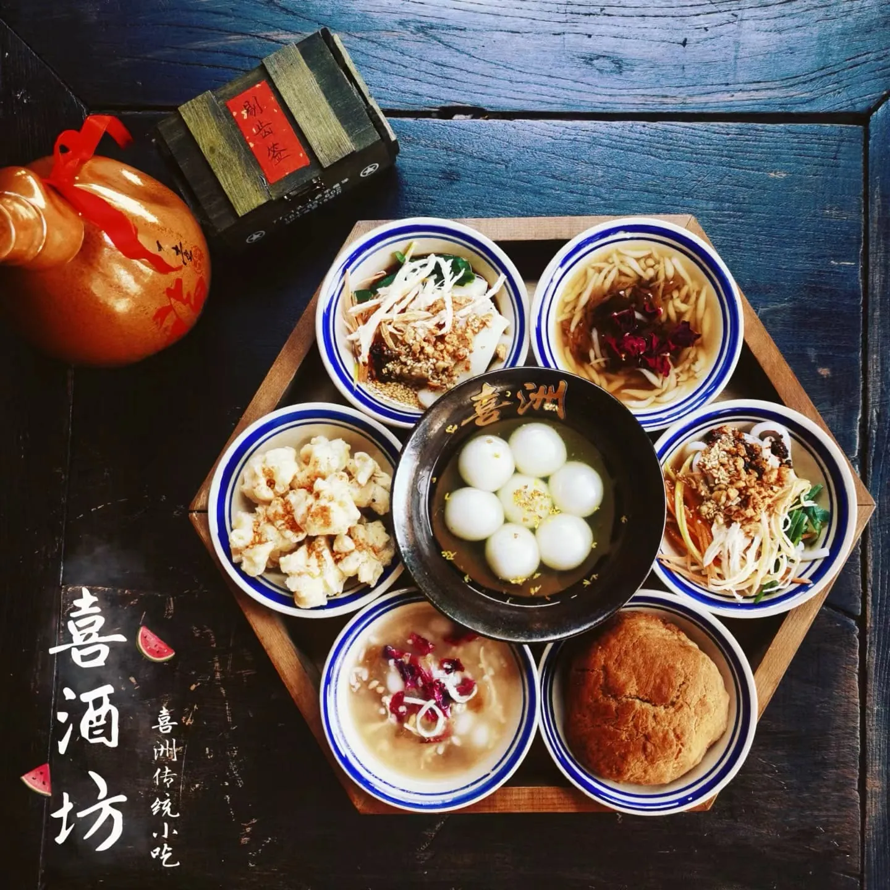

Eat · 食 過橋米線、汽鍋雞、喜洲破酥粑粑、白族風味拼盤 —— 一次嚐遍雲南的多面性。

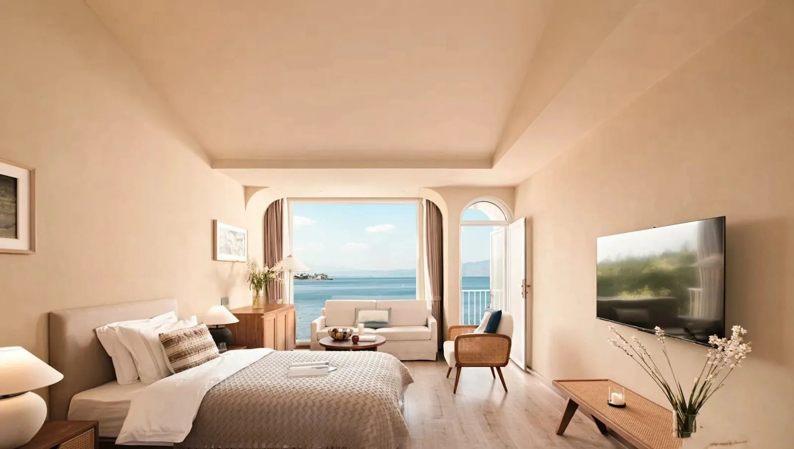

Stay · 宿 洱海旁的雨林療癒酒店、沙溪夯土院落民宿 —— 不是貴的，是對的。

YOUR HOSTS

## 領 路 人

— founder & host —

### 簡 家 旗 CHIACHI · 大道至簡

14 年前，他在台灣的稻田裡，擺出了第一張餐桌。\
從那之後，她在台灣、香港、上海、成都、深圳、雲南，一張一張地擺，一桌一桌地吃。

相信一件很慢的事 —— 人會在好好吃一頓飯的時候，重新遇見自己。

這些年他稱自己為「幸福行為藝術家」。\
這趟旅程，他把自己 14 年走過的雲南，慢慢交給你。

— local guide —

### 幸 福 導遊  Happy · 在地領路人

她在雲南生活多年，熟悉這裡每一條巷弄、每一位手藝人、\
每一座廟宇背後的故事。

沒有傳統導遊的腔調，\
只有一個雲南朋友，\
帶你走進她最珍惜的那些地方。

— Nine Days, At a Glance —

## 行 程 一 覽

1.

DAY01

昆 明

抵 達 · 落 地 昆明長水機場接機，入住昆明酒店，從這裡開始把時間還給自己。

2.

DAY02

昆 明

花 之 城 斗南花市、昆明老街、南強夜市，依當天節奏彈性安排，住昆明酒店。

3.

DAY03

大 理

啟 程 · 有 風 小 院 昆明乘車至大理，下午茶於有風小院，入住洱海雨林療癒酒店。

4.

DAY04

大 理

蒼 山 洱 海 海西生態廊道騎行或步行、崇聖寺三塔，住洱海邊。

5.

DAY05

大 理 → 沙 溪

大 理 藍 喜洲古鎮、周城璞真扎染，午後前往沙溪古鎮，入住沙溪渡假民宿。

6.

DAY06

沙 溪

慢 · 之 一 石寶山石窟、先鋒沙溪白族書局、咖啡時光，住沙溪。

7.

DAY07

沙 溪

幸 福 餐 桌 清晨農貿市場、石龙村漫步、傍晚『幸福餐桌』雲南限定場，住沙溪。

8.

DAY08

沙 溪 → 昆 明

歸 途 · 茈 碧 湖 沿途茈碧湖賞景，返回昆明，住昆明酒店。

9.

DAY09

送 機

把 風 帶 走 昆明長水機場送機。

— 行程依當下天候、體驗最佳節奏為主，保有調整權利 —

#### 費用包含 Included

- 昆明長水機場接送機

- 昆明、大理、沙溪古鎮全程住宿

- 全程餐食（含『幸福餐桌』雲南限定場）

- 全程交通車輛安排

- 大理有風小院下午茶

- 景區門票、景區電瓶車

- 家旗部分陪同、專屬幸福導遊全程陪同

#### 費用不含 Not Included

- 台灣往返昆明長水機場機票

- 個人消費、自費購物

- 行程外的延伸活動

- 領隊、導遊、司機小費（隨喜）

- 個人旅遊保險

JOIN US · 一 起 走 一 趟

## 如果這篇文章\
讓你停下來看了兩次

那就是風，吹到你了。\
名額有限，每團 4 — 12 人。\
我們相信，旅伴的密度，決定旅程的深度。\
歡迎透過任一方式聯繫，\
我們再依你的時間、節奏，安排詳談。

— Line —

@473nnjul

— WeChat —

chiachilove

— Email —

dadaoissimple@gmail.com

with care,\
大 道 至 簡 · 簡 家 旗
