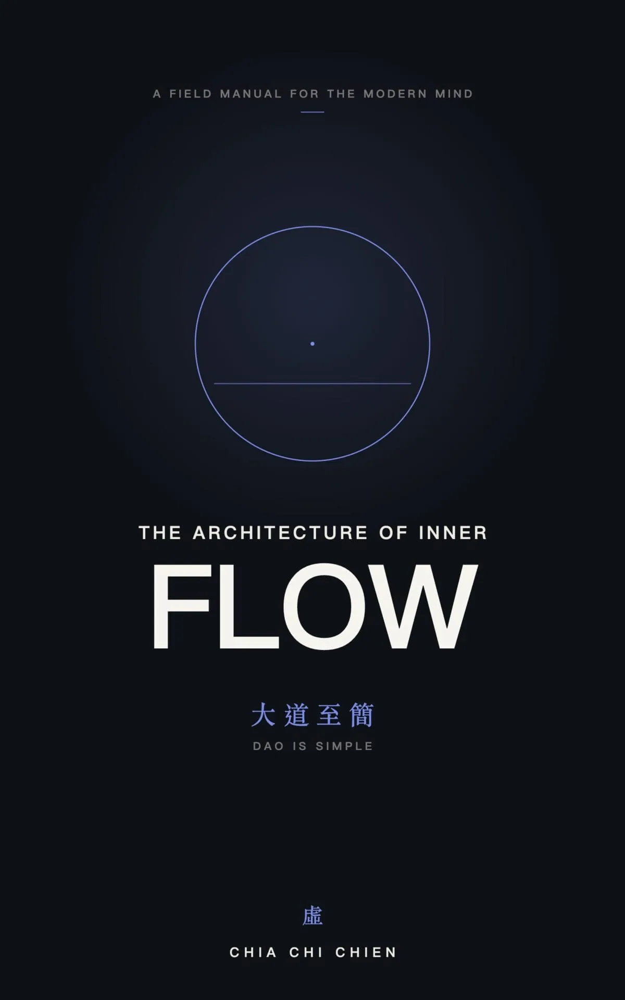

簡家旗第一本Amazon英文電子書

The Architecture of Inner Flow | CHIA

A FIELD MANUAL FOR THE MODERN MIND

# INNER\
FLOW

中文｜從虛開始，重新設計你的生命系統。\
English｜A practical framework for clarity, focus, creativity and inner freedom.

[Read on Amazon](https://www.amazon.com/dp/B0H3VZ1JH2) [Amazon Author](https://amazon.com/author/daochiachichien) [幸福服務](/幸福服務/)

## The Architecture of Inner Flow

English — Explore how simplicity, attention and awareness become the foundation of a meaningful life.

中文 — 《內在流動的建築學》探索專注、覺察與大道至簡的實踐方式，讓幸福成為一種可被培養的能力。

## Dao Is Simple

大道至簡。

幸福不是獲得更多，而是減少內在阻力。\
Flow 不是技巧，而是一種存在方式。

## Work With CHIA

### 幸福餐桌

文化、土地與人的深度連結。

### 幸福行為藝術

讓幸福成為可體驗的行動。

### 顧問與演講

ESG、地方創生與創新教育。

## The Simplest Path Is Often The Deepest

[Buy Kindle Edition](https://www.amazon.com/dp/B0H3VZ1JH2) [Dao Is Simple](/)

CHIA CHI CHIEN · DAO IS SIMPLE
