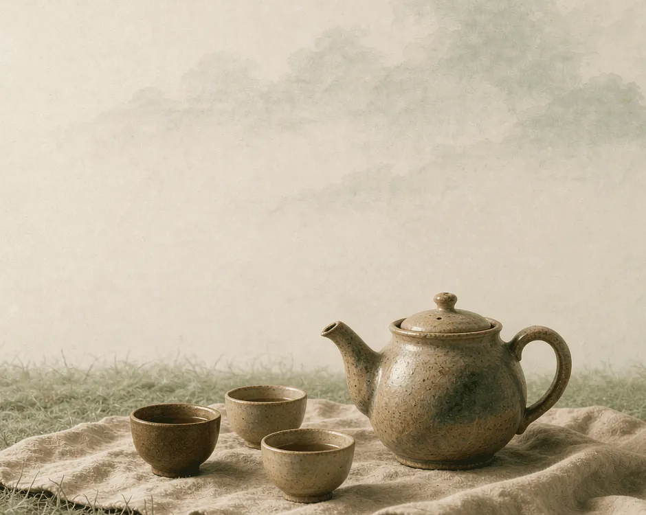
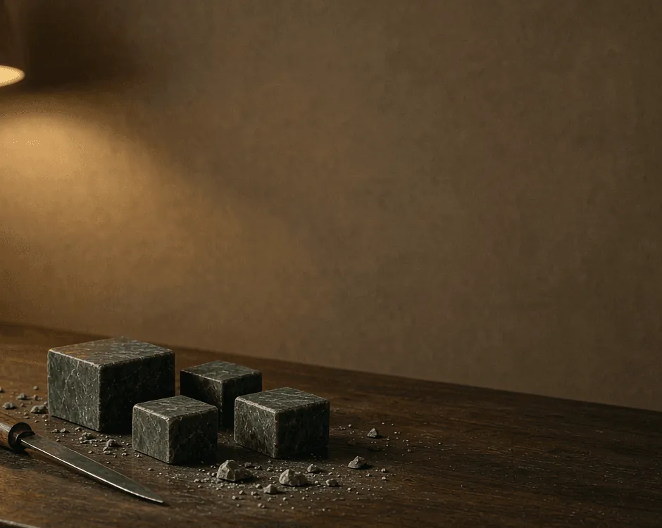

幸 福 生 活 · HAPPY LIVING

# 把日子過成詩的人，都在做這四件不花錢的小事

他講課時學生穿過整座城來聽，講晚唐詩能講到印象派。方法拆開看，四件事，沒一件要花錢。

昆明東北郊的司家營，村裡人常見到一幕。一位教授天沒亮出門，走十八公里進城上課，妻子帶著幾個孩子送到村口。傍晚回來，同樣的路，又有一群小的在村口等。

同一時期住在文研所的教授不少，家眷多半不在身邊，看了都羨慕。這位教授叫聞一多，家裡八口，月薪撐不過十天。

窮成那樣，日子卻過得有滋味。把方法拆開看，一共四件，沒一件要花錢。

## 01一 給一件事釘死時間和地點

那年春天他在晉寧補休，備課的間隙帶孩子們去郊外。草地上一塊毯子，泡一壺茶。他和妻子坐著，看孩子翻跟頭、抓蝴蝶。玩夠了叫回來，講遠古的神話，或者教背唐詩。

背的是整首。《長恨歌》《琵琶行》，都在那段時間背下來。雲南的天又高又藍，白雲在上頭飄，遠處一片綠，念著念著，孩子說好像走進詩裡去了。

夜裡另有一套。住的是樓上，窗戶很大，月亮升起來，月光整片灑進屋裡。就在那樣的光裡背《春江花月夜》，春江潮水連海平，海上明月共潮生。背不出來罰捶腿一百下，孩子圍著他，一個一個輪著捶。

月光灑進閣樓，地上攤開的書

不是想起來才做，是那段時間天天如此。詩意這東西靠隨興撐不久，它需要一個時間和一個地點把自己釘住。釘住了，人就期待，期待本身就是甜的。

## 02二 把課堂搬到光裡去

他給朋友的信裡寫過一句，要詩化生活，詩化家庭。這話落到課堂上，就成了另一番樣子。

學生汪曾祺後來回憶，楚辭班人不多，先生點燃菸斗，能抽菸的學生也跟著點。課上開講的第一句是，痛飲酒，熟讀《離騷》，乃可以為名士。他的筆記本很大，長一尺有半，寬近一尺，寫的正楷一筆不苟，還愛用禿筆。別人用廢的筆，他收起來寫蠅頭小字。

古代神話那門課「叫座」。不只中文系的人來，理學院、工學院的學生也來。工學院在城東，文學院在城西，聽一堂課要穿過整整一座昆明城。他用整張的毛邊紙畫出伏羲、女媧的畫像，按釘釘在黑板上，口講指畫，高低抑揚。本來枯燥的考證，被他講出了思想的美、邏輯的美、才華的美。

講唐詩更是沒有人講得過。他把晚唐詩和後期印象派的畫放在一塊兒講，講李賀的時候講到點畫派，說那些點看起來各不相干，凝視久了，就能感到點與點之間的內在聯繫。這樣講詩的人，得同時是詩人和畫家。

另一位學生鄭臨川記得他進教室的樣子。長衫布履，手提一隻褪了色的舊布袋，坐在木椅上，把布袋掛到椅背，掏出自己用竹根雕的菸斗，裝上菸絲，靜靜抽著。鈴一響，收起菸斗，抽出講稿，開講。講到得意處掀髯大笑。

他也有不下樓的時候。有陣子備古代文學課，住在簡陋的宿舍樓上，成天下不來，同事給了個綽號，叫何妨一下樓主人。在北平清華新林院的家裡，他把一塊漢畫像石的金色圖案鑲在一面純黑的牆上。書房叫二月廬，因為每年暑夏回鄉，都要關在裡面讀兩個月古書。

屋子、課堂、假期，都被他當成了同一件作品。

## 03三 手上的活，當作品

那一年他掛牌治印。朋友浦江清替他寫了駢文啟事，梅貽琦、馮友蘭、朱自清、蔣夢麟、熊慶來等十二位教授聯名推薦，一時轟動春城。

那兩年刻了六百多方。昆明的石頭硬，用鑲牙的鑽頭刻，手指磨出硬繭。

刻刀與幾方石印，桌上一盞燈

換米的東西最容易草草了事，他沒有。給數學家華羅庚刻的那方，邊款是自己寫的，頑石一方，一多所鑿，奉貽教授，領薪立約，不算寒磣，也不闊綽，陋於牙章，雅於木戳，若在戰前，不值兩角。

有個規矩。有錢人來求印，他說時間寶貴，得付高價。學生來求，分文不取。

同一雙手還畫畫。有一回從長沙一路走到昆明，沿途寫生一百多幅。到了昆明，聯大排《祖國》《原野》，他做舞台設計，圖稿講現代意識，把美的元素簡化、提取，不堆東西。

## 04四 找個人一起做

前面三件，沒有第四件就都是獨角戲。

村裡人記得那對夫婦。他進城，妻子帶孩子送到村口；他回來，又有一群小的在路口等。搬到西倉坡那回，家裡開會投票決定，孩子多，主張搬的贏，七手八腳裝完車就走。搬完他跟鄰居說，我們家用民主方式表決的，可惜人多手雜，把家裡唯一一隻熱水瓶砸了。

深夜他刻章，妻子端一杯熱茶進來，放下一塊點心，不說話，轉身走。

他跟學生也是這樣相處。汪曾祺有陣子窮得臥床不起，被他訓了一頓。學生不服氣，寫信過去，說先生把他俯衝了一通。他回信說，你也對我高射了一通，今天晚上你不要出去，我來看你。

> 「詩意不用等有錢有閒，它只等一個肯停下來的人。
>
## 05五 今天能做的一件小事

挑一件小得不能再小的事，釘死在一個時刻。晚飯後七點半，陽台上站五分鐘。睡前十點，關大燈，只留一盞。不必多，釘住就行。

一週一次，把一件能坐著做的事搬到戶外。看雲也行，念一首短的也行。屋頂換成了天，人的氣就長一點。

第四件最容易漏。找一個人一起做，不用解釋原因，約好就行。一個人撐著的興致容易散，兩個人就不一樣。

這四件都不花錢，花的是一點心思，和一點肯慢下來的時間。

這些動作改變不了收入，也擋不住壞消息。難的還是難。只是日子有了這幾個小鉤子，人不容易被生活一路拖著走。

· · ·

那年夏天，他被特務打死在離家十幾步的地方。留下的東西裡，有一塊刻了一半的石頭，和幾個學生記得的課堂。

這四件小事，今晚想先試哪一件？留言裡說一句。

如果這篇讓人想起某個人，轉給他，往後一起慢慢過。

— 幸 福 生 活 —

簡家旗 · 幸福生活的作者，陪你看見關於自己
