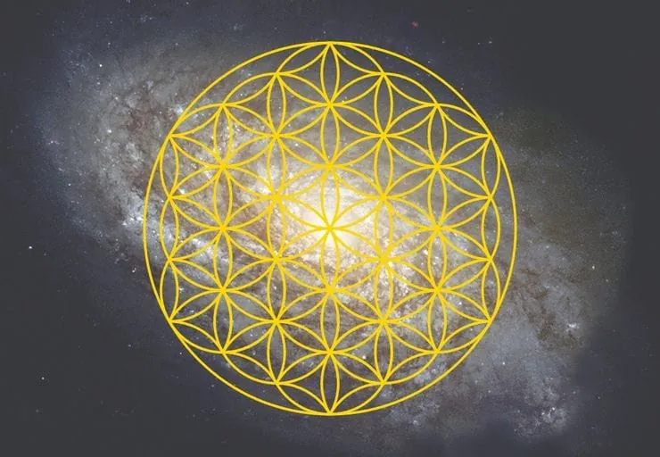

六角色演化顺序：从自我到文明的幸福旅程

# 六角色演化順序

隨著時間演化、影響力擴大，角色定位也會隨之轉換

1

## 🌀幸福原型者

起點：所有改變必須從自己開始。

行動：以自身實踐幸福，成為範例與活案例。

意義：奠定「幸福不是理論，而是可以活出來」的基礎。

2

## 🎨幸福設計師

第二步：把「個人的幸福經驗」轉化為可傳播的設計、課程、活動。

行動：設計餐桌體驗、教育課程、幸福模組。

意義：將抽象的幸福轉化成具體的模型，讓他人能複製與學習。

3

## 🕸️幸福織網者

第三步：不再只是個人或單點設計，而是把人與資源編織成網絡。

行動：連結不同社群、學校、組織，形成幸福網絡。

意義：幸福從單點轉為系統，開始具備「生態」特質。

4

## ⚡幸福催化師

第四步：當網絡形成後，需要加速影響，突破臨界點。

行動：發起跨界合作、推動創新計畫、引爆變革。

意義：讓幸福快速擴散，形成群體共鳴。

5

## 🧭幸福航行者

第五步：當系統加速後，需要有人指引方向，避免迷失。

行動：成為引導者，導航幸福文明的未來航線。

意義：角色由「推進」轉為「引領」，帶領集體探索新境界。

6

## 🌌幸福願景師

終點（同時也是新起點）：把幸福推向文明高度，提出全球願景。

行動：提出「幸福文明論」、參與國際論壇、影響政策與文明框架。

意義：角色完成從「個人原型 → 全球願景」的進化。

## ⏳ 演化路徑總覽

原型者：活出幸福

→

設計師：設計幸福

→

織網者：連結幸福

→

催化師：加速幸福

→

航行者：導航幸福

→

願景師：文明幸福

## 🌱 簡單一句話：

角色演化就是從「自我 → 模型 → 網絡 → 加速 → 導航 → 文明」的循環。

