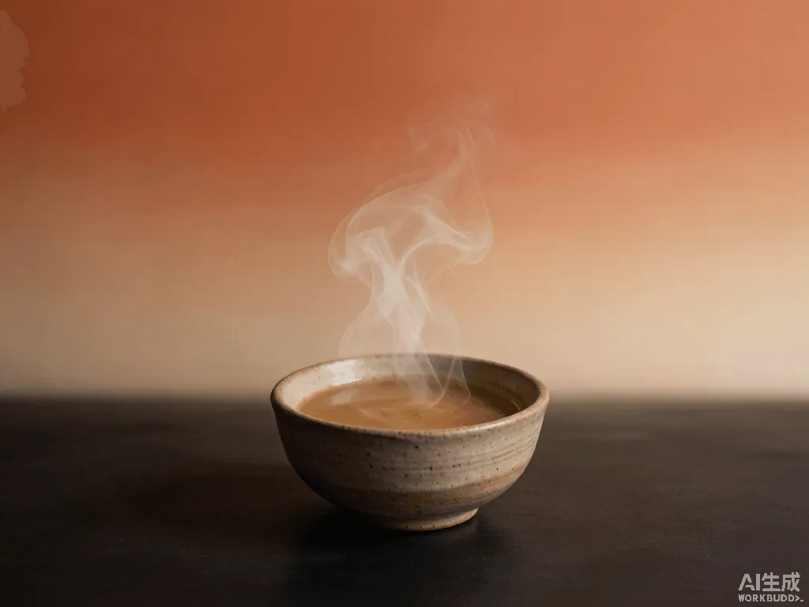
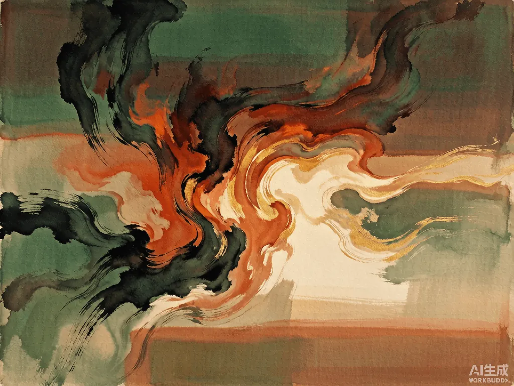
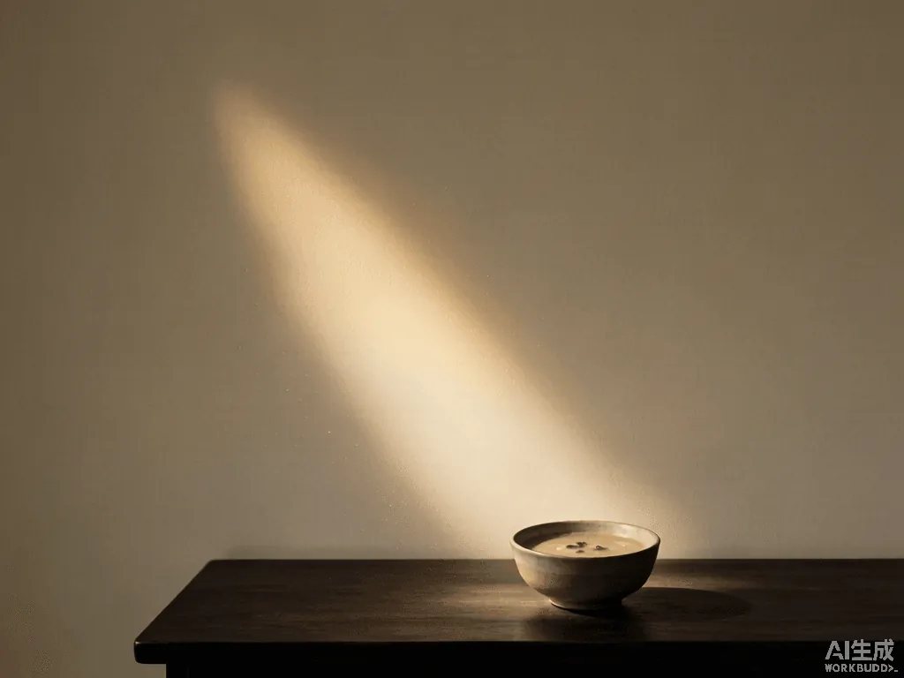

幸 福 生 活 · HAPPY LIVING

# 在一間永遠著火的廚房裡，找一口溫的湯

寫給《大熊餐廳》——混亂不會結束，但幸福是牆縫裡漏進來的光。

追完《大熊餐廳》那晚冒出來的念頭：如果混亂是拿不掉的，那藏在混亂縫裡的那點幸福，到底算不算是種溫柔。

## 01那間永遠著火的廚房

那間芝加哥的小店，鏡頭一進去就讓人喘不過氣。爐火轟轟、蒸氣糊了整面牆、金屬鍋鏟撞得叮噹亂響，訂單像雪片一樣卡上那條永遠清不完的軌道，每個人都在對彼此吼「Yes, Chef」。手持鏡頭晃得人心慌，像是有誰抓著你的後領，把你整個人按進那口正在沸騰的鍋裡。

看的時候會有種熟悉。那不是廚房，那是生活。帳單、家人、沒說出口的話、突然響起的電話——真實的日子，也很少給人一個乾淨、安靜、萬事俱備的起點。而這部戲最誠實的地方，就是它從頭到尾，都沒打算騙你混亂會結束。它不會結束。這是先得認的第一件事。

Carmy 那口鍋為什麼老在滾？因為他在乎。在乎那盤菜、在乎死去的哥哥、在乎這間裝滿家族傷口的店。一個人手忙腳亂的程度，往往正比於他把多少東西放在了心上。真正什麼都不在意的人，廚房是安靜的——安靜得像沒有人活過。

於是混亂有了它的幾張臉。一張臉是時間。軌道上的單子永遠比手快，做完一張又來三張，人被推著跑，連喘氣都像偷來的。一張臉是隨時會炸。水管會爆，電閘會跳，爐子上的火說翻臉就翻臉，一間店像是永遠只離災難一秒鐘。還有一張臉，是人和人的碰撞。Richie 的刺、Carmy 的執拗、每個人身上都背著各自的委屈，一到那個窄小的廚房裡，就砰砰地撞在一起。

再往裡看，最燙的那張臉根本不在鍋裡，在心上。哥哥留下的空位、還不完的債、那句「你為什麼要走」——這些傷口也一起在湯裡滾著，看不見，卻最灼人。幾張臉湊在一起，混亂其實只給人三種感覺：快、燙、吵。快到停不下來，燙到碰一下就縮手，吵到聽不見自己。

永遠著火的廚房，是一面又快又燙又吵的牆

· · ·

## 02牆縫裡漏進來的光

可就在這面又快又燙又吵的牆上，光是從縫裡漏進來的。戲裡最動人的，從來不是什麼大功告成的時刻，是那些被混亂擠出來的、細細的縫。這份細膩的感受是最吸引我的。

Marcus 一個人待在角落做甜甜圈，把外頭的喧囂關在門外，指尖沾著糖霜，神情安靜得像在禱告。那一刻，快被他過成了慢。

> 「幸福不必等混亂結束才開始——它就長在混亂還沒收拾好的旁邊。
>
Sydney 第一次端出一道連自己都滿意的菜，沒有歡呼，只有一瞬間、不敢張揚的驕傲。灼人的那股熱，忽然變成了暖的。Richie 在高級餐廳實習那集，一個原本沒有出口的中年男人，終於摸到自己「為什麼還在這裡」，開著車，放著歌，又哭又笑。那個一直在跟世界頂嘴的人，第一次跟自己和解。

還有那頓「員工餐」。打烊了，累到骨頭裡，一群人卻圍坐下來，一起吃一頓不必表演、不必趕的飯。吵了一整天的人，這時候安靜地把湯遞給彼此。這些都是幸福，只是很輕、很淡，不會出現在慶功的照片裡。它們是牆縫裡漏進來的一道光，不刻意去接，一轉身就錯過了。

打烊後圍坐的員工餐，安靜地把湯遞給彼此

讓這群人撐下去的，從來不是他們解決了所有問題，是他們學會了在問題和問題之間，好好呼吸一次。

· · ·

## 03Corner，別撞上了那點微溫的幸福

順著看下來，那面牆上真正在鬆動的，也不是混亂本身。是他們慢慢長出來的一點點秩序——傳菜時喊一聲「Corner」，提醒同伴我來了、別撞上；一句「Behind」，一句「Heard」。在那樣的兵荒馬亂裡，這幾句短短的暗號，是他們對彼此最溫柔的約定。它不讓風暴停，只讓人在風暴裡，站得住。

於是快慢慢被過成慢，燙慢慢退成暖，吵裡漸漸聽得見靜。

到後來，Carmy 最大的長進，並不是他終於馴服了那口鍋。是他總算明白過來：要是幸福的條件，非得等「一切完美、全在掌控之中」，那他這輩子都不會幸福。追求完美的那道牆，曾經差一點就把他和身邊每一個人，隔在兩邊。

混亂不是一個等著被修好的錯誤。它是生活的原始碼。而那點微妙的幸福，也正因為是從混亂裡長出來的，才那麼真、那麼經得起。

這部戲沒有承諾誰風平浪靜。它承諾的，比那個實在得多——混亂會一直在，這是真的。可它從不是要你先清空一切、才准許你快樂的通行證。就算在最燙手的廚房裡，一口溫的湯，一頓不趕的飯，依然可能。而且往往，就在下一個轉角。

Corner。小心，別撞上了那點正走過來的、微溫的幸福。

在這個美劇中，感受到生命在混亂中所自然萌生的溫柔，我們的人生何嘗不是如此，熱熱火火、安安靜靜、吵吵鬧鬧，也如此歲月靜好。

— 幸 福 生 活 —

簡家旗 · 幸福生活的作者，陪你看見關於自己
