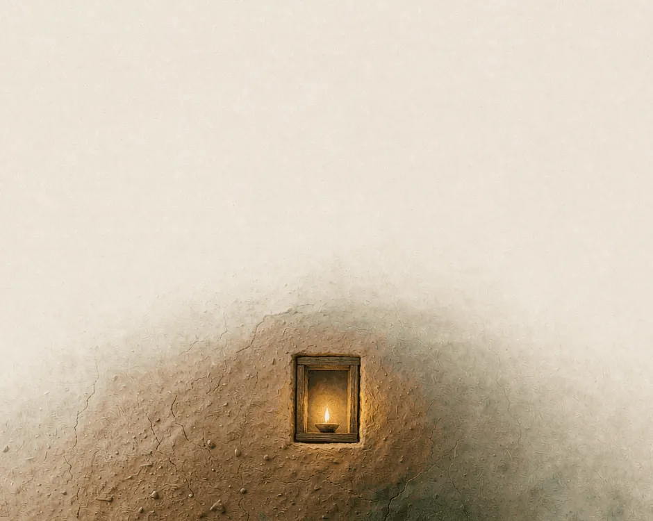
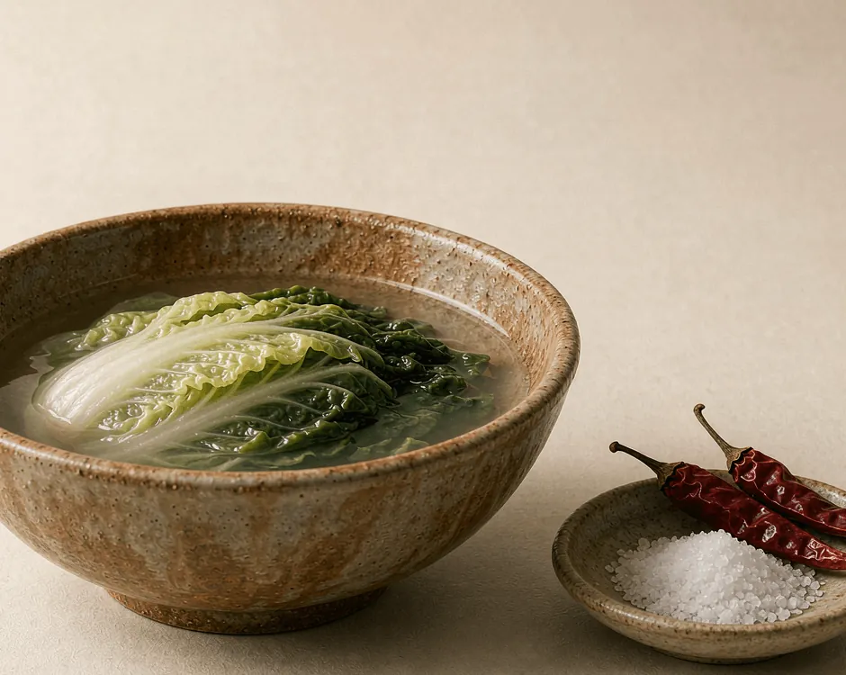
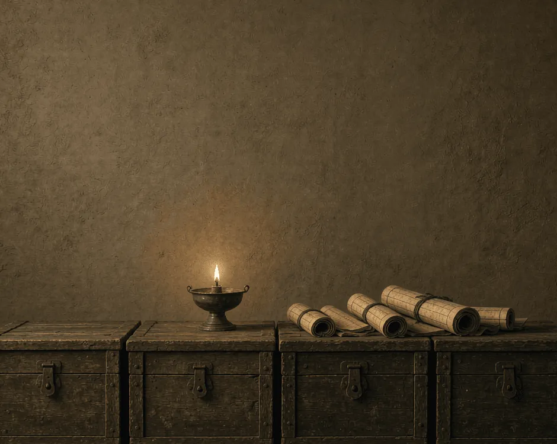

幸 福 生 活 · HAPPY LIVING

# 豆腐叫白肉，螞蚱叫蝦米，聞一多把苦日子過成了詩

窮到吃豆渣的那些年，他把糙米、炸塌的牆和一隻煤油桶木箱，都過成了體面的樣子。美不是裝飾，是撐住人的東西。

昆明有一戶人家的飯桌上，最上等的一道菜叫白肉。那不是肉，是豆腐。

一家八口，教授的薪水領回來，十天半個月就見底。飯桌上常年三樣，炒蠶豆、清水煮白菜、蘿蔔。孩子後來回憶，那幾年不知道肉是什麼味道。買回來一點豆渣，和白菜煮一鍋，他給這鍋東西取名叫「一鍋煮」。田裡捉來的螞蚱，到了桌上算蝦米。

一碗清水煮白菜，旁邊一小碟鹽巴

這個人叫聞一多。寫《紅燭》和《死水》的那一位，也是幾年後在昆明街頭倒進血泊裡的那一位。這一篇想說的不是那些，是他怎麼跟窮相處。

## 01一 飯桌上的三個名字

窮這件事，他沒藏著。飯桌上最常聽到的三個詞是白肉、蝦米、一鍋煮。東西沒變，稱呼變了。稱呼一變，吃的人跟這盤菜的關係就變了。

陳家營那陣子，一家人吃最便宜的糙米，裡頭盡是沙粒和稗子。為了省油，煮的多，炒的少。他常常就著燒乾辣椒蘸鹽巴吃飯，咬一口辣椒，扒一口飯，一頓就過去了，還跟孩子說豆腐有營養，讓幾個小的多吃，自己很少動筷子。

鹽巴辣得慌，米裡硌牙，日子照過。名字改了，苦還是苦，只是苦不再長著一張灰撲撲的臉。

## 02二 當掉的東西

後來實在撐不住，幾部線裝書忍痛賣給清華圖書館。交書那天他說了一句，將來回北平還要贖回來。

狐皮大衣也拿去寄賣。回家就打噴嚏、發燒，妻子埋怨了一頓，讓長子把大衣追了回來。

再後來，他給兄長的信裡寫過一段實話。前兩年常在斷炊的威脅裡過日子，先去中學兼課，還是不夠，經朋友慫恿，才掛牌刻圖章補。最近三分之二的收入，靠這個。

一句抱怨也沒有。都是在交代怎麼想辦法。

## 03三 換屋簷

文法學院從蒙自遷回昆明，一家人在小西門內福壽巷姚宅落下腳。他在給妻子的信裡寫，昆明的房子又貴又難找。

第二年開春，搬到滇池南端的晉寧北門街。夏末搬去華山東路節孝巷，跟胞弟聞家駟、詩人馮至兩家做了鄰居，巷口對面五華山坡下挖著一座防空洞，警報一響，幾家人一起往洞裡跑。

入冬以後，空襲越發密，搬去西北郊大普吉村，住在一間大車店的樓上。太擠，年關將近又搬到陳家營楊家宅院。

再開春搬到谷堆村，秋天再搬進龍泉鎮司家營的清華大學文科研究所。後來受聘昆華中學，又搬到大西門外。再後來開春，西倉坡的聯大教職員宿舍蓋好，一家人才喬遷，那是一間二十平方米出頭的土坯牆平房，還得在教授們裡頭抽中籤才輪得到。

從踏進昆明到倒下，那些年，屋簷一直在換。

屋子一直在換，有幾樣沒換。家具是沒有的，四隻裝煤油的木箱拼一拼，改成了寫字桌。後來搬到司家營的文科研究所，書桌換了一塊縫紉用的案板。

四隻木箱拼成的寫字桌，一盞小油燈

那年深秋，數學家華羅庚的住處被炸垮，一家六口無處可去。他騰出正房，讓兩家人住到一起，中間沒牆，掛一條布簾隔開。聞家八口加華家六口，十四個人，一間屋。華羅庚後來寫了兩句詩，掛布分屋共容膝，豈止兩家共坎坷，布東考古布西算，專業不同心同仇。就在那條布簾旁邊，華羅庚寫完了《堆壘素數論》的書稿。

樓下牲口棚的味道飄上來，他教孩子念杜甫。安得廣廈千萬間，大庇天下寒士俱歡顏，風雨不動安如山。念到這兒，孩子抬頭看了看頭頂的樓板。

## 04四 警報

初秋，昆明第一次挨大轟炸。警報響起的時候，小兒子還在城裡的學校，他跑出去找，半路上被震落的牆磚砸中頭部，血流滿面，長衫前胸染紅了一片，縫了幾針。

還有一次，全家人躲進院子裡的防空洞，一枚炸彈就砸在洞前，洞裡的人都感到了震動。那是一枚臭彈，沒炸。全家又搬走。

搬到司家營之後，進城上課來回幾十里路，為了省車錢，他步行。夫人勸他坐馬車，他說走了幾千里，兩條腿練出來了，這點路算不了什麼。冬天為了省木炭，帶著幾個高高低低的孩子去河邊的冷水裡洗一把臉。

就在這樣的日子裡，他寫完了《楚辭校補》《神話與詩》《唐詩雜論》。

## 05五 餓著肚子的那一次

他在一份宣言上簽了名。為抗議美國政府扶植日本，拒絕領用帶有收買性質的美援平價麵粉，退還配購證。那一年昆明的米價已經漲到看不懂。

簽完名不到一個月，趕上那個下午。他一連幾天沒吃飽，是餓著肚子上的台。

> 「美不是生活的裝飾，是生活的責任。
>
## 06六 今天能做的一件小事

給眼下最難的那件事換個叫法。還不完的帳單先不叫帳單，叫這一關。名字一換，人跟它的距離就變了。

睡前關掉大燈，只留一盞。燈下那一小會兒，一天裡最不像在趕路。

手上正在做的活，不論多小，把它做完。洗碗就洗碗，擦桌子就擦桌子。手上認真，心才不慌。

這些動作還不了帳，也改不了處境。難的還是難。只是人在難裡頭，還留得住一點不粗糙的東西，日子就磨不到骨頭。

· · ·

那個夏天，他倒在離家十幾步的地方，身上沒有存款。

那些賣掉的線裝書，再也沒人回北平去贖。

今晚這頓飯，桌上那道菜叫什麼名字？留言裡說一句。

如果這篇讓人想起家裡那張桌子，轉給那個一起吃飯的人。

— 幸 福 生 活 —

簡家旗· 幸福生活的作者，陪你看見關於自己
