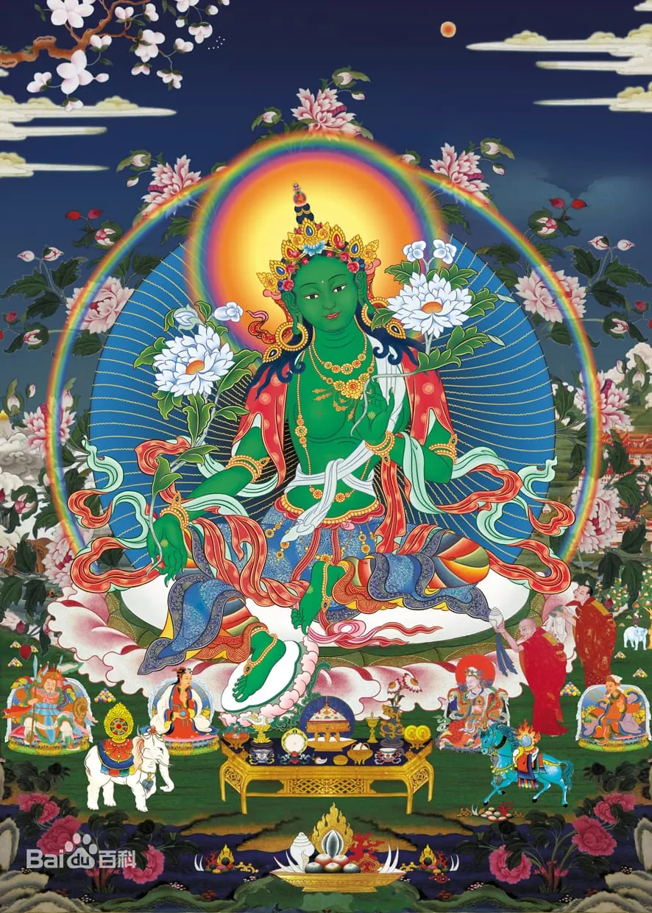
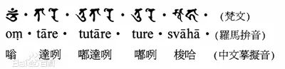
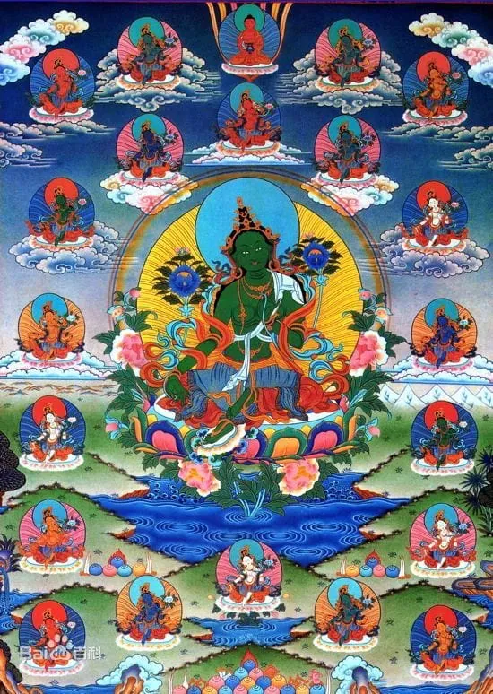
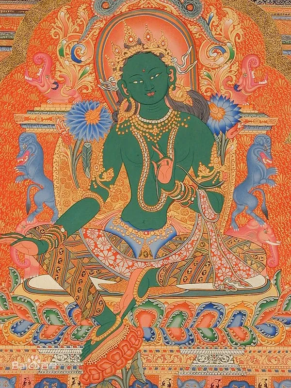

綠[度母](https://baike.baidu.hk/item/%E5%BA%A6%E6%AF%8D/2109825)為[觀世音菩薩](https://baike.baidu.hk/item/%E8%A7%80%E4%B8%96%E9%9F%B3%E8%8F%A9%E8%96%A9/169349)的化身。度母，梵名Tara，全稱聖救度[佛母](https://baike.baidu.hk/item/%E4%BD%9B%E6%AF%8D/2013832)。

[綠度母](https://baike.baidu.hk/item/%E7%B6%A0%E5%BA%A6%E6%AF%8D/6147435) [1]  為觀世音菩薩的化身。度母，梵名Tara，全稱聖救度佛母，我國古代稱[多羅菩薩](https://baike.baidu.hk/item/%E5%A4%9A%E7%BE%85%E8%8F%A9%E8%96%A9/5715522)、[多羅觀音](https://baike.baidu.hk/item/%E5%A4%9A%E7%BE%85%E8%A7%80%E9%9F%B3/5715869)。度母有許多不同的化現，包括有[二十一度母](https://baike.baidu.hk/item/%E4%BA%8C%E5%8D%81%E4%B8%80%E5%BA%A6%E6%AF%8D/7531511)、五百度母等等，皆為觀世音菩薩之化身，而綠度母為所有度母之主尊，總攝其餘二十尊化身之所有功德。

綠度母能救八種苦難，如獅難、象難、蛇難、水難、[牢獄](https://baike.baidu.hk/item/%E7%89%A2%E7%8D%84/3499439)難、賊難、非人難，又稱為“救八難度母”。同時，還能把稱為五毒的[人類行為](https://baike.baidu.hk/item/%E4%BA%BA%E9%A1%9E%E8%A1%8C%E7%82%BA/9050344)貪、嗔、痴、慢、疑中的“疑”轉成究竟圓滿的智慧，有護持婦女幼兒的功德。

## 心咒

綠度母心咒：“嗡。大咧。度大咧。度咧。斯瓦哈。”（梵文：Oṃ Tāre Tuttāre Ture Svāhā）。

漢字注音: ong, da lie, du da lie, du lie, suo ha

來自《[佛説大方廣曼殊室利經](https://baike.baidu.hk/item/%E4%BD%9B%E8%AA%AC%E5%A4%A7%E6%96%B9%E5%BB%A3%E6%9B%BC%E6%AE%8A%E5%AE%A4%E5%88%A9%E7%B6%93/23159140)》

## 本尊

為了調化所有女性者，阿彌陀佛左手發出綠光化現為聖者至尊度母，度母又幻化出百俱胝的度母，於[無量](https://baike.baidu.hk/item/%E7%84%A1%E9%87%8F/33326)無邊的世界中度化眾生。

很久以前彩光王國有一位慧月公主，她從小虔誠信奉觀音如來，經過一千萬億年的供養與修行，她終於證悟了勝義諦。許多僧人勸她以男身來度化眾生，但慧月公主拒絕了他們的要求，她説：以前的許多修行人都發願以男身成佛度化眾生，但我願意以女身成佛利益眾生。又經過漫長時日的苦行，她終成正果，名號為度母。

綠度母，是一位救世大菩薩，她坐在白色的[蓮花座](https://baike.baidu.hk/item/%E8%93%AE%E8%8A%B1%E5%BA%A7/9923910)上，依其本誓，是觀世音菩薩因慈悲天下眾生，傷心時掉下眼淚的[變化身](https://baike.baidu.hk/item/%E8%AE%8A%E5%8C%96%E8%BA%AB/9950663)，所以是最慈悲的。

《佛説大方廣曼殊室利經·觀自在菩薩授記品》中説：度母是從觀世音菩薩眼睛所放光明流現出來的。

《綠度母頌》記載：二十一度母是綠度母的不同事業所化現的佛母，綠度母則是二十一度母所有功德的總攝聚集。

《度母本源記》記載：觀音菩薩在[無量劫](https://baike.baidu.hk/item/%E7%84%A1%E9%87%8F%E5%8A%AB/9945944)前，已普救了無數眾生，可是有一天，菩薩用她的慧眼觀察六道，發現受苦的眾生並未減少，頓生憂悲，雙眼流出眼淚，眼淚變成了蓮花，蓮花又變成了綠度母，接着又變出了二十一尊度母。

相傳，[白度母](https://baike.baidu.hk/item/%E7%99%BD%E5%BA%A6%E6%AF%8D)和綠度母是觀音菩薩的兩滴眼淚所化現，綠度母是觀世音菩薩右眼眼淚所化。大悲觀世音菩薩無量劫來救度眾生，但是眾生仍然常溺[五欲](https://baike.baidu.hk/item/%E4%BA%94%E6%AC%B2/19785561)生死苦海、輪迴六道受無量諸苦，菩薩因為悲憫蒼生而不由得悄然落淚，當此之時左眼的眼淚頓時變現出白度母，右眼的眼淚變現出綠度母，各自合掌恭敬向觀音菩薩同聲説道：“菩薩，您不要擔心，我等誓度一切流轉生死苦海的眾生，為菩薩分擔救度眾生的悲願。”因此，度母是觀音悲淚的化身。

## 形象

綠度母造像為菩薩裝，全身呈翠綠色，是佛的事業部之色，亦即[不空成就佛](https://baike.baidu.hk/item/%E4%B8%8D%E7%A9%BA%E6%88%90%E5%B0%B1%E4%BD%9B/4680988)之身色。一面二臂，面容姣好，二八妙齡，身材纖細，美貌絕倫。頭戴小五佛寶冠，身子放射出虹光，身佩各種瓔珞珠寶，着各色天衣，下身重裙，其形象華貴美麗，慈祥莊嚴。

綠度母坐菩薩座於蓮花月輪上，雙腳屈左展右，左腿單坐，右腿向下舒展，踏在蓮花上表示隨時準備起身救度苦難眾生，如慈愛的母親一般，拯救鍾愛的孩子；

右手持烏巴拉花（藍蓮花），向外置於膝前，掌心向外，作施願印，此印有施予、[令如願](https://baike.baidu.hk/item/%E4%BB%A4%E5%A6%82%E9%A1%98/23011848)、賜護及普度的意義，象徵施予一切眾生無畏、慈悲滿願；

左手亦拈支盛開着的烏巴拉花（藍蓮花），置於胸前作[三寶印](https://baike.baidu.hk/item/%E4%B8%89%E5%AF%B6%E5%8D%B0/717219)，其豎起的三指的食指表義佛寶，中指表義法寶，小指表義僧寶。拇指及[無名指](https://baike.baidu.hk/item/%E7%84%A1%E5%90%8D%E6%8C%87/2957)碰觸着，表義悲智雙運；

左右手各拈的兩朵蓮花，都延伸至度母的肩位。在莖的頂端，各有一果實、一盛開之花及一未開之[花蕾](https://baike.baidu.hk/item/%E8%8A%B1%E8%95%BE/58703)。果實表義以[迦葉佛](https://baike.baidu.hk/item/%E8%BF%A6%E8%91%89%E4%BD%9B/2213830)為首的過去諸佛，盛開之花表義世界的釋迦牟尼，未開之花蕾代表以彌勒為首的未來佛，所以它們均意味着未來、現在、過去三世均是如此的依止着佛法的誓願而行。

本尊心咒具足一切息增懷誅之功用，消除一切眾生的煩惱痛苦、滿足一切眾生願求，現世富貴長壽平安吉祥、除諸病苦業魔障礙等，幫助眾生解脱生死苦海，命終往生極樂世界，獲得究竟的安樂，因為其救度之迅速、摧滅魔業之勇猛，故又稱作「救度速勇母」。

[audio](https://hii.hdv.mybluehost.me/wp-content/uploads/2024/04/徐清原-少女快樂咒（綠度母心咒吟唱短版）-Hsu-Ching-yuen-Young-Girls-Mantra-of-Joy-the-Green-Tara-mantra-.mp3)

[進一步資料請參考百度百科](https://baike.baidu.hk/item/%E7%B6%A0%E5%BA%A6%E6%AF%8D%E5%BF%83%E5%92%92/82827)
