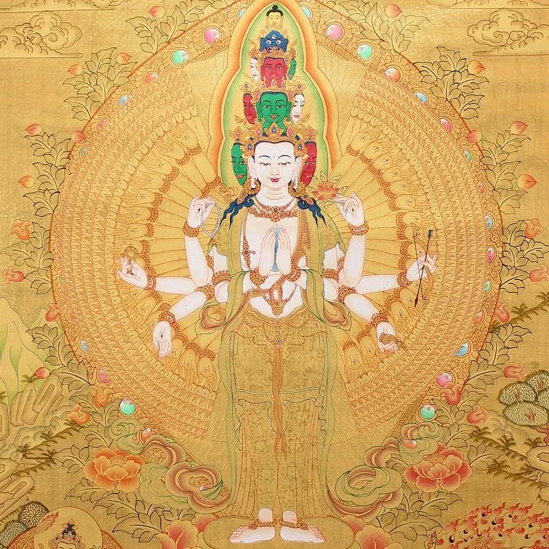

2025年7月13日

農曆六月十九

恭迎觀世音菩薩成道吉日

.

觀音菩薩的出家因緣 ──妙善公主的故事傳播廣、影響大

1、出生

古時候有個國家的皇帝，名為妙莊王，他有三個女兒，長女妙緣、次女妙音、三女兒妙善。妙善公主就是觀音菩薩示現，傳說妙善公主在農曆二月二十九出生，一出生便現莊嚴寶相，因而取妙善為名，表示妙相善行之意。

2、拒嫁

妙善公主生性聰明伶俐，篤志行善。聰慧美麗的她不學描龍繡鳳，而在宮中秘修禪事。等到了出嫁的年齡，兩個姐姐都找了門當戶對的夫婿，唯有妙善卻死活不願意結婚，還說要出家削髮為尼。

3、出家

妙莊王對此極為震怒，把妙善公主關了禁閉，還斷了飲食供給，希望逼迫妙善公主就範。沒想到妙善公主反而覺得此為清靜修為的好時候，反而更加專心修行。妙莊王沒辦法，便在農曆九月十九假意將妙善公主送到了一家寺院出家，想讓寺院住持刁難妙善公主，讓她知難而退。顯然，這一招也不會管用。妙善公主將每一個困難都當作修行的道場。住持沒辦法，便如實稟報給了妙莊王。

4、妙莊王施惡

妙莊王見妙善公主「死不悔改」，一怒之下火燒寺院，欲將妙善公主逼出寺院。沒想到卻將妙善和五百比丘尼全部燒死在寺中。但是，妙善公主卻沒有死，有的傳說她從寺院的密道中逃走，有的傳說她被龍王/山神復活。不管如何，妙善公主此後便隱居深山修行。

5、妙善救父

妙莊王火燒寺院卻不慎「燒死」了女兒，痛苦不已，此後又過了好幾年，妙莊王突發怪病，久治不愈，需用未出嫁的親骨肉之手眼做藥才能治好。妙善此時已有一定修為，得知此事後，為報父母養育之恩，毅然挖下自己的雙眼，砍下自己的雙手，製成藥丸，化身仙人去送藥救活了父親。

6、成道

妙善公主不記前仇、捨己為人的慈悲之心感動天地，妙莊王也叩拜天地呼籲，求妙善能重長手眼。此時，妙善公主突然金光大作，不僅手眼恢復如初，更是長出了千手千眼。這一天，就是農曆六月十九。從此，妙善公主就成了眾所祈求的千手千眼觀世音菩薩。

頂禮、供養、應供正等覺 南無大慈大悲觀世音菩薩

