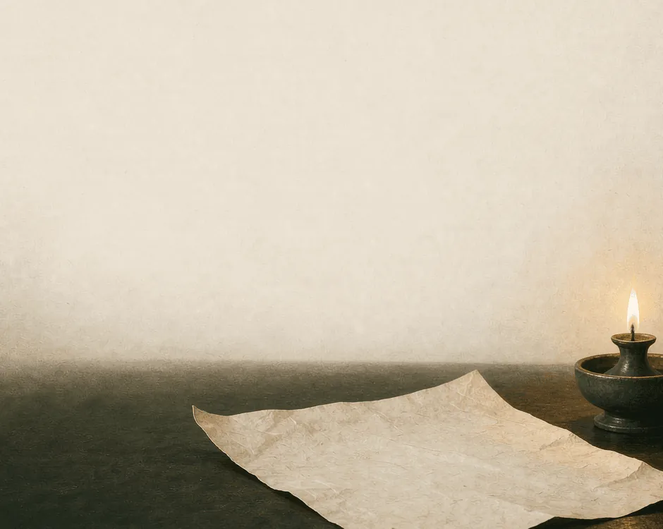
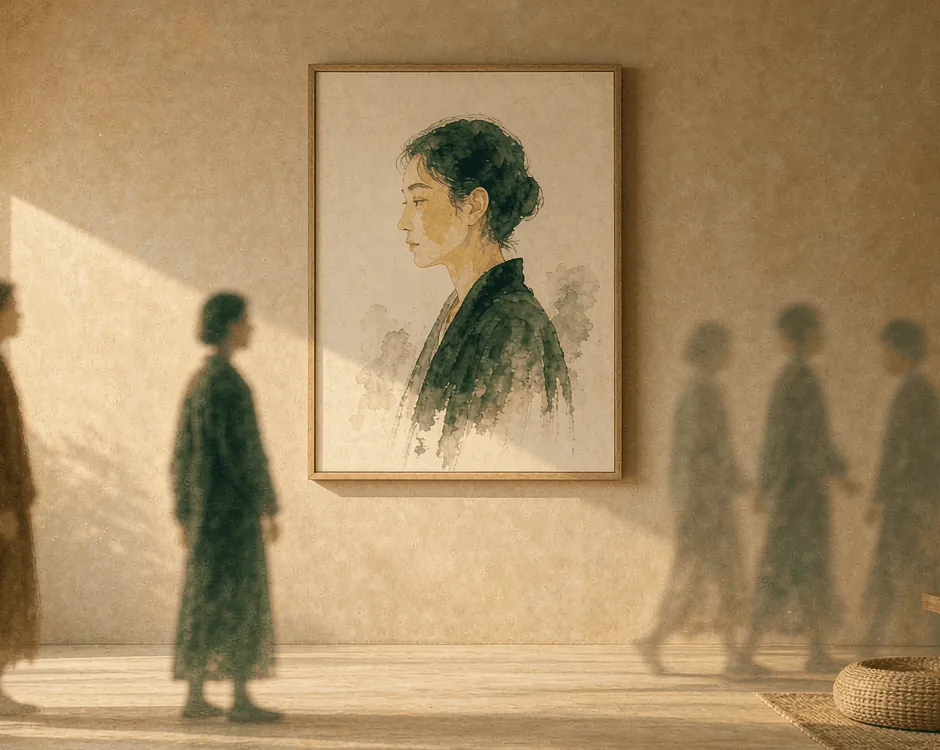

幸 福 生 活 · HAPPY LIVING

# 窮到吃豆渣，還寫「我的心肝」，聞一多的浪漫藏在細節裡

他會在廣場上拍案而起，也會在信裡寫「我的肉，我的心肝」。最硬的骨頭，往往長著最軟的心腸。

那年夏天，一位教授獨自留在北平的家裡，妻子帶孩子回了湖北探親。夜裡，他寫下這樣一封信。

親愛的妻，這時他們都出去了，一個人在屋裡，靜極了，靜極了，在想你，我親愛的妻。不曉得自己是這樣無用的人，你一去了，就同落了魂一樣，什麼也不能做。

寫信的人叫聞一多。幾年後他在昆明的追悼會上拍案而起，又在當天下午倒在家門口的血泊裡。人們記住的多半是後一個他。

這一篇想留一下前一個。

## 01一 從鐵鏈到心肝

這門親事是父母定的，還是遠房姨表親。成婚那年，蜜月裡他沒怎麼進洞房，悶頭寫了兩萬多字的《律詩的研究》。家書裡抱怨，那個新家庭是捆手捆腳的鐵鏈，活一天算一天罷了。

後來的走向卻出乎意料。他做了一件當時男子很少做的事，力勸父母送妻子進武昌女子職業學校念書。赴美之後仍一封封寫信叮嚀學業，舉美國女詩人的例子，說女人並不是不能造大學問大本事，中國女人又何嘗不是這樣。

赴美的第一個冬天，他用五天寫下一組四十二首的《紅豆》，寄給新婚的妻子。裡頭有甜的，也有苦的。寫兩個人像被鞭絲抽攏又抽散的伙伴，寫相見那一天若掉下一滴苦淚，別驚訝，那是生了鏽的熱情。末尾兩句最狠，有酸的有甜的有苦的有辣的，豆子都是紅的，味道卻不同，甜的呢，啊，甜的紅豆都分送給鄰家作種子罷。

十幾顆紅豆散在米白紙上

妻子果然讀了書，學會了寫信。兩個人隔著大洋，一封一封，把話說開了。

過了十幾年，同一支筆寫出的是另一路話。信裡有「我的肉，我的心肝」，也有一句「我不怕死，只要我倆死在一起」。他還跟同事自嘲過，前回罵一個學生為戀愛問題讀書不努力，今天才知道自己也一樣。

從鐵鏈到心肝，中間隔的不是運氣，是兩個人一起把日子重新做了一遍。

## 02二 一年裡寫出去的那些信

那年秋天，他獨自去長沙任教，妻兒留在北平，分開近一年。那一年寫信的頻率高得不像一個忙人。

初到長沙那晚就寫信，五個孩子一個一個問到。隔幾天又寫，抱怨出門快一週還收不到家信，問小女兒的病究竟如何，說鶴和雕都能寫信，小弟和大妹也能畫圖寫字，怎麼不寄點來看看。再過幾天再寫，說現在哀求速來一信，可憐這顆心並非鐵打的。

孩子的塗鴉被當寶貝。長子的信寫得好，拿去給朋友看，賺一圈讚美。次子不寫，就追問，難道一出門就把人忘了嗎。信寫得通順了，字跡整齊了，他高興得說今天非多吃一碗飯不可。

到了開春，學校再遷昆明，他參加學生步行團，從長沙一路走到昆明。出發前在家書裡寫上次離家的情形。那天動身時孩子都睡著了，想把他們一一叫醒，說一聲人走了。叫到小弟，話音沒落，喉嚨管硬了，說不下去，大妹就沒叫。一上轎子，眼淚下來了。四十歲的人，何以這樣心軟。

那個在台上說話不留餘地的人，在孩子面前是這樣一副心腸。

## 03三 軟不下去的那一段

那年冬天，五歲的女兒立瑛病夭。他從上海趕回浠水，晚了，只看見一片墓草。

葬完之後寫《也許》，整首詩不提死字，只說睡。不許陽光撥你的眼簾，不許清風刷上你的眉，無論誰都不能驚醒你，撐一傘松蔭庇護你睡。後來又寫《忘掉她》，反反覆覆念，忘掉她，像一朵忘掉的花。念得越勤，越忘不掉。

浪漫這兩個字，裝不下這種東西。可是若不叫浪漫，又叫什麼呢。

## 04四 那一天

那年夏末，昆明籠罩在白色恐怖裡。長子立鶴收到一封恐嚇信，寫著如不悔改，你父子命在旦夕。他把信收起來，沒跟家裡任何人說。

那個下午，他開完記者會，立鶴去接父親回家。走到離家還有十幾步的地方，槍響了。十九歲的兒子撲上去，伏在父親身上。子彈沒停。右腿大腿骨打碎，右肺貫穿，一顆子彈離心臟半寸。

被抬走的時候，立鶴短暫醒過一次，眼睛沒睜開，嘴唇動了動，問的是，我爸沒事吧。

十三歲的女兒聞銘跑到門口，看見父親和大哥倒在血泊裡。幾個人抬也抬不動，拖也拖不動，周圍站著的人，沒有一個敢伸手。後來家人硬拉住一位黃包車夫，借了一副行軍床，才把人送進醫院。她站在旁邊，看著父親的血一滴一滴滴到甬道上，流進花壇裡。

她後來縫了兩個布袋，一個裝父親身下的血土，一個裝大哥的。她說，這樣父親就永遠和她們在一起了。

## 05五 她的那一份

妻子手製菸絲。逢鄉下趕集買嫩菸葉，噴上酒和糖水，切成絲，滴幾滴香油，溫火慢慢烘炒。他抽菸喝茶，物價飛漲時下決心戒菸，她不肯，說一天那麼辛苦，就這點嗜好，再難也要把菸茶錢省出來。

住在昆華中學的時候，夫婦倆在門前空地開荒種菜，吃不完還送人。有一回大雨成澇，番茄鬧了病，他特地請同在聯大的植物學家吳徵鎰來瞧，兩個人蹲在地頭看蟲子。

後來傳出黑名單，有人來勸避一避。他說，事已至此，不出則諸事停頓，何以慰死者。妻子知道勸不動，哭著叮嚀小心。

槍響那天，她從屋裡衝出去，撲到丈夫身上，渾身是血，當場心臟病發作。第二天，旁人發現她鬢角的頭髮白了一片。

幾年後她改名叫高真，帶著幾個孩子穿越國統區，投奔解放區。晚年她一個人把幾個孩子拉扯大。

> 「浪漫不是紀念日的一束花，是幾十年裡把一個人放在心上，沒放下來過。
>
## 06六 今天能做的一件小事

寫一句話給那個人。不用長，就寫今天看見的一件小事。寫不出口的，寫在紙上放著也行。

替對方做一件他每天做的雜事。倒垃圾、收衣服、把藥片擺好，做一次就夠，不必聲張。

約一個固定的鐘點，每天問一句今天怎麼樣。問的人不用多說，被問的人會記住那個點。

把對方常掛嘴邊的那句口頭禪，今晚學著說一次。家裡有回聲，人才不孤單。

這些動作不解決什麼大問題。只是日子一天一天過去，總要留下點證據，證明這段關係被人認真對待過。

· · ·

又過了半個世紀，澳門回歸那一年。最小的兒子聞立鵬在自己的畫室裡給父親設了個靈堂。沒有素縵，沒有孝帳，滿屋子顏色，生氣勃勃，中間掛著一幅父親的油畫像，畫的還是父親剃掉長鬚的那張照片。

滿屋子顏色，牆上掛著一幅肖像

那一天，聞家幾代人聚在那裡，唱《七子之歌》。

那封信的末尾還有兩句，這些算了我贖罪的菲儀，這些我跪著捧獻給你。

今晚想給誰寫一句話？留言裡說一句。

如果這篇讓人想起某個人，轉給他，往後一起慢慢過。

— 幸 福 生 活 —

簡家旗· 幸福生活的作者，陪你看見關於自己
