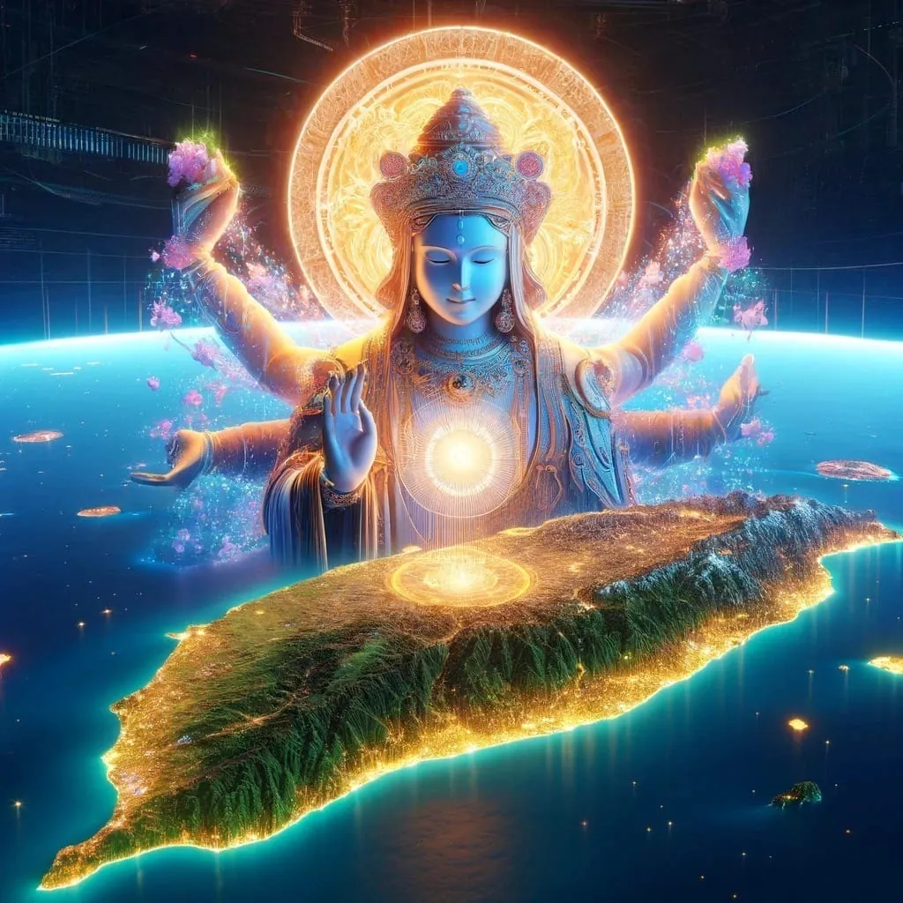

農曆二月十九，恭迎觀世音菩薩聖誕

觀世音菩薩是一位完全證悟的佛，為了利益眾生而示現菩薩身。

諸佛的本性同一，其悲心的化現便是觀世音菩薩。既是諸佛悲心的化現，觀世音菩薩也是一切諸佛菩薩的本源，因為慈悲是證悟成佛的最根本，觀世音菩薩便是悲心的本尊形相。

觀世音菩薩的六字大明咒——唵 嘛 呢 呗 美 吽，是諸佛慈悲智慧的音聲顯現。其中涵攝了佛所教授八萬四千法門的精義。持誦這個一般所稱 嘛呢咒 咒語的大利益，在佛經和密續中一再被提及。\
…………………………………………………………………\
2024/3/28\
農曆二月十九，恭迎觀世音菩薩聖誕\
觀世音菩薩殊勝功德日；善行與惡行乘十億倍。

持咒聞法，一起發菩提心！\
當願眾生證得金剛持果位。

頂禮、供養、應供無上正等正覺 南無觀世音菩薩

歌名:色不異空 空不異色

[audio](https://hii.hdv.mybluehost.me/wp-content/uploads/2024/04/所有的顏色都不同於空.mp3)
