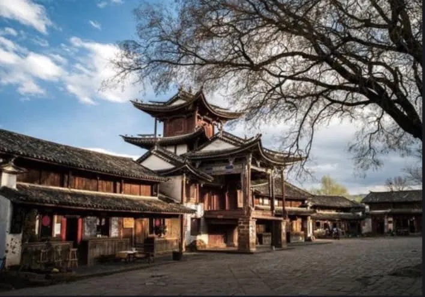

## -雲南大理

## [生命裡的幸福課](https://forms.gle/piAHfq3NeWFkTSap7)

在這接近盛夏之際,你是否也在尋覓內心的寧靜和幸福?

跟隨幸福導師[簡家旗](/關於我的故事/)老師 "生命裡的幸福課"之旅 。

領略大自然恩賜的永恆之美,探索真我的無盡可能。

在雲南大理-蒼山、洱海的湖光山色間,遺忘浮世的喧囂,靜心凝視生命的本真。

在沙溪古鎮的巷陌之間,聆聽歲月的低吟,走過心靈的禪意長廊。

當大自然的律動與內在的波瀾交融共鳴,幸福就在這一瞬間綻放。

這不僅是一場旅行,更是一次身心靈的重塑,一次將自我放逐又重新擁抱的心靈之旅。

在簡老師的引領之下,你將跨越重重障礙,突破自我的限制,最終感受到內心的幸福。

生命的意義不在於尋找,而在於體驗當下。\
幸福的本質不在於擁有,而在於心境的自在。

現在,就是與自我幸福相遇的最好時機,一同踏上"生命裡的幸福課"

這段清淨芬芳的生命之旅吧!

## 大理之 風、花、雪、月

中國文化裡，把人世間的美好事物所產生的浪漫情愫，用四個字形容——「風花雪月」。這個形容詞用來形容大理也很合適，因為在大理，「風花雪月」一詞都有對應的自然風景。「風」，是指大理終年不烈不寒的風，吹出了這裡的四季如春。「花」，指的是大理上關的草原壩子，每逢夏秋，到處鮮花爛漫。**「雪」是人們眼中的蒼山山頂的積雪。

「月」，則是寬闊清澈又波光粼粼的洱海，倒映的那輪明月。

「聽下關風，觀上關花，賞蒼山雪，望洱海月。」這是大理人最引以為傲的自然風光。「春有百花秋有月，夏有涼風冬有雪。若無閒事掛心頭，便是人間好時節。」在大理，最不缺的就是時間，還有被這裡風花雪月所吸引來的人。在被這裡的風花雪月、淳樸閒適的生活潛移默化地滋潤下，這些人也學會了大理「緩慢」的智慧，成為了一介「幸福的人」。

## 沙溪古鎮介紹

雲南大理沙溪古鎮被聯合國譽為「茶馬古道上唯一倖存的集市」，也是一個至今都純樸原始的真正意義上的古鎮。

如果說束河是10年前的麗江的話，那麼沙溪就是20年前的麗江，同樣的小巷、流水、四方街，這裡卻更加的古樸淳厚、原汁原味。這是一個以白族為主，漢、彝、僳僳族共居的少數民族居住地，一個被人們譽為「山美、水美、壩子美、姑娘更美的魚米之鄉和歌舞之鄉」。

漫步在古街的紅砂石板，登上古戲台，逛一逛四方街的鋪面和馬店，走一走黑潓江上的玉津橋，到興教寺感受各種流派佛教合而為一的寺廟，聽一聽沙溪洞經古樂，賞一次白族傳統的霸王鞭，跳一曲白族傳統的肖拉者舞，聽一曲沙溪姑娘唱的白族調，嘗一回沙溪土特產，茶馬古道上能有這樣一座古鎮保存下來，是一件幸事，也是一塊無價之寶。

玉津橋

玉津橋跨空12米，高6米，橋長35.4米，寬5米，石柱石板護欄。 拱頂上有石雕鼈頭，雄視黑惠江上游，另一側是石雕鼈尾連接黑湛江下游，護欄盡頭有四衹“娃娃魚”石雕。 古橋是世代居住在沙溪的白族人通往田間地頭勞作經商的必經之路，橋身的石板被過往車馬和行人踩踏得泛着青光，坑坑窪窪。

生命的意義不在於尋找,而在於體驗當下。幸福的本質不在於擁有,而在於心境的自在。現在,就是與自我幸福相遇的最好時機,一同踏上"生命裡的幸福課"這段馥郁芬芳的求道之路吧!

