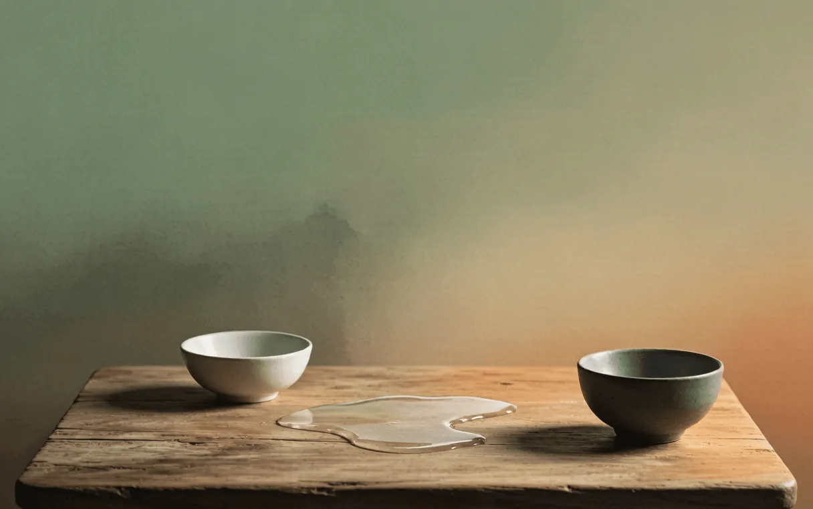
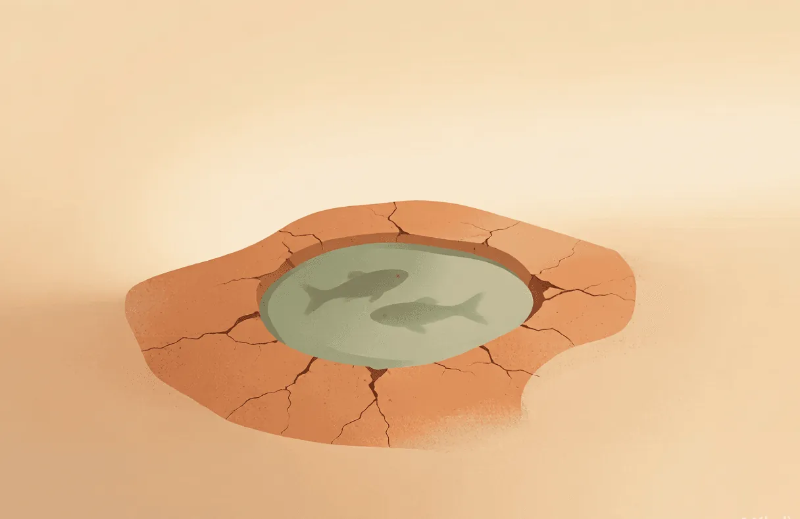
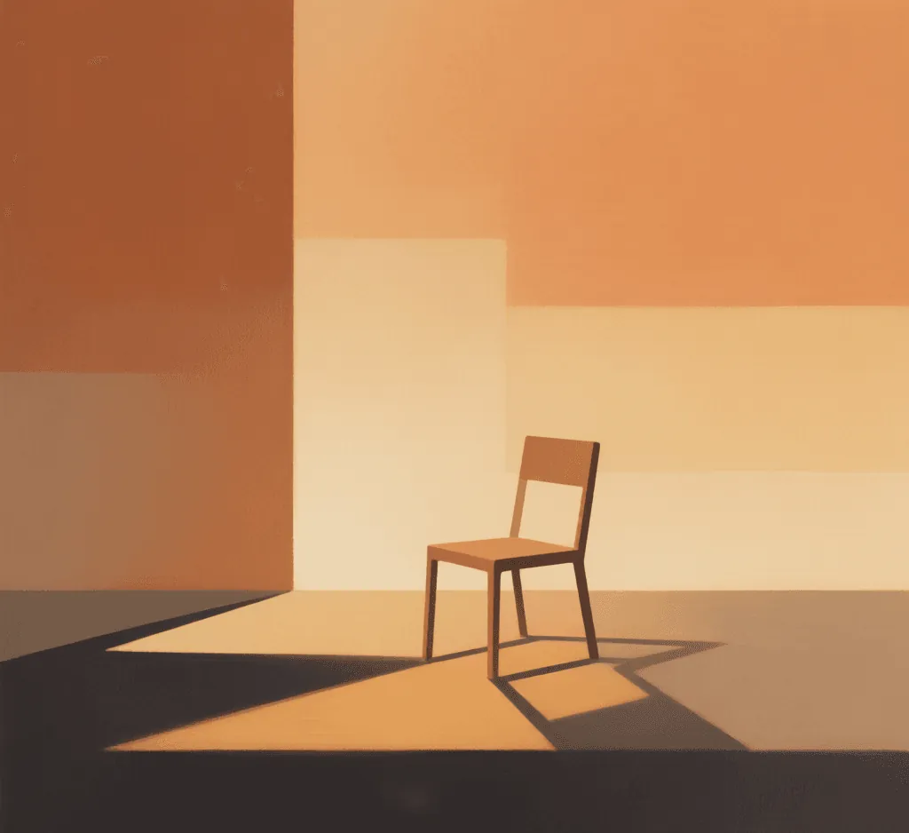

幸 福 生 活 · HAPPY LIVING

# 所謂相濡以沫，不如各自在江湖裡好好活

困頓裡互相緊抓，有時是一種消耗。鬆手，讓彼此回到各自的江湖，反而都活得好。

幸福餐桌的聚會上，有一對坐得近的客人。兩個人說話聲音很輕，手卻一直碰著杯子，像怕對方隨時會走。有人提起從前的難，另一個立刻接上，說記得記得，那時候的事都還記得。話說得密，桌上的菜倒涼了。

那畫面讓人想起一句老話。泉水乾了，魚困在淺淺的泥裡，彼此用唾沫潤著對方的鱗，好讓彼此別那麼快乾。這叫相濡以沫。聽起來很動人。可那句老話還有下半句，說與其這樣，不如各自游回江河湖海，在水裡忘了彼此。

> 「相濡以沫，不如相忘於江湖。
>

乾涸淺灘上的一小窪清水，周圍龜裂的地面，兩條魚影困在淺泥裡相濡以沫

開場那一口菜涼在嘴裡，後來想起很多次。

人擠在一段關係裡，有時候就是這樣。都不好過，卻誰也不肯先鬆開。兩個人用僅剩的一點溫，互相糊著對方的裂。糊著糊著，裂沒補上，自己先累垮了。那種累不靠吵，靠的是日日繃著、夜夜掛心，慢慢掏空的。

幸福餐桌來吃飯的人，各有各的來法。有人把伴侶帶來，一路上還在替對方回答別人的問。有人和朋友處了十幾年，彼此的動態比自己的還熟，熟到一聽見對方嘆氣，自己的肩就先塌下來。關心的樣子很好看。只是好看背後，常常是兩個人都忘了，自己也需要喘口氣。

滿屏的動靜看久了，人會誤以為，離不開才是深情。其實哪有那種事。有些緊，是怕。怕一鬆手，就證明這段關係本來就撐不住。於是越抓越緊，越緊越疼，疼了還要笑給別人看，說一切都還撐得住。

飯桌之外，這樣的場面不少。有人把一段關係過成了彼此的拐杖，離了誰都站不穩，可真靠上去，兩個人都彎了腰。有人把委屈講給同一個人聽，講了十年，對方從耐心聽到敷衍，到後來連敷衍也省了。

有回在幸福餐桌聽見兩個老同學聊天。一個說，最怕半夜接到對方的電話，可真不接，又怕出事。另一個笑，說你這是把命都拴在別人身上了。話是玩笑，神色卻認真。兩個人幾十年的交情，早分不清是惦記，還是放不下。

從前有對開店的夫妻，生意最難那年，兩個人白天守店，晚上算帳，連吵架都省了，因為沒力氣。後來有人問，那時候靠什麼撐過來。妻子想了想，說靠的就是誰也不鬆手。可停了一會兒，她又補一句，也是因為，誰也沒敢先說自己累了。

那句老話的妙處，不在勸人放手，而在點破一件事。困在淺泥裡的相濡以沫，是善意，也是不得已。它讓人暖，也讓人動不了。能游回江湖的，未必無情。恰恰相反，是看清了，與其兩個人都困在泥裡彼此消耗，不如各自去寬闊處，把自己活順了，再回頭看，反而都還好。

寬闊平靜的江湖水面，遠處朦朧山影，暖色留白

有回陪母親去吃飯，鄰座一對老夫妻。老先生給老太太夾菜，夾得很勤。老太太把碗往邊上挪了挪，說自己來。那一下，兩個人誰都沒不高興。老太太不是不領情，是她清楚，自己還能動的手，不必被人替著。

傳統市場那位阿姨，老伴走得早。有人問她，一個人過，難不難。她把秤往案上一放，說難什麼，自己能走的路，自己走，反倒輕。她說這話時，手裡還擇著菜，像說一件再平常不過的事。有些鬆手，不是沒人要，是這個人把日子重新種回了自己身上。

清早去傳統市場，賣菜的阿姨把蔫掉的葉子挑出來，碼得齊整。有人問她，這菜怎麼挑。她手不停，說了一句，看著就好，新鮮的葉子有精神。那句話沒要錢，問的人卻站了一會兒，真的在看。有些好意，接住了就夠，不必抓著不放。

幸福餐桌的湯鍋，熬到後半夜也還是溫的。有人走的時候，鍋裡留著一碗，說給晚歸的人。那份好意不黏人，盛了就盛了，沒說你要記著。能這樣待人，大概就是游回江湖之後，還肯順手替路過的人添一勺湯。

給自己一個小練習。下次覺得非得替誰撐著的時候，先停一下，問一句，這件事，是當真幫得上，還是只是不敢鬆手。

相處的時候，別把對方的每口氣都接過來。像吃飯，各人碗裡的滋味各人嘗。替人愁的，大多對方沒要人愁。鬆一鬆手，對方反而能自己站起來。

也可以從一頓飯開始。和一個人吃飯，不急著把沉默填滿。菜上來了，先各自吃幾口，讓飯有飯的味道，話有話的空隙。許多時候，最好的陪伴不是黏著，是彼此都在，誰都不必替誰憋著一口氣。

這些練習做起來不難，難的是那一下。手伸出去接慣了，收回來的瞬間會有點空。那種空，不是丢了什麼，是終於騰出了地方，讓自己也站一站。

坐在這張桌子上久了，會慢慢看得清。有人來，是來找個依靠。有人來，是來學著，怎麼在不靠的時候，也還是好的。關係這堂課，修的從來不是抓緊，是怎麼在鬆手裡，彼此都還站得穩。

黃昏巷口，一張空木椅拖著長影，暖色留白，東方禪意

打烊之後，巷口空著一張椅子，拖著長影。風從巷子那頭吹過來，帶著一點蔥香。有人把碗擱下，沒再急著替誰續上什麼。

你呢。最近有沒有那種時刻，明明兩個人都還在乎，卻學著先鬆開手，讓彼此回各自的江湖裡喘口氣。

— 幸 福 生 活 —簡家旗 · 幸福生活的作者，陪你看見關於自己
