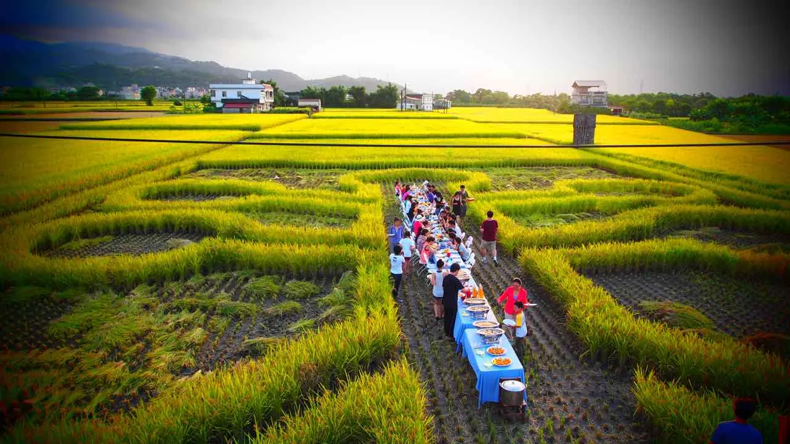
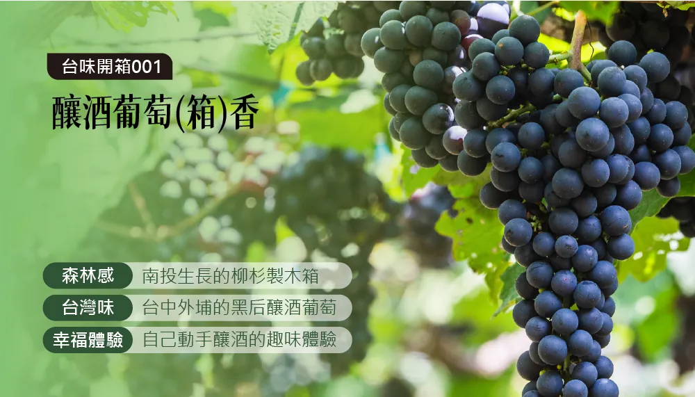
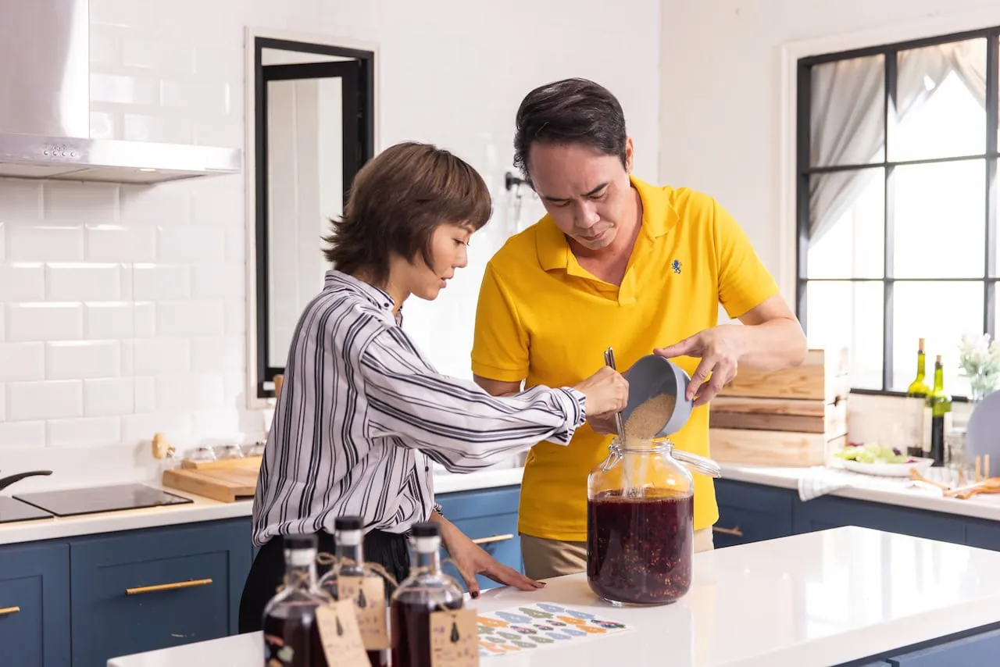
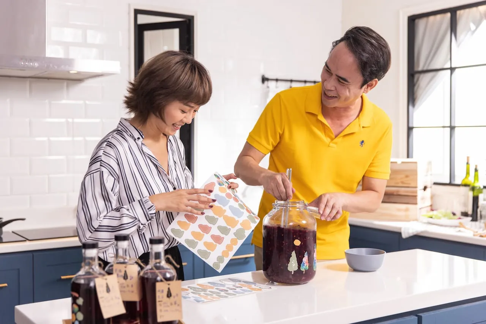
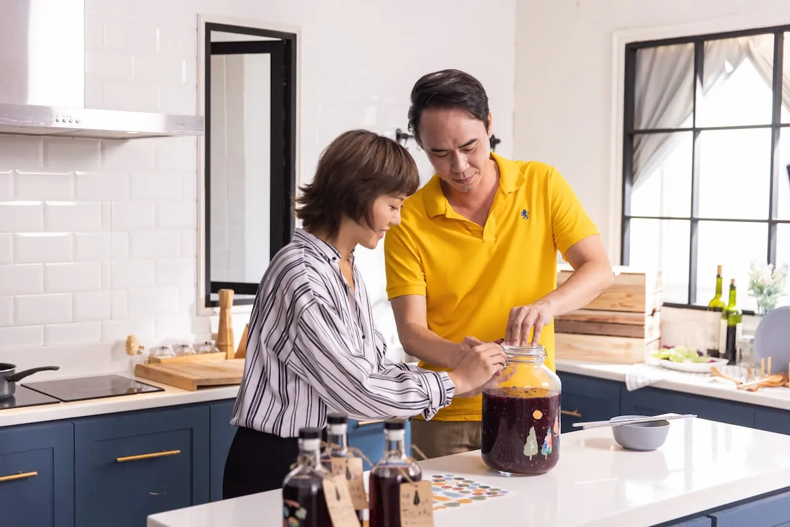
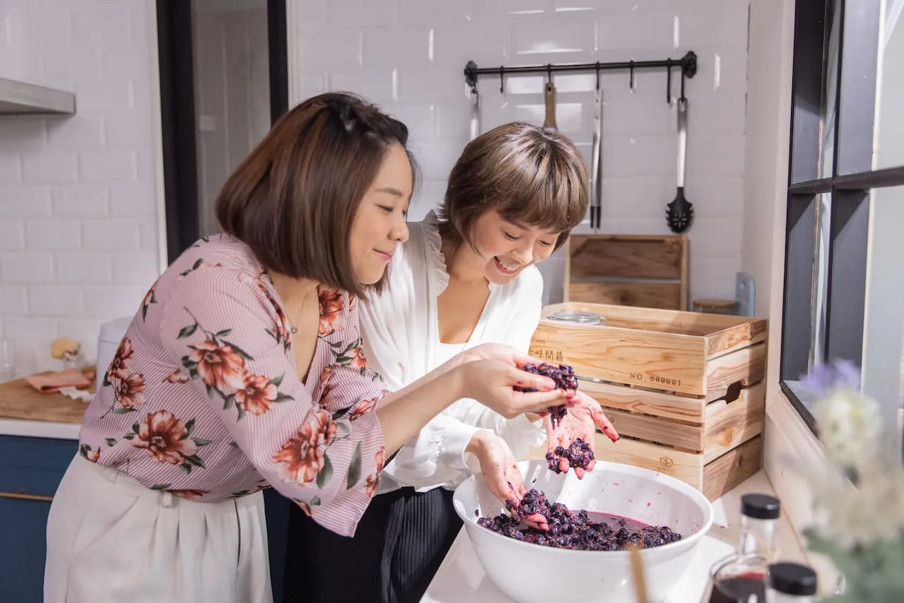
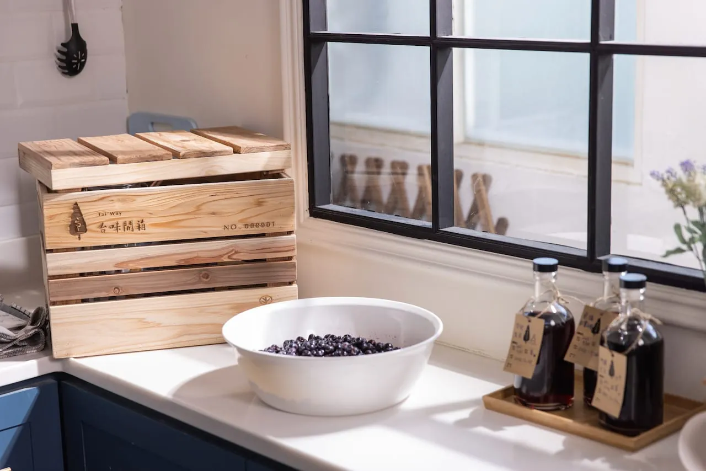
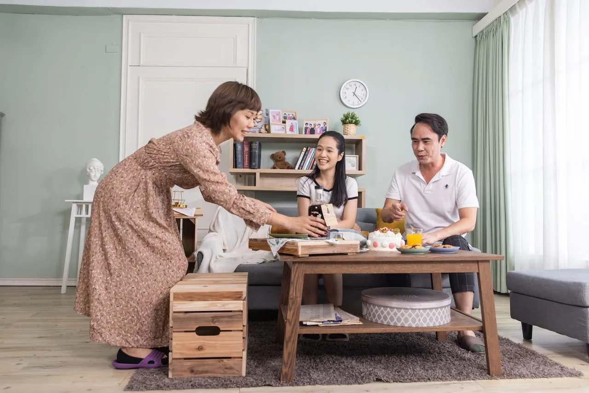
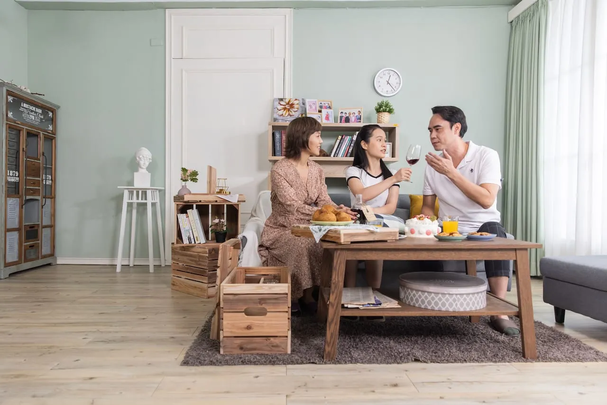

[video](https://hii.hdv.mybluehost.me/wp-content/uploads/2024/03/台味開箱網頁用檔案.mov)

大道至簡 簡家旗

> 2012年啟動之稻田裡的餐桌計畫的經驗，讓我回歸土地重新感受初心。
>
> 從小在木材產業家族長大的我，自認是森林養大的孩子，想做些可以回饋森林的事情。
>
> 森林、木頭的溫潤與氣味，是很療癒人心的，也是我想分享的體驗。
>

2012年，我們發起了「稻田裡的餐桌計劃」，於台灣農村進行超過500場農村行動劇與食農餐會，讓参與者實際踏入鄉村、親近土地與農作，培育近千位農民與志工，輔導與合作近百個農村社區。

稻田裡的餐桌

> 🌲森林感 - 南投柳杉製成原創造型木箱\
> 🍇台灣味 - 台中后里當季採摘釀酒葡萄\
> 👨‍👩‍👧‍👧幸福體驗 - 居家釀造品嘗的開心回憶
>

透過「台味開箱」，將土地的饋贈回歸每人身旁。我們與長期配合的在地小農及林木業者合作，發動全新「釀造回憶計畫」透過居家獨特釀酒體驗，支持台灣農作、本土木材使用，更接近台灣森林，感受土地的美好，居家打造專屬自己的幸福回憶。

台味開箱用時間醞釀幸福回憶，一群人透過用心的體驗，在生命裡創造彼此共同的幸福。

共同釀造屬於彼此幸福的葡萄酒

一起分享彼此用心的幸福滋味，需要透過時間去發酵這份愛的感覺。

這就是因為愛的 台味開箱
