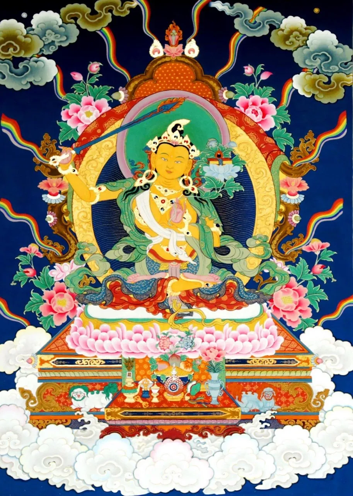

《大智度論》中記載，文殊師利菩薩在眾菩薩問修行法門時，曾說出一段驚人之語：

"真實慧根不在經卷，而在日用中見性。"

有人說這是在否定誦經念佛的重要性，也有人說這是在鼓勵人們放下修行。

其實都不完全正確。

文殊菩薩此言，正是為了警醒末法時代眾生：

日日夜夜誦經念佛，皆是無用，只有找到正確的境界，才是證道正途。

唐代有一位禪師，法號智通，年幼時就展現出超人的悟性。七歲那年，他在寺院裡聽僧人誦《金剛經》，竟能一字不差地背誦出來。寺裡的長老們都說這孩子天資聰穎，必成大器。

智通十五歲時，已經精通三藏十二部經，無論是誰來請教佛法，他都能引經據典，對答如流。漸漸地，他的名聲傳開了，不少人慕名而來，向他請教佛法。

智通也因此生出幾分傲氣，覺得自己的佛法修為已經很高。一日，他正在院中背誦經文，一位衣衫襤褸的老僧從外面走過，聽見他的誦經聲，停下腳步。

智通見有人駐足聆聽，聲音不自覺地放大了幾分。那老僧聽了一會兒，忽然笑道："小師傅，你背得倒是很熟。"

智通心中得意，說道："不敢當，我從小就在寺裡長大，這些經文早就爛熟於心了。"

老僧卻搖搖頭："可惜，可惜。"

智通聽了這話，不禁有些惱火："老師父此言何意？難道我背得有錯？"

老僧說道："你背得沒錯，但是你只得其文，未得其義。"說完轉身就走。

智通被這話點醒，連忙追上去："請老師父指點。"

老僧停下腳步，說道："你每天誦經，可曾想過經中說的是什麼？你引經據典回答別人的問題，可曾真正理解其中的道理？你說自己通曉三藏，可你的心行可與經中所說相應麼？"

這一連串的問題，問得智通啞口無言。他這才意識到，自己雖然能背誦經文，卻從未真正理解經中的深意。

老僧見他如此，便說：

"文殊菩薩曾說，真正有慧根的人，修行不在念誦多少經文，而在於三種境界的體現。你可知是哪三種境界？"

智通恭敬地說："請老師父開示。"

老僧正要回答，天色忽然暗了下來，一陣狂風刮過。

等智通睜開眼時，老僧已經不見了。只見地上留下一張字條，上面寫著：

"若要明白三種境界，且隨我到峨眉山來。"

智通心中大急，立刻收拾行裝，準備啟程。這時，寺裡的方丈聽說此事，叫住了他："你可知那老僧是誰？"

智通搖頭。方丈說道："據你描述的相貌，那位老僧極可能是峨眉山的無垢禪師。他早年拜文殊菩薩為師，得到真傳，最後在峨眉山悟道。

只是他為人古怪，從不輕易收徒。你能得他指點，是莫大的福分。"

智通聽了，更加堅定了前往峨眉山的決心。他連夜啟程，歷經千辛萬苦，終於來到峨眉山下。

來到峨眉山的智通，在山中苦尋多日，終於在一處簡陋的茅庵中找到了那位老僧。

老僧見他誠心求法，欣然道：

"既然你誠心前來，我就告訴你文殊菩薩所說的三種境界。只是這三種境界，可不是用嘴說說那麼簡單。"

說著，老僧帶著智通走進茅庵。

"文殊菩薩說的第一種境界，就是'心如明鏡'。"

"何為'心如明鏡'？"

"明鏡無私，物來即現，物去即空。真正有慧根的人，心中不存偏見，不起分別，不執著於任何境界。就像一面明鏡，如實反映一切，卻不為外物所動。"

他指著茅庵外的一片竹林說："你看那竹子，風來時搖曳，風去時挺立，隨緣而動，卻不失其性。我們的心也應該如此，能觀照一切，卻不被外境所轉。這就是第一重境界。"

智通若有所思。老僧繼續說：

"第二種境界是'處處是道場'。"

"這話怎講？"智通問道。

"很多人以為，修行一定要在寺院裡誦經拜佛。其實不然，真正有慧根的人，知道生活中的每一刻都是修行的機會。砍柴擔水，耕田種地，與人交談，處理俗務，無不是修行。"

他拿起身邊的一個破碗，說："你看這只碗，它盛飯時是飯碗，盛水時是水碗，不用時就空著。它從不抱怨自己的角色，也不執著於任何一種身份。我們的修行也應該如此，隨緣應物，處處作道場。"

智通恍然大悟："原來修行不在形式，而在心態。"

第三種境界。

也是最重要的一種。

"處處見如來."

智通正要發問，老僧抬手制止："且聽我說完。很多人總覺得佛在很遠的地方，所以整天誦經拜佛，希望能夠親近佛陀。殊不知，佛性本自具足，無處不在。"

"真正有慧根的人，能在一花一草中見佛性，在一言一行中見佛心。他們不是用眼睛去尋找佛，而是用智慧之眼去體會佛性的遍在。

就像陽光照耀大地，不會分別這是高山還是低谷，佛性也是如此，遍滿一切處。"

智通聽到這裡，忽然淚流滿面："我終於明白了。以前我只知道背誦經文，卻不知道經中的真意。我執著於文字相，卻忽略了實踐的重要性。"

老僧欣慰地說："你能有這樣的領悟，說明你的慧根已經開始發芽了。文殊菩薩說的這三種境界，就是要告訴我們：修行不在形式，而在心地。真正的修行，是在日常生活中培養覺照的智慧，是在與人交往中體現慈悲的胸懷，是在處理俗務時保持清淨的心。"

智通在峨眉山上住了三年，在老僧的指導下逐漸契入這三種境界。後來他回到原來的寺院，成為一代高僧。

"修行不在經卷上用功，而在日用中見性。你若能在生活中時時保持明鏡般的心，處處以世界為道場，念念與佛心相應，那才是真正的修行人。"

佛教界普遍認為，這三種境界正是文殊菩薩智慧法門的精髓所在。

《大智度論》中說："般若如大火聚，四面不可觸。"

真正的智慧就像熊熊燃燒的火焰，不可以言語道出，不可以思維揣測，只能在實踐中去體會。

真正的修行不在表面的形式，而在內心的證悟。如果能夠做到心如明鏡，了了分明而不染著；視處處為道場，在日常生活中修行；時時見如來，處處見佛性，那才是真正有慧根的人。

就如《金剛經》所說："凡所有相，皆是虛妄。若見諸相非相，即見如來。"

