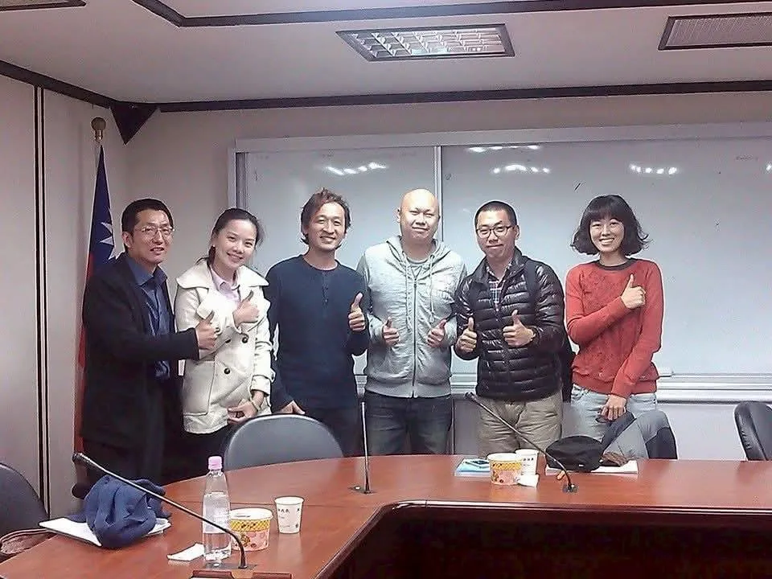
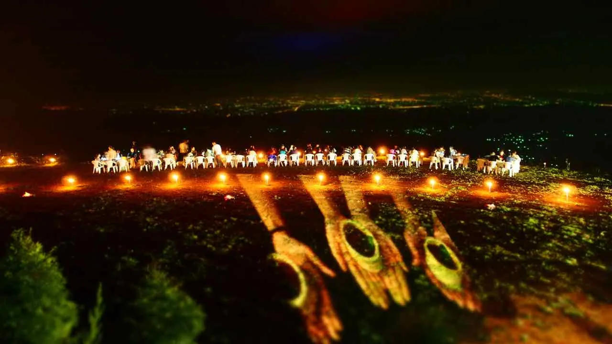
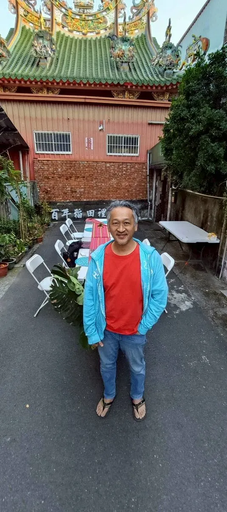
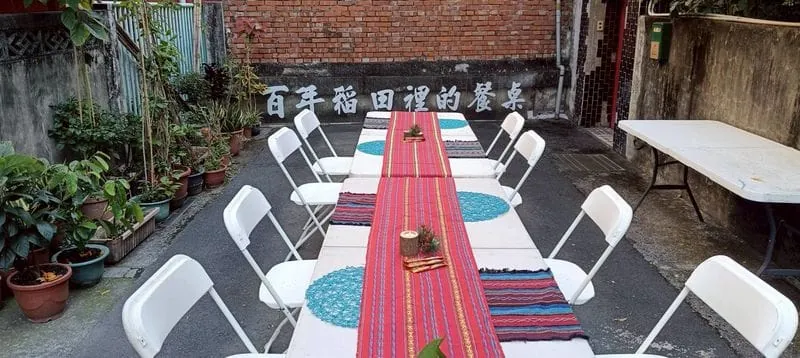
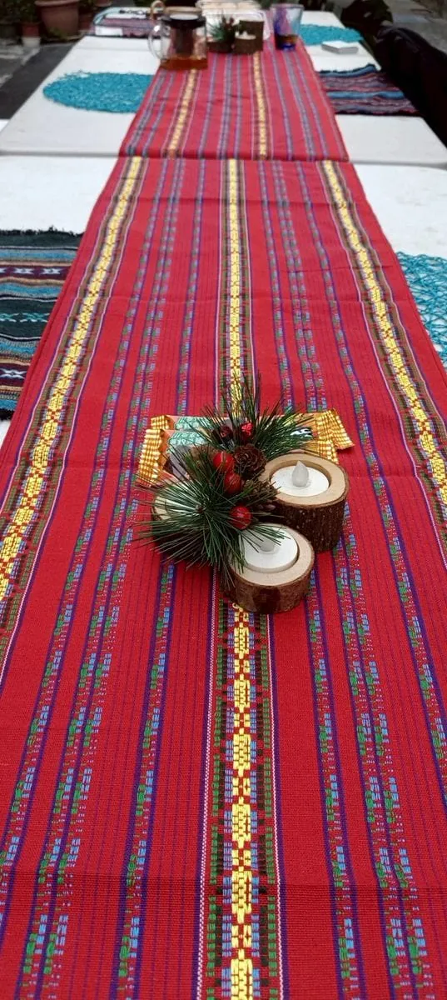
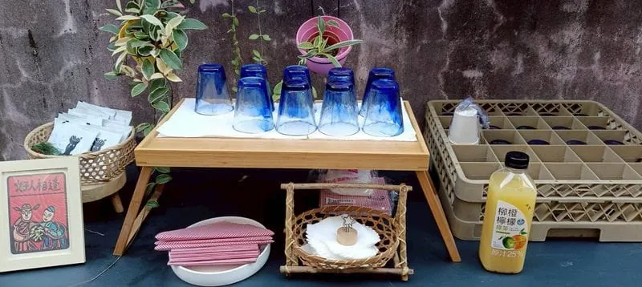
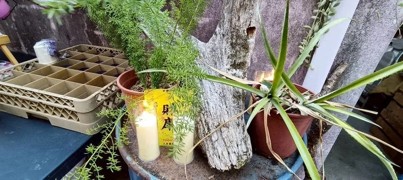

2025/12/25 兩位中年大叔的南投中興新村午後對談！

今天，特別到中興新村，走進家旗的家。一個下午的餐會與對談，讓時間慢了下來。

兩位一年一遇的大叔，在人生中段再次相對而坐，談的不只是近況，而是那些走了十多年、沒人能替我們承擔的選擇。

我們回想起 2014 年，那個被稱為台灣社會企業元年的時代。從認識、交流、嘗試、跌跌撞撞地成長。

我甚至還記得，曾邀請幸福果食團隊到竹山大鞍，在海拔一千公尺的山上、夜景無邊的懸崖邊，完成兩場餐桌計畫。

那些畫面，到現在仍然清晰。

我們認識超過十年。這些年，沒有密集合作，卻始終在彼此的人生邊緣，安靜關心、適度靠近。那是一種不需常聯絡，卻不會消失的長期情誼。看著家旗在雲南，成為一位把「幸福學」落實在地方日常裡的台灣大叔，我始終相信 —— 這樣的人，走得慢，卻走得遠。

下午走進他家，巷弄裡正進行一場聖誕餐會。他笑著說，那只是家裡安排的小聚。太太、女兒，還有左鄰右舍，一起在緊鄰廟宇的巷道裡吃飯、聊天。那一刻，我的心徹底放鬆了。不是因為活動多熱鬧，而是那種「人真正活在生活裡」的氛圍，讓人安心。這一年，大家都走過極其不容易的經歷與考驗。

當我聽著家旗數這些年的一切，我忽然意識到 ----- 當我們用十多年的人生，投入在最熱愛的工作上，能夠擁有被社會看見的風風光光，也經歷著傷痕累累。都在心裡問著自己：走到這個年紀狀態，我們真正想要的又是什麼？

我看著家旗充滿熱情跟我分享，明年度各種新企劃的當下，我突然感受到這個答案，其實很簡單 ----- 「我想活出自己喜歡的樣子。」一種不是最安全的樣子，也不是最被期待的樣子，而是即使辛苦、即使孤單，也能對得起自己的樣子。

但在這個流於形式百廢待舉的時代，又有多少人在四十之後，還願意誠實地走這條路？看著家旗依然灑脫、保有浪漫，也依然堅定信念地活著，我心中只有深深的敬意。

原來，真正難的不是成功，而是在現實裡，沒有背叛自己。同時在困難中，也沒有放棄。
