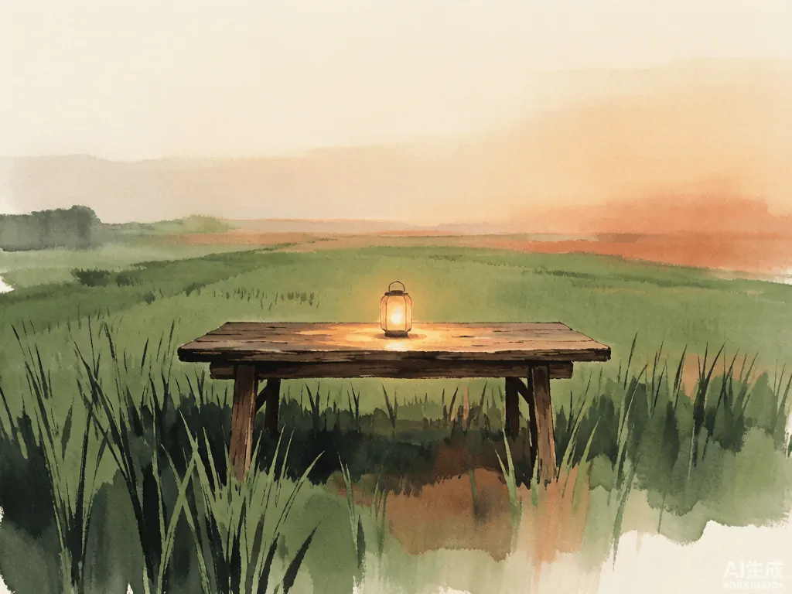
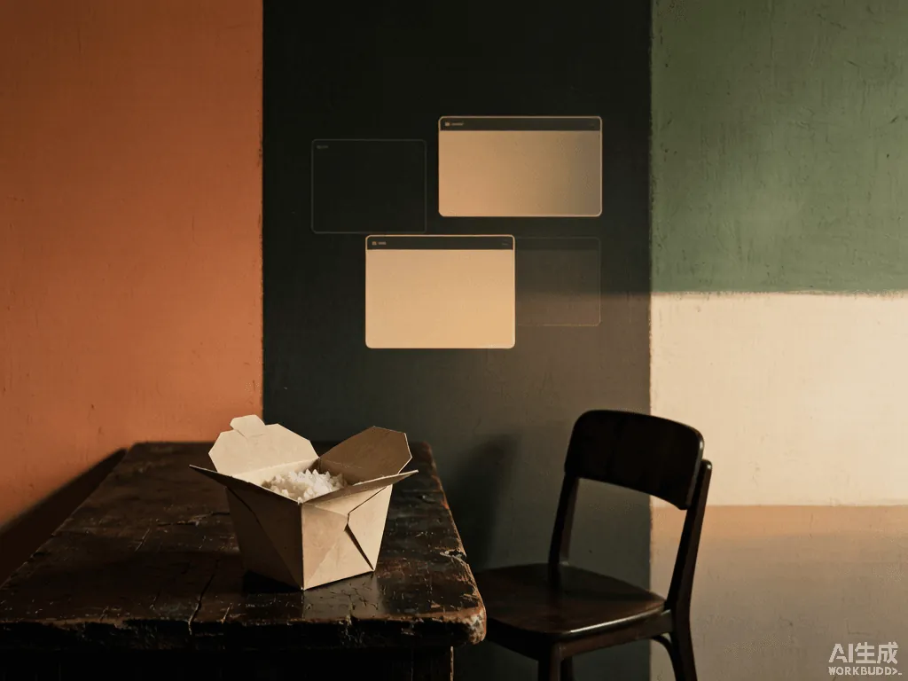
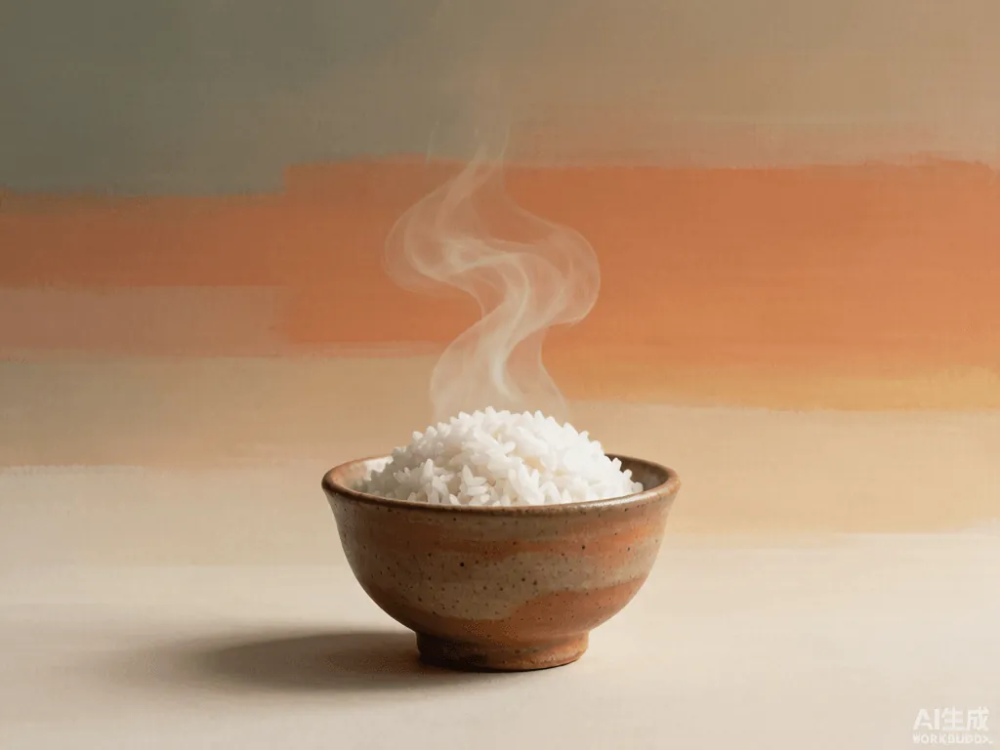

幸 福 生 活 · HAPPY LIVING

# 幸福餐桌｜經營者，你有多久沒在飯香裡嘗到生活的本味了？

寫給 AI 時代的一人公司。你已經能一個人做完十個人的事，只是那頓飯，好久沒好好吃了。

深夜十一點半，屋裡只剩螢幕的光。三個對話框還開著，一個在改文案，一個在跑客服話術，還有一個停在半句提示詞上，等你想清楚要什麼。桌角那盒外送早就涼了，白飯結成一小塊。你扒了兩口，眼睛還黏在螢幕上。

這一天，你一個人做完了從前一整個團隊的事。企劃、設計、客服、對帳、出貨、下廣告，全在你身上。做完了，也沒有人跟你說一句辛苦。

那一刻，你真的嘗到味道了嗎。

我走一人公司這些年，也在這樣的深夜裡坐過很久。所以想先把所有道理放下，跟你說一句，能撐到今天，你已經很不容易了。

一人公司的深夜，三個對話框還亮著，桌角一盒涼掉的外送

## 一個人，正被要求活成一支軍隊

AI 來了之後，一個人的產能被放大了好幾倍。從前三個人磨一週的東西，現在一個下午就有了雛形。聽起來是解放。可你我都清楚，真正發生的是另一回事。

工具變快，別人的期待也跟著變快。客戶覺得隔夜就該交，同業昨晚又上了新玩法，平台的規則一季換三次。你不敢停，因為停下來的代價，好像全要自己一個人扛。

於是一個人被要求活成一支軍隊。軍隊有輪班，你沒有。軍隊有後勤，你的後勤是一盒涼掉的飯。

夜裡最難熬的那一下，其實常常跟累無關。是那個悄悄冒出來的念頭。模型越來越強，你身上還剩下什麼，是它做不到的。

這個念頭很重，先不急著回答它，也先別用更長的工時去堵它。你不是不夠努力。你只是太久沒有被好好餵過一頓飯，太久沒有人問過你，今天想吃什麼。

## 從頭腦回到身體，從一碗白飯開始

你有沒試過，把所有對話框關掉，坐在桌前，什麼都不想，只是看著剛起鍋的白飯。

鍋蓋掀開的一瞬，帶著微微清甜的水氣撲上來，眼鏡起了一層霧。那是日光、雨水、土壤和農人一整年的汗，交織出來的香氣。舀一匙放進嘴裡慢慢嚼，澱粉在唾液裡化開成甘甜，溫熱順著食道滑進胃裡。原本因為焦慮而縮緊的肩膀，會自己鬆下來一寸。

我們活在一個頭腦嚴重過載的時代。觀點、數據、指標、別人的進度，整天在腦袋裡轟鳴，人離自己的身體越來越遠。餐桌，是全天下最溫柔的降落跑道。願意停下來，用眼睛看食材的顏色，用鼻子聞高湯滾沸的香氣，用舌尖去認這個節氣的味道，那點被關起來的感知力，就慢慢醒過來了。

一勺剛起鍋的白飯，水氣輕輕升起，帶著整年日光雨水的香

> 「幸福不在遠方那條功成名就的終點線上。它是一種可以隨時被重新召喚出來的感知能力。
>
也許你會想，這十分鐘能換來什麼。它換不來訂單，也換不來流量。它只是把你從一台機器，換回一個人。而一個人身上最貴的東西，恰好就是任何模型都學不像的那部分。你的溫度，你的在場，你親口嘗過的那些真實滋味。

## 我們不改變土地，我們改變看土地的眼光

常有人問，幸福餐桌是不是就是帶大家去鄉下吃一頓在地菜。每次聽到，都只能笑著搖頭。它比一頓飯要走得更遠一點。

把一張鋪著素麻布的長桌，搬進綠浪翻滾的稻田中央，或是果香四溢的果園樹下，會發生什麼。那不再是四面水泥牆的封閉餐廳，而是天地為幕、風聲為樂的天然劇場。一級產業的友善耕作，端出最誠實的土壤風味。二級產業的在地工藝與農特產加工，變成桌上的食器與調味。三級產業的旅宿與沉浸體驗，把一場吃飯，變成一次心裡的著陸。

一級乘二級乘三級，這就是六級產業的融合。我們不改動土地原本的模樣，只是改變人們看它的眼光。都市人脫了鞋踩在溫熱的泥土上，聽身旁的農人講這粒米怎麼熬過一整季的雨與颱風，原本被包裝得冰冷的食物，忽然就有了體溫。

這些年走過許多鄉鎮，也看過不少讓人心疼的場景。年輕人走了，果子爛在地裡，老屋的門鎖久了會生鏽。很多人把這些當成沒落的證據。

問題從來不是障礙，而是還沒被打磨的原礦。滯銷的背後，只是那份價值還沒有被好好說出口。

幸福餐桌做的事，說穿了就是替一塊土地重新把話說清楚。不談成分與產量，只找出它說不出口、卻最值錢的那份情感與記憶，講給對的人聽。當一位習慣了都市節奏的經營者，在稻田邊因為一碗熱湯紅了眼眶。當一個對家鄉失去自信的年輕人，看見客人對自家作物露出讚嘆的神情，信任與尊嚴就一點一點長回來了。

這也是幸福餐桌的 C 到 B 循環。坐在桌前的人先記起了幸福，感動變成信任。企業、地方與品牌看見這份深度的連結，也願意一起把事情做起來。參與的人於是慢慢換了角色，從第一場的客人，變成放不下的常客，最後成為一起推著地方往前走的共創者。

## 給 AI 時代一人公司的一封信

也許你會問，在這麼拚的世道裡談幸福，是不是太浪漫了一點。商業真的能跟幸福放在一起嗎。

想認真地說一句。商業只是價值的容器，幸福則是一種隨時可以打開的感知能力。這兩件事，從來不衝突。

走一人公司這條路，最深的體會是大道至簡。你不需要一支龐大的隊伍才能創造改變，也不需要把事情做得複雜才顯得專業。AI 時代的一人公司，真正的護城河不在你會用幾個工具，工具明天就會有人比你更會用。護城河在於你是誰，在於你端出來的東西裡，有沒有一個活人真實待過的痕跡。

一段文案可以被生成，一鍋湯不行。一份提案可以被複製，一次真的把人餵飽的心意不行。你花在生活裡的時間，最後都會變成你作品裡別人學不像的那部分。

幸福餐桌的八大構成，從文化創意的扎根、六級產業的加值、深度旅遊的入口、五感餐飲的驚喜，到服務設計的啟蒙、身心健康的療癒、社會創新的翻轉，最後都落在同一件事上，一個能讓所有參與者都過得更好的生態。聽起來很大，做起來其實很小。小到就是把一頓飯好好做出來，再好好吃完。

今晚回家，試著做一件很小的事。

不用複雜，哪怕只是給自己煮一碗麵，或剝一顆當季的橘子。把電腦闔上，手搭在溫熱的碗邊，深呼吸一次，聞一聞那股香氣，慢慢嘗第一口。

給自己十分鐘。只有十分鐘，不算奢侈。

明天照樣會有做不完的事，回不完的訊息。這十分鐘不會讓它們消失，它只是讓那個要去面對它們的人，重新有了一點溫度。

幸福從來不在遠方。它一直都在你當下的這一口飯、這一杯茶、這一份對自己的溫柔體恤裡。

你呢。最近一次好好吃完一頓飯，是什麼時候的事了。留言跟我說說，那天你吃了什麼。

· · ·

— 幸 福 生 活 —

簡家旗 · 幸福生活的作者，陪你看见关于自己
