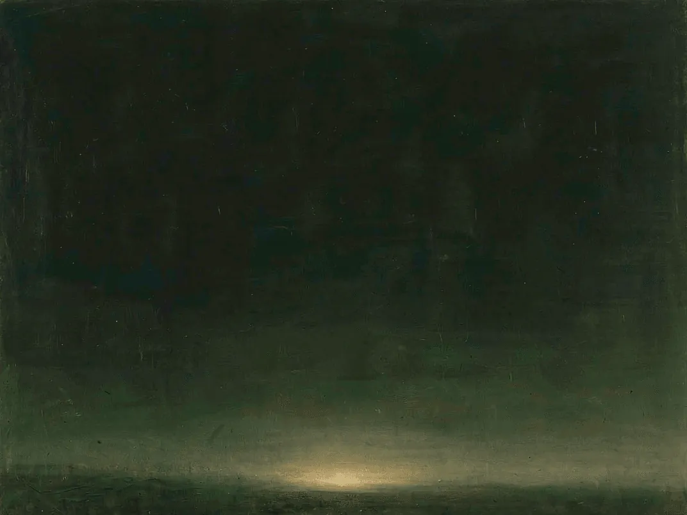
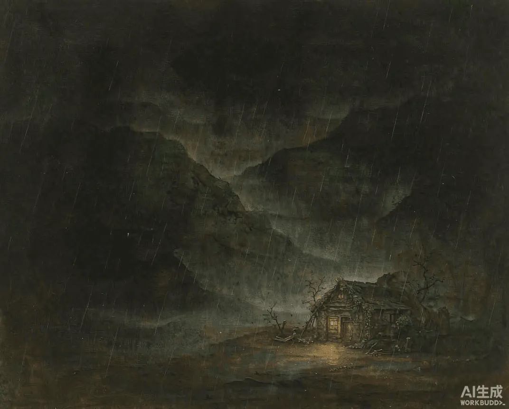
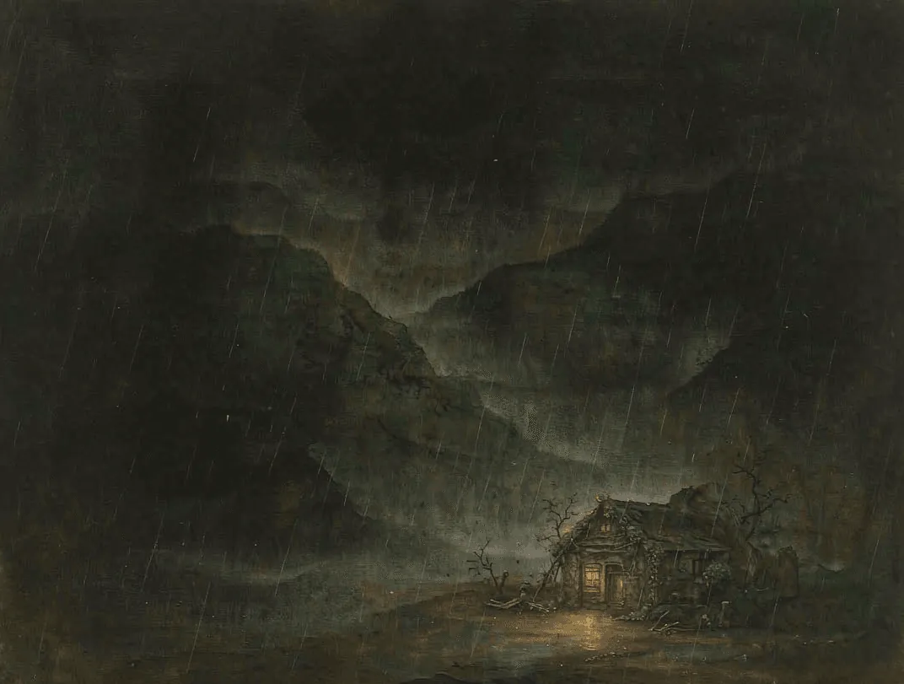
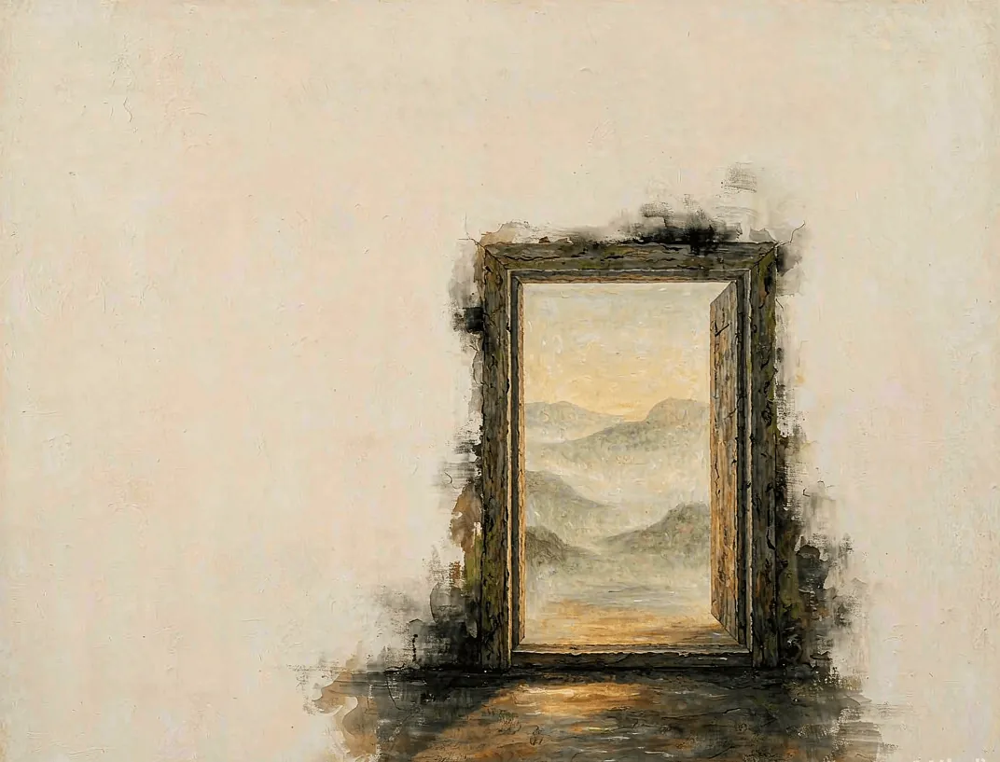

幸 福 生 活 · HAPPY LIVING

# 最黑暗的那一刻，光正在起身

深夜以為天不會亮，多半是光要進來的前奏。三個角度，看黑暗如何成為開始。

山裡的雨下到第三天的時候，連鳥都停了叫。

一間屋子，一盞燈，窗外黑得像是把整座山都收了進去。

那種黑不是沒有光，是光還沒到。

屋裡那盞燈瓦數不高，照得桌面泛黃。水壺在爐上溫著，偶爾發出細細的聲響。那種安靜，比黑夜本身更讓人心裡發空。

風從窗縫鑽進來，涼涼的，帶著泥和葉子的味道。屋外那條路白天還有人走，這會兒只剩下黑暗，連輪廓都沒了。

山裡連下三天的雨，窗只剩一片黑

有個說法流傳了很久，講禍福之間從來不是兩條路，是一枚銅錢的正反。

走到最暗的地方，往往也是轉身的時候。

許多人以為自己在谷底，其實是谷底把人穩住，好讓接下來的往上，有個落腳。

## 黑暗不是光的反面

光和暗，從來不是敵人。

一株在土裡的種子，要在看不見的地方待很久，根才敢往下扎。那段時間什麼也看不見，急不得，也催不得。

日子裡那些撐不住的時刻，常常被當成出了問題。

可仔細看，多數時候不是壞了，是舊的東西鬆了，新的還沒長好，中間留了一段空。

這段空最難熬，卻也最珍貴，因為只有空著的時候，光才進得來。

許多人在這段空裡慌了，四處找光，卻不知道，空，正是光要落腳的地方。

節氣也是這樣。冬至那一天，白晝短到極點，可從那天起，天就一天比一天長了。

最暗的點，剛好是回頭的路開始的地方。

前陣子遇見一位做陶的阿姨。她的窯連燒了三窯都裂，第四窯開窯前夜，她說自己整晚沒睡，以為手藝要斷在這裡。

可第四窯出來的杯子，釉色比往年都沉靜。她後來笑說，前三窯的裂，是土在替她把多餘的急去掉。

一個人坐在那裡，手機亮了又暗，暗了又亮。

想找點什麼把空填滿，越填越空。

後來發現，與其把黑暗趕走，不如先承認它在。承認之後，那種緊，反而鬆了一點。

後來才明白，黑暗最怕的不是光，是人的不耐煩。

## 最暗的時刻，是條件在換手

看過海邊的浪嗎。

退到最遠的那一下，沙灘露出最多，可下一秒，更大的浪就來了。

一個系統要換一種樣子活，總得先亂一陣。亂，不是失敗，是舊的秩序在讓位。

身邊常有這樣的轉折。

一段關係走到沒話說，以為要散了，卻在某個尋常的早晨，兩個人因為一碗熱湯又靠近了。

一份工作做到懷疑自己，辭職的念頭天天有，可真正鬆開的那天，新的方向也跟著顯了出來。

黑暗最深的時候，常常是兩個世界交棒的瞬間。

像煮一鍋湯，水要滾之前，會先安靜一陣，鍋邊冒細泡，那才是最關鍵的時候。

早春的竹林也一樣。地表上看不出動靜，可土裡的筍已經頂了很久。

某個雨後的清晨，一夜之間全冒了頭。

看的人只看到那一下，看不到的是前面那些天，地底下從來沒停過的用力。

退到最遠的浪，是下一波浪要來的開始

這不是安慰人的話。這是許多真實日子裡反覆發生的樣子。

撐到某個點，會發現原本用力撐著的東西，自己鬆了手。

不是更強了，是那股勁到了要換的時候。

就像一場長聊，話題聊到盡頭，總要安靜幾秒，新的話才接得上。那段安靜不是冷場，是換氣。會說話的人，都懂得在該停的地方停一下，讓下一句有地方落。

## 別急著逃離黑暗

人都想快點好起來。

這份想，有時比黑暗本身更累人。

真正難的，不是熬過去，是允許自己還在黑暗裡待一會兒。

待著不是放棄，是給自己一個不被催促的角落。

把「趕快好」這件事先放下，試試看在黑暗裡做一件很小的事。

切半顆洋蔥，聽油鍋裡那聲輕響。

把手機放到另一個房間，聽三分鐘雨。

睡前把燈關了，什麼也不做，只是呼吸。

給窗台上的那盆草澆點水，看水珠掛在葉尖。

這些事小到不值一提，可身體會先鬆開。身體一鬆，腦子才跟著慢下來。

有回半夜醒來，心裡亂得睡不著。

沒去滑手機，只起來燒了壺水，沏了杯茶，坐著聽水聲。

沒過多久，那股亂自己就退了，像被水聲慢慢撫平。

那時才懂，黑暗裡最不需要的，是拼命去找出口。

心裡那片黑，不是被趕走的，是自己慢慢退潮的。

問題不必急著解決。

多數時候，問題本身就是還沒被打磨的原礦，把它捧在手上待久了，答案會自己浮出來。

光不是被找回來的，是黑暗退到某個位置，它自然就顯了。

> 「最黑暗的時刻，往往不是結束，是光換了個方向，要進來了。
>

推開門的那個早晨，山還在，鳥又開始叫了

窗外那場雨，終究會停。

停的時候不會敲鑼打鼓，就是某個早晨推開門，發現山還在，鳥又開始叫了，地上是濕的，空氣是清的。

沒做什麼驚天動地的事，只是陪自己走過了一段黑。

而那一段黑，後來回頭看，剛好是光要進來的縫。

天亮不是誰的努力，是黑夜走到了它該走完的地方。

人也是，走到夠暗，光就會從另一側透出來。

你呢？最近有沒有那種，覺得自己撐不太下去的時刻？

那時候，是怎麼陪自己走過來的？留言說說，或是把這篇留著，等哪天用得上。

— 幸 福 生 活 —簡家旗 · 幸福生活的作者，陪你看見關於自己
